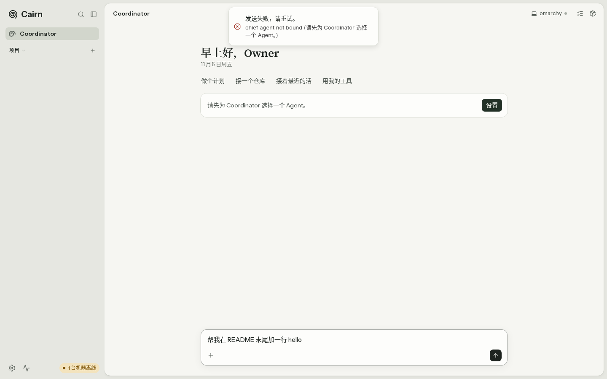
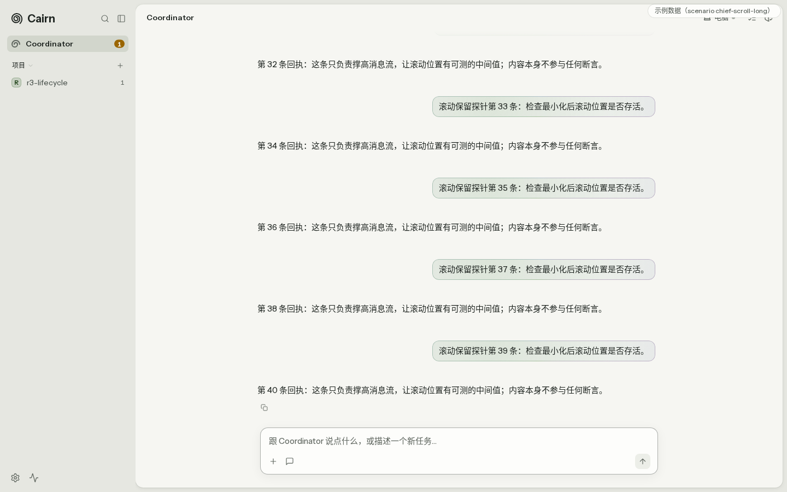
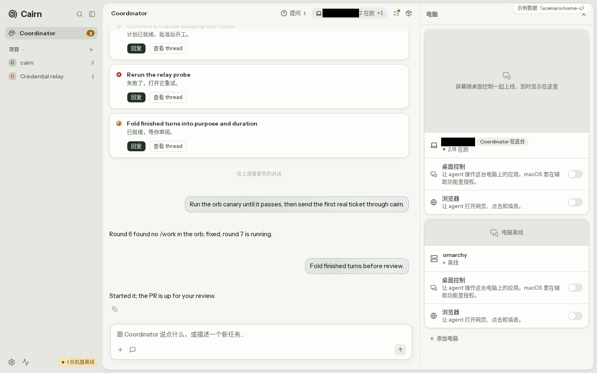
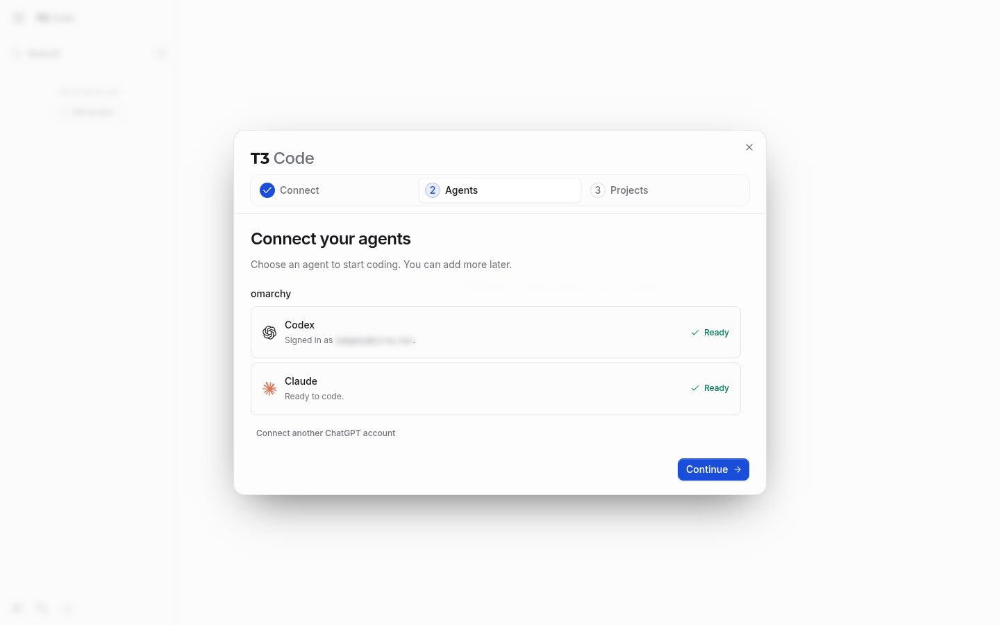
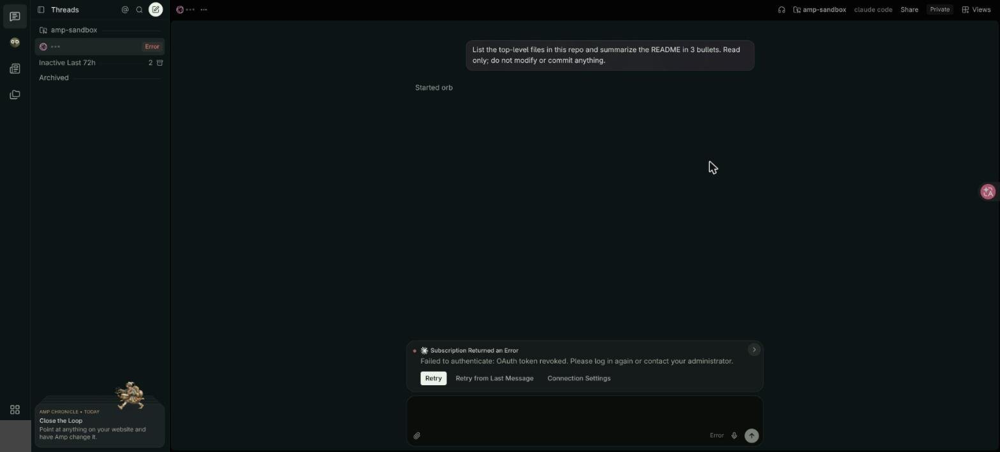
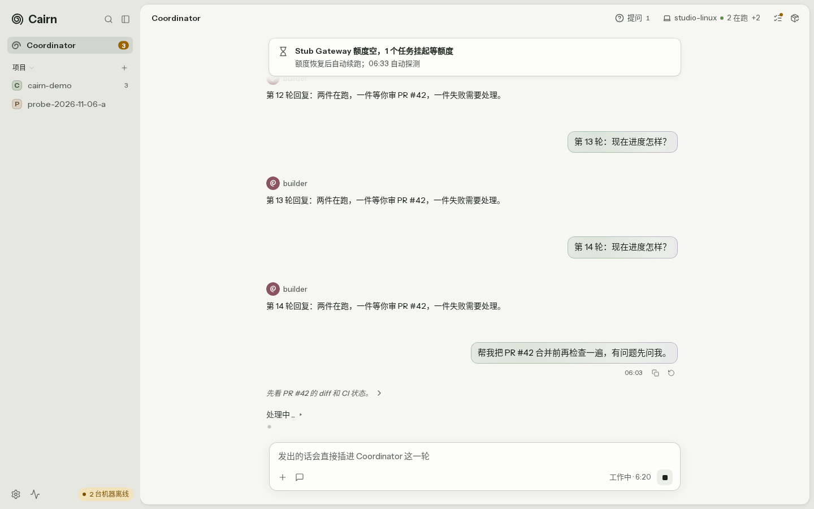
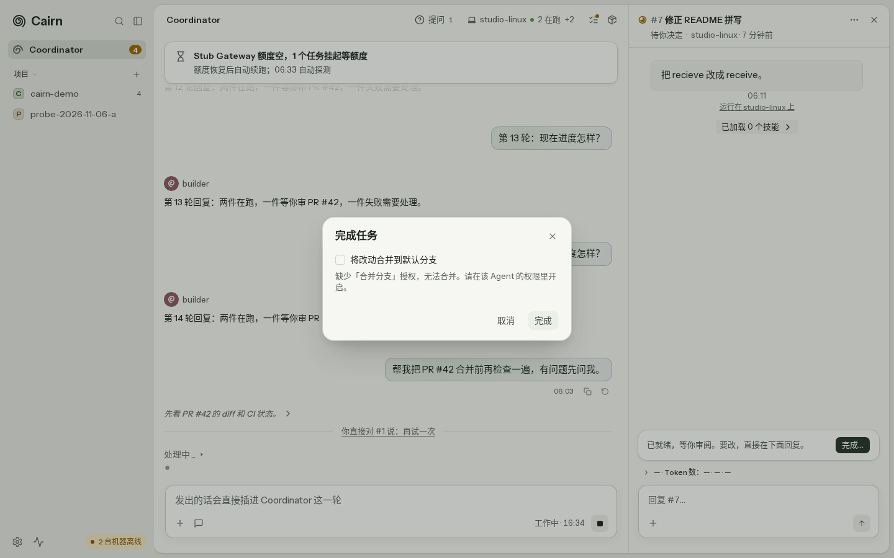

# cairn UI/UX audit (2026-11-06)

Scope: `apps/web`, commit `ae86f0cb2` (worktree `project-review-52869e`). Isolated stack on 8791/5273; 8787 was not touched. Images are in [`ui-ux-audit-2026-11-06/`](ui-ux-audit-2026-11-06/): `L*` are real isolated-stack screenshots, `F*` are fixtures (`?scenario=`; they show the interface only, not real behavior), `M*` are 390px phone-width shots, `R*` are reference-product screenshots.

Tags: `实测` = output I ran myself this round or text I read in the original; `推断` = derived from `实测` and re-checkable; `猜测` = everything else.

## 1. Method: three layers, rerunnable by one person

| Layer | Content | Tool | Frequency |
|---|---|---|---|
| A automatic | 7 journeys x key states x two widths (1440/390) screenshots; axe (`wcag2a/aa/21aa/22aa`); metric assertions: message spacing, click targets >= 24px (44px on phone), icon buttons have a visible hint, consistent status wording, number of DOM nodes deleted after a click (a proxy for flicker) | Playwright (script in `apps/web/.audit-live2.mjs`; a separate measuring script used this round was deleted after use) | Every UI PR or weekly |
| B expert | For each journey, walk the cognitive-walkthrough four questions step by step (does the user want this step? can they see the control? can they connect the control to their goal? after acting, can they see progress?), classify problems by the ten Nielsen heuristics, severity 0-4 | This table + screenshots | Monthly |
| C task | The maintainer does 7 tasks, recording success / time / error count, and fills in the two UMUX-Lite items after each (7-point scale: "the capabilities meet my needs", "easy to use") | Stopwatch + sheet | Monthly; track the trend, do not compare with others |

The craft bar uses items that can be checked directly: Vercel Web Interface Guidelines (click targets 24/44px, first-tooltip delay, `:focus-visible`, optimistic updates, loading indicators appearing only after 150-300ms to avoid flicker, error messages that say how to fix); Linear's quality practices (zero-bug policy, regular polish; there is no written checklist, so this is a second-hand description). The AI/agent-specific checks are distilled from hands-on use of reference products: a sent message pins to the top of the viewport; each row in the thread list shows status and duration; intermediate work is collapsed by default (Amp calls it "Show Work"); connection state sits where it is used (Amp writes `Connected · path · branch` above the input box); irreversible actions need confirmation.

**Scorecard** (each journey 0-4, 4 is best): (1) it works end to end; (2) trustworthy state (one fact has one wording); (3) feedback and errors (say what to do); (4) density and hierarchy; (5) consistency (terms, components); (6) accessibility. Total 24.

Sources: [NN/g ten heuristics](https://www.nngroup.com/articles/ten-usability-heuristics/), [NN/g severity rating](https://www.nngroup.com/articles/how-to-rate-the-severity-of-usability-problems/), [cognitive walkthroughs (Wharton et al. 1994; NN/g introduction)](https://www.nngroup.com/articles/cognitive-walkthroughs/), [MeasuringU: SUS to UMUX-Lite](https://measuringu.com/umux-lite/), [WCAG 2.2](https://www.w3.org/TR/WCAG22/), [Vercel Web Interface Guidelines](https://vercel.com/design/guidelines), [Linear Conversations on Quality](https://linear.app/quality), [Amp "Agents, Everywhere"](https://ampcode.com/news/agents-everywhere), [t3code](https://github.com/pingdotgg/t3code), [Shape of AI](https://www.shapeof.ai/), and Joel Lewenstein (Anthropic design lead) on [Dive Club](https://www.audioscrape.com/podcast/dive-club/episode/joel-lewenstein-pursuing-ambitious-design-ideas-84871) (only the episode blurb was seen, not the full text).

Research limits (`实测`): ~~This machine has no agent-reach Exa (`mcporter` does not exist), Twitter lacks `twitter_auth_token`, and Reddit has no backend, so designer discussions on X/Reddit are **not covered**; the web part used WebSearch, WebFetch and Jina instead. claude.ai redirects to `/login` when not logged in, so it was skipped as instructed; Cursor was not walked. t3code and Amp were taken from official product screenshots and video frames, not operated by hand.~~ **11-06 incremental revision**: X/Reddit have now been read; claude.ai, Cursor and Amp were walked by hand in ian's already-logged-in Chrome, and t3code was run as a real instance on this machine. See the "Increment" section at the end, which lists what is still missing.

## 2. Scores per journey

| Journey | 1 | 2 | 3 | 4 | 5 | 6 | Total | Evidence |
|---|---|---|---|---|---|---|---|---|
| First run / empty state | 1 | 2 | 1 | 3 | 2 | 4 | 13 | L01, L09, L12, L13 |
| Coordinator conversation | 3 | 3 | 3 | 2 | 3 | 3 | 17 | F01-F08, F05 |
| Create task, view thread | 3 | 3 | 3 | 3 | 2 | 3 | 17 | F09, F06, F13 |
| Review result / PR | 3 | 2 | 3 | 3 | 2 | 3 | 16 | F10, F11 |
| Settings (providers, machines) | 3 | 2 | 3 | 3 | 2 | 4 | 17 | L03-L05, F14, F15 |
| Computer sidebar | 3 | 1 | 2 | 1 | 2 | 3 | 12 | L02, F16, F17 |
| Phone width | 3 | 2 | 3 | 2 | 2 | 3 | 15 | M01-M04 |

Except for first run and the sidebar, scores come from fixtures plus code reading. "Create task" and "review PR" could not be walked on the real stack: no Agent was bound, and there was no provider or online machine (`实测`).

**First run** (`实测`): the home page says `请先为 Coordinator 选择一个 Agent` ("Choose an Agent for the Coordinator first"), yet the input box still accepts text. After sending, a toast appears with the raw English error `chief agent not bound (…)` ([L09](ui-ux-audit-2026-11-06/L09-send-without-agent.png)). Clicking `设置` (Settings) goes to Coordinator settings; clicking `未设置` (Not set) lists 6 seed Agents, none with a description ([L13](ui-ux-audit-2026-11-06/L13-pick-agent-empty.png)). At this point providers are empty ([L04](ui-ux-audit-2026-11-06/L04-providers.png)) and the machine is offline. No step in the flow tells you "add a provider first, then connect a machine". Compare ChatGPT: you can chat without logging in, and the first message gets an immediate reply ([R01](ui-ux-audit-2026-11-06/R01-chatgpt-empty.jpg)).

**Coordinator conversation**: spacing between short messages is 42-46px (`实测`, last 8 messages of `chief-scroll-long`). The cause is that the tool row under each message (24px) is only `opacity-0` on desktop, so it still takes up space, plus `mt-1/mt-2` and the row gap `mt-3.5` (`实测`). On touch, the copy/restore buttons under every message are always visible ([M02](ui-ux-audit-2026-11-06/M02-mobile-homec.png)). What ChatGPT does (`实测`): the Copy on user messages is normally `opacity 0`, only the latest reply's Copy is always visible, the click target is 44px, no shadow; the sent message pins to the top of the viewport and the reply grows below it ([R02](ui-ux-audit-2026-11-06/R02-chatgpt-sent-pins-top.jpg), [R03](ui-ux-audit-2026-11-06/R03-chatgpt-reply-actions.jpg)).

**Thread and review**: the top of the done state says `已完成，未验证` (Done, not verified) while the bottom says `🎉 任务已完成` (Task complete), and there is a placeholder row `Token 数：—·—·—` (Token count) (`实测`, [F11](ui-ux-audit-2026-11-06/F11-thread-done.png)). In t3code's sidebar every row has project, branch, duration and status (`Waiting 18s`, `Done`), split into Working / Settled groups ([R04](ui-ux-audit-2026-11-06/R04-t3code-marketing-shot.jpg)). Amp rows carry a spinner status and time, with the process folded into "Show Work" ([R05](ui-ux-audit-2026-11-06/R05-amp-desktop-thread.jpg)). cairn's sidebar groups only by project, and thread status is visible only after opening the Tasks panel ([L07](ui-ux-audit-2026-11-06/L07-tasks-pane.png), [F13](ui-ux-audit-2026-11-06/F13-sidebar-statuses.png)).

**Settings**: the Account page has developer-only "release new feature / feature flag" input boxes and a release button mixed in (`实测`, [L03](ui-ux-audit-2026-11-06/L03-settings.png)). On the providers page, the machine label uses "name · offline" to show state, which is readable ([F14](ui-ux-audit-2026-11-06/F14-providers-fleet.png)).

**Computer sidebar**: see section 3 #2 and #8.

**Accessibility** (`实测`): on the four pages `/app`, `/app/settings/providers`, `/app/settings/machines`, `/app/project/new`, axe reports 0 violations under the WCAG 2.2 AA tags. Tab order is reasonable and every focus has a 2-3px outline. There are no clickable targets under 24px on desktop. Not tested: actual screen-reader output, dark-mode contrast, `prefers-reduced-motion`. better-colors was not run because axe's color-contrast already passes.

## 3. Problem list (severity x frequency)

Frequency: high = hit on every use, medium = weekly, low = occasional.

| # | Sev | Freq | Problem | Basis |
|---|---|---|---|---|
| 1 | P0 | Every new install | First run does not work end to end: you can type but cannot send, the error is a raw English string, there is no "provider -> machine -> Agent" guidance, and the Agent list has no descriptions | `实测` L09/L12/L13 |
| 2 | P1 | High | **Machine status contradicts itself, partly confirmed**: the footer "1 machine offline" counts all machines in the team (`app-sidebar.tsx`); "on" is the `computer.state` of the Coordinator's own computer (`computer-feed.tsx`); "idle" is the running count on a machine card; "computer offline" is a 64px-high grey bar on top of another offline machine card that looks like a button but is not clickable. Four sources each say their own thing, and none says which machine | Code, `实测`; the owner's exact combination is `推断` (omarchy online, Mac offline), 8787 not read |
| 3 | P1 | High | **Probe projects stay in the sidebar, confirmed**: the server has `/api/projects/:id/archive`, but the web side never calls it and the list does not filter `archivedAt`; the only cleanup in the UI is cascade delete, which is not recoverable | Code, `实测` |
| 4 | P1 | High | Replies land below the visible area: #3124 is fixing it | Owner observation; ChatGPT comparison R02 |
| 5 | P1 | High | Click flicker: another agent is fixing it. On the fixture, clicking a header button once deletes 0 DOM nodes, so it did not reproduce; `猜测`: it happens when real data is refetched | `实测` (fixture only) |
| 6 | P2 | High | **Message spacing is large, confirmed**: 42-46px, of which 24px is taken up by the hidden tool row | `实测` |
| 7 | P2 | High | **Copy buttons always visible, partly confirmed**: on desktop only the latest is always visible, same as ChatGPT; on touch all messages are always visible (M02). The "ugly shadow" did **not reproduce** on this commit, the button has `box-shadow: none`; `猜测`: a hover background or another build | `实测` |
| 8 | P2 | Medium | **Large grey screen placeholder, confirmed**: without desktop control installed, a 16:10 grey block still renders, reading `屏幕随桌面控制一起上线` ("Screen ships together with desktop control"), about 250px high, with nothing actionable | `实测` F17 + `machines-panel.tsx` |
| 9 | P2 | High | **Header icons have no text hint, confirmed**: hovering "Tasks" and "Made" for 2.5s shows neither a tooltip nor a `title`; there is only an aria-label, which screen readers can use | `实测` L10 |
| 10 | P2 | Medium | Contradictory done-state wording (`已完成，未验证` and `🎉 任务已完成` appear together), plus the Token placeholder `—·—·—` | `实测` F11 |
| 11 | P2 | Low | The Account page exposes developer toggles "feature flag / release new feature" | `实测` L03 |
| 12 | P3 | Medium | Mixed Chinese and English: `查看 thread` ("view thread"), raw English error strings, English Agent names | `实测` |
| 13 | P3 | Low | Machine cards on phone: the provider icon has no label, and "3 ⌄" and "—" do not say what they mean | `实测` M04 |

## 4. Phased plan

| Phase | Item | Effort | Benefit |
|---|---|---|---|
| Quick fix (1-3 days) | #9 apply one Tooltip component to all icon buttons (first delay about 300ms, adjacent ones appear instantly) | S | Medium |
| | #6 make the tool row absolutely positioned or use a negative margin, target spacing 16-24px; on touch only show tools for the latest message, others appear on long press | S | Medium |
| | #8 do not render the grey block when desktop control is not installed; use a single line "Desktop control is off · Turn on"; offline machines no longer show the "button-like grey bar" | S | Medium |
| | #10 keep one wording for the done state; hide Token when empty | S | Low |
| | #11 move "feature flag" to `/app/settings/dev`, or show it only in dev mode | S | Low |
| | #1a disable send when no Agent is bound and show "Go to settings" above the input; localize the error text. **11-06 incremental revision**: change the error from a toast to an error card above the input, with a human-readable title, the cause on the next line, then "Retry / Go to settings" buttons (Amp, `实测` R33); also list unavailable items in the Agent picker, with the reason (Amp, `实测` R35) | S | High |
| Structural (1-3 weeks) | #1b first-run checklist: provider -> machine -> Agent -> send the first message, each step detecting state live (reference: ChatGPT "usable first", Amp's connection state written on the input box) | M | High |
| | #2 single source of machine status: one `fleetStatus` selector feeds the footer, the header chip and the panel, wording always "machine name + state"; show state and actions separately | M | High |
| | #3 project archive: add "Archive" to the sidebar menu and filter archived projects from the list; the probe script marks or archives projects it creates | M | High |
| | Sidebar thread rows carry status and duration, split into Working/Settled groups (both t3code and Amp do this) | M | High |
| | Turn the section 1 layer A into a `vp.mjs drive ui-audit` routine: screenshots, axe and metric assertions go into the CI report | M | Medium (regression guard) |
| Long term | Unify copy and glossary (thread / task); run layer C monthly and record the UMUX-Lite trend | S/month | Medium |

## 5. For the owner to decide

1. **Is first run a forced wizard or a home-page checklist?** Recommendation: a home-page checklist. It does not block users who are already configured, and each step shows live state.
2. **What to do with probe projects: archive, or isolate in a separate team?** Recommendation: both. Ship archive first (the API already exists); the probe script later creates projects in a dedicated `probes` team, which keeps the main sidebar clean.
3. **How should the footer show machine status: only the Coordinator's machine, or all?** Recommendation: all, written as "2 machines online · 1 offline (the Mac)", clicking through to the machines page; the header chip shows only the Coordinator's machine.
4. **Without desktop control installed, should the screen preview still be shown?** Recommendation: no, replace it with a one-line toggle hint.
5. **Display rule for message tools: show on hover on desktop plus always show on the latest, on touch only the latest is always shown. OK?** Recommendation: OK, consistent with ChatGPT; after #3124 merges, tune spacing again under this rule.
6. **Should the sidebar change from "grouped by project" to "thread list grouped by state"?** Recommendation: keep project grouping, but list in-progress threads (with state and duration) directly under each project, and fold the finished ones. **11-06 incremental revision**: add a "Needs you" group at the top (threads waiting for input, approval or in error), give "Done" only to explicit completion signals (PR merged, user confirmation), and do not auto-collapse by time. Basis is in increment section B at the end (t3code `实测` R44/R45, and Elie Steinbock saying t3code's auto-settle also sweeps in things that are not finished).
7. **Should the UI audit routine go into CI as a non-blocking report?** Recommendation: yes; report only at first, and after it runs stably for two weeks make axe violations = 0 a blocking condition.

## Increment (11-06 additional reading)

This section only fills in sources the previous version lacked and does not redo the earlier text. New screenshots are in the same directory: `R10-R46` are reference products and `M10-M22` are narrow-screen shots of reference products. claude.ai, Cursor and Amp used ian's already-logged-in Chrome; historical session titles, account avatars and names in the screenshots are all masked. t3code was a real instance run on this machine from a scratch cache directory (`t3 serve`, bound to 127.0.0.1 only), screenshotted with Playwright.

**How access was fixed** [`实测`]: X and Reddit were fixed the same way as in the increment section of the PR evidence report: agent-reach 1.6.1 + fxtwitter to read X; Reddit search goes through public-web, and reading a post goes through the comment RSS. claude.ai showed one Cloudflare human check, which ian clicked through. Amp was already logged in. While driving ian's Chrome, Chrome exited normally three times (no coredump, no OOM, cause not found). Each time the walk continued after restart; the gaps and substitutes are in section D.

### A. X / Reddit: how designers and practitioners judge AI chat and agent products

| # | Source | Points | Tag |
|---|---|---|---|
| 1 | Lauren Tan (poteto) asks "is chat the final form of agent UI?", [X](https://x.com/poteto/status/2111321176769442251) | The replies hold three mainstream views: chat is good as a control plane while the work happens in an adjacent workspace (diffs, test results, status); output "escapes" into diffs and canvases because nobody scrolls back through 400 messages; with several tasks in parallel you have to ask the agent to restate progress each time, and chat keeps growing | `实测` |
| 2 | shadcn: every AI harness ends up building two kinds of UI, "Slack is already happening, Linear is next"; chroxify's task-style home, [X](https://x.com/chroxify/status/2116659377981821434) | chroxify thinks chat as the basic unit does not suit many agents and humans cannot keep up, so task-style, low-intervention, high-control interfaces are better. The counter-argument: the list reorders every 15 minutes, and a priority-sorted session list in the sidebar is easier to use | `实测` |
| 3 | Elie Steinbock on T3 Code, [X](https://x.com/elie2222/status/2117013138071847071) | Four groups: Needs you / Working / Snoozed / Settled, plus Archived. He mostly looks only at "Needs you" and Snoozes what he wants to handle later. He also says auto-settle is not trustworthy and puts unfinished things in | `实测` |
| 4 | Theo (t3.gg) day-33 update, [X](https://x.com/theo/status/2117742796102836353) | Polish list: mark inline in the conversation when the model or reasoning effort is switched; keep polishing the model picker; sub-agents should stop blocking themselves with questions. He claims token throughput tripled after users moved to T3 Code, which is the vendor's own claim | `实测` (the number is at `猜测` level, not verified) |
| 5 | Benji Taylor (X design lead)'s Stageshow skill, relayed by [shannholmberg](https://x.com/shannholmberg/status/2116957574008590445) | Lists five ways agents fail at UI: too full, too empty, framed as a screenshot, flat hierarchy, no brand feel. The last step of the flow is to record the animation and review it frame by frame. A reply notes it targets fake marketing UI, not production UI | `实测` |
| 6 | matt_teeixeira, [X](https://x.com/matt_teeixeira/status/2117951022043664475) | Generating UI takes 30 seconds, designing the experience takes hours. The hardest part of an agent product is deciding when to show the plan and when to report progress | `实测` |
| 7 | r/UXDesign: [staff designer moves to agents](https://www.reddit.com/r/UXDesign/comments/1tn0bgi/), [is chat the AI-native interface](https://www.reddit.com/r/UXDesign/comments/1tne1zm/), [chatbots are just band-aids](https://www.reddit.com/r/UXDesign/comments/1mnf2e6/) | When "the LLM decides the journey", some people still draw flows from researched scenarios and watch actual use after launch; others use a service blueprint. Senior designers say natural-language interfaces are like "a command line without a manual", where users do not know the system's boundaries; a blank "Ask anything" box leaves people lost, and good design narrows the options to about three | `实测` |
| 8 | r/UXDesign [reply vs @ to address a specific agent](https://www.reddit.com/r/UXDesign/comments/1qzpzm6/) | In multi-agent conversations, support both; if only one, replying to a message is more intuitive than @ | `实测` |
| 9 | r/opencode [best web UI](https://www.reddit.com/r/opencode/comments/1vuy030/); r/ChatGPT [Claude feels more visual](https://www.reddit.com/r/ChatGPT/comments/1tq0vwg/) | "T3 Code looks and feels better but has fewer features"; someone says opencode's built-in web is hard to use in a phone browser. Another post argues the difference mostly comes from the harness and interface, not just the model | `实测` |

### B. Reference products, hands-on (same set of journeys)

| Journey | claude.ai | Cursor (web agents) | Amp (web) | t3code (local instance) |
|---|---|---|---|---|
| First run / empty state | A greeting plus a centered input box, with a line below for project, model and reasoning effort ([R20](ui-ux-audit-2026-11-06/R20-claudeai-empty.jpg)) | Input box on top, recent agent cards below, each with a thumbnail, status badge (Merged / Branch), model, repo and duration ([R10](ui-ux-audit-2026-11-06/R10-cursor-agents-home.jpg)) | The empty state has only the logo, "New Thread" and "Puck" ([R30](ui-ux-audit-2026-11-06/R30-amp-threads-empty.jpg)). Right under the input box is a setup hint: "No .agents/setup on main yet", with Set Up with Amp / Docs / Dismiss ([R31](ui-ux-audit-2026-11-06/R31-amp-new-thread-composer.jpg)) | **Three-step wizard** Connect -> Agents -> Projects: first confirm the computer is "Connected", then list the agents detected on this machine, each marked "Ready", then import projects from Claude Code/Codex, or skip ([R40](ui-ux-audit-2026-11-06/R40-t3code-setup-1-connect.jpg), [R41](ui-ux-audit-2026-11-06/R41-t3code-setup-2-agents-ready.jpg), [R42](ui-ux-audit-2026-11-06/R42-t3code-setup-3-import.jpg)). The account email is blurred by default |
| Send and reply | The sent message stays on top and the reply streams below; several paragraphs appear within 1 second; while generating the input button becomes a stop button; at 14 seconds it does **not auto-follow the scroll** and a "↓" button appears at the bottom; the first line of the reply is a grey one-sentence thinking summary; the title is auto-generated ([R21](ui-ux-audit-2026-11-06/R21-claudeai-streaming-1s.jpg), [R22](ui-ux-audit-2026-11-06/R22-claudeai-reply-14s-no-autoscroll.jpg)) | No new message was sent in Cursor this round (it would start a cloud agent on ian's repo); only existing threads were read | After sending, the same spot shows only **one live progress line** ("Cloning into…" -> "$ systemctl daemon-reload" -> "Started orb") ([R32](ui-ux-audit-2026-11-06/R32-amp-progress-line-and-title-error.jpg)). After a successful reply, the process folds into "Worked for 25 seconds ›", the title is auto-generated, and an "Archive" button appears above the input box to tuck away a finished thread ([R37](ui-ux-audit-2026-11-06/R37-amp-reply-done-worked-25s-archive.jpg)) | After sending it shows "Working for 0s · Thinking" and the input button becomes a red stop button ([R44](ui-ux-audit-2026-11-06/R44-t3code-working-sidebar-group.jpg)); when done, below the reply are copy, fork and time ([R45](ui-ux-audit-2026-11-06/R45-t3code-reply-done-settled.jpg)) |
| Task / thread progress | - (chat product) | The process folds into "Worked 29m 18s"; opening it shows steps such as "Ran …" and "Edited notes.md +2 −4"; above the input box is a "1 File Changed · Review" card; the right panel has four tabs Changes / Desktop / Terminal / Files, with PR status on top (Merged · branch -> main · View PR) ([R11](ui-ux-audit-2026-11-06/R11-cursor-thread-worked-collapsed.jpg), [R12](ui-ux-audit-2026-11-06/R12-cursor-worked-expanded.jpg), [R13](ui-ux-audit-2026-11-06/R13-cursor-thread-changes-panel.jpg)) | The sidebar groups by project, with "Inactive Last 72h" and "Archived" below; a thread row in error carries a red "Error" badge ([R33](ui-ux-audit-2026-11-06/R33-amp-error-retry-connection.jpg)). The Activity page can filter by time, status (Active / Archived / Snoozed / Committed), user, project and sharing scope ([R36](ui-ux-audit-2026-11-06/R36-amp-activity-filters.jpg)) | The bottom of the sidebar has two groups "Working 1" and "Settled 0"; a running row reads "Working 0s" with a "Settle" button beside it; when done, the thread header status becomes "Done" (R44, R45) |
| Errors | Not triggered | Not triggered | **The error card sits above the input box**: title "Subscription Returned an Error", the cause verbatim on the next line (OAuth token revoked), then three buttons Retry / Retry from Last Message / Connection Settings. Non-fatal problems use a different card ("Could Not Create a Thread Title") (R32, R33) | Not triggered |
| Settings | Settings is a dialog with grouped left navigation (Account, Billing, Usage, Appearance, Capabilities, Notifications, Privacy…); General has only appearance options ([R23](ui-ux-audit-2026-11-06/R23-claudeai-settings-general.jpg)) | The Cloud Agents page in order: runs and success rate over the last 7 days, environments (repo + scope), a self-hosted machines switch, a personal machines switch ("control local agents from phone and web"), and a "My machines" list with a hint to connect using `agent worker start` ([R14](ui-ux-audit-2026-11-06/R14-cursor-settings-cloud-agents-machines.jpg)) | The Model Routing page draws "mode -> provider" as a line diagram; a Claude subscription has two options "subscription only / allow pay-as-you-go"; unavailable modes are marked "Unavailable" ([R34](ui-ux-audit-2026-11-06/R34-amp-settings-model-routing.jpg)). In the mode picker, unavailable items state the reason directly: "Anthropic only allows Claude subscriptions in Claude Code" ([R35](ui-ux-audit-2026-11-06/R35-amp-mode-dial-unavailable-reason.jpg)). But the Claude subscription had already been revoked, and that row on the settings page shows nothing wrong | Many settings groups (General, Chat, Providers, Threads, Devices, Worktrees…); General has a switch to "notify when a thread completes, fails or needs input", and the sidebar can configure a "Working section" ([R46](ui-ux-audit-2026-11-06/R46-t3code-settings-general.jpg)) |
| Narrow screen (t3code 390px; the other three 500px, see section D) | The sidebar collapses, leaving only a top title bar; below the reply five icons (copy, read aloud, thumbs up, thumbs down, retry) are always visible; the input box and model row are unchanged ([M20](ui-ux-audit-2026-11-06/M20-claudeai-500px-reply.jpg)) | The card list becomes a single column: each row is a status icon, title, repo, `+62 −46` and duration; grouped by "Last 7 days / Older" ([M22](ui-ux-audit-2026-11-06/M22-cursor-500px-agents.jpg)) | The right panel becomes horizontal tabs on top of the thread: Agent / Changes / Portals / Files / Terminal…, with chat always the first tab ([M21](ui-ux-audit-2026-11-06/M21-amp-500px-thread.jpg)) | Under each message copy, fork and time are always visible but faint; the input box collapses to one line plus the model name; the sidebar becomes a drawer with the same content as desktop ([M10](ui-ux-audit-2026-11-06/M10-t3code-mobile-thread.jpg), [M11](ui-ux-audit-2026-11-06/M11-t3code-mobile-sidebar.jpg)) |

### C. Effect on this document's recommendations

| Item in this document | Changes? | Basis |
|---|---|---|
| Section 3 #1 first run P0; section 5 question 1 "home-page checklist" | **Direction unchanged, the reference is more concrete.** t3code uses exactly the three steps "computer -> agent -> project", each detected live (Connected / Ready), matching one-to-one cairn's "provider -> machine -> Agent". It is a dismissible dialog, not a hard block, so the checklist is still recommended, but its per-step state wording can be copied | R40-R42 [`实测`]; correspondence [`推断`] |
| Section 4 #1a errors | **Changed** (see the revision mark in section 4): toast becomes an error card above the input, with actionable buttons; the picker lists unavailable items with the reason | R33, R35 [`实测`] |
| Section 5 question 6 sidebar grouping | **Changed** (see the revision mark in section 5): a "Needs you" group on top; "Done" is not decided by time | t3code R44/R45 [`实测`]; A#3 [`实测`]; A#1 replies [`实测`] |
| Section 1 AI-specific "collapse intermediate work by default" | Unchanged, and now with three real examples: Cursor's "Worked 29m", Amp's single live progress line, t3code's "Working for 0s". The original text said Amp's "Show Work" came from the official site; this round did not see that phrase on Amp web but saw the single-line progress, which is not a contradiction | R11, R32, R44 [`实测`] |
| Section 1 "sent message pins to the top of the viewport" | Unchanged. claude.ai matches ChatGPT: the message stays on top, the reply grows below, no auto-follow, and a "↓" button | R21, R22 [`实测`] |
| Section 1 "connection state sits where it is used" | Unchanged, in an updated form: Amp web uses three chips under the input box for where it runs (Orb), which repo, which mode | R31 [`实测`] |
| Section 3 #2 single source of status | Unchanged, with one more counterexample: Amp's error card says the subscription was revoked, while the matching row on the settings page shows no problem. The same fact is stated differently in two places, which is exactly what #2 should avoid | R33 vs R34 [`实测`] |
| Section 3 #7 copy buttons always visible on touch | Unchanged. t3code is also always visible on every message at 390px, but the color is faint and there is no button background, so the visual load is smaller than cairn's | M10 [`实测`]; "smaller load" is [`推断`] |
| Section 3 #3 archive; section 5 question 2 | Unchanged, with one more precedent: after a thread completes, Amp gives an "Archive" button directly above the input box, so archiving is one click and needs no menu | R37 [`实测`] |
| Section 5 question 3 machine status display | Unchanged. In settings, Cursor splits "self-hosted machines / personal machines / My machines" into three blocks, each with a sentence on what it is for, and the connect command written next to the list. cairn's machines page could add a "how to connect" line in this format | R14 [`实测`]; applicability to cairn [`推断`] |
| New suggestion | Insert an inline marker row in the conversation when the model or reasoning effort is switched (Theo's update); add a system-notification switch for "needs you" in the sidebar (t3code's settings) | A#4, R46 [`实测`]; value to cairn [`猜测`] |

### D. Gaps and substitutes

- **Amp successful reply state**: filled in (R37). The first send failed because the authorization of ian's Claude subscription had been revoked (R33); the second used medium mode, Chrome exited as it was sent, and after Chrome restarted the run was seen to have completed.
- **Narrow screens of claude.ai, Cursor and Amp**: the window that holds the claude-in-chrome tab group is not managed by Hyprland, so `resize_window` has no effect; a same-origin iframe is refused by Amp's frame-ancestors. In the end a managed window was opened with `google-chrome --new-window`, set to floating and narrowed, screenshotted with `grim`, then restored to tiling and closed. Chrome's minimum window width is 500px, so these three are **500px, not 390px**. All three already switched to the narrow layout at 500px, so the conclusions are usable as a reference; but being wider than 390px, button crowding and wrapping problems will be underestimated. [`实测`; "underestimated" is `推断`]
- **Cursor send and reply**: not sent. Sending a message in Cursor would start a cloud agent on ian's repo, so only his existing threads were read.
- **Limits of the comparison**: neither claude.ai nor Cursor triggered an error state, so the "Errors" row in the table has only Amp's `实测`.

## Coverage audit (component x state)

The previous version only checked phenomena the owner mentioned, and had not seen states without test data (for example the Coordinator's pending question). This section fills in "every component x every state". Commit `ae86f0cb2`; a separate isolated stack on **8792/5274** (`VERIFY_RUN_DIR=.claude/verify-run-coverage`), without touching 8787 or the 8791/5273 used in the previous section. New screenshots are in the same directory with prefix `C`; `C*` are real data on the real isolated stack unless marked "fixture" or "DB rewrite".

**How the data was built** [`实测`]: `apps/web/.audit-cov-seed.mjs` goes through the real machine protocol (API key registers machine -> presence -> claim -> tool/transcript -> ask -> done) and produces:

| State needed | How built | Evidence |
|---|---|---|
| Coordinator pending question | A fake machine claims the Coordinator turn, and `POST /api/machine/ask/:stepId?holdMs=0` sends a three-option question | C060-C068 |
| Failed thread | A build is claimed, then `done status=failed`; the server auto-retries once on zero usage, and it settles after failing a second time | C069 |
| Offline machine | `xmons-mac` reports presence only once and is marked offline by the sweep after 150 seconds; it also reports its Claude login as expired | C072, C073 |
| Running and streaming | `studio-linux` keeps presence and heartbeat; one thread pushes transcript deltas and a running bash tool row, and the Coordinator turn pushes thinking and body deltas | C030, C035 |
| PR awaiting review | A build `done success` with `prUrl/prNumber` (#42, #43) | C037, C112 |
| Long conversation | Coordinator with 15 round trips (including tables and code blocks), one thread with 40 output segments, 24 projects, 21 tasks | C031, C115, C150, C197 |
| Plan awaiting approval | A `withPlan` build, with plan.md filled in with `Kind`/`Verification` per the structure check | C039 |
| Quota suspended | A build `done` with `quotaBlock` (task); a Coordinator turn with `quotaBlock` (Coordinator unavailable) | C030, C134 |
| Loading, error, offline | Playwright `page.route` delays 20 seconds or returns 500; `context.setOffline(true)` | C110, C111, C080 |
| Done state | The review state cannot be completed in the UI (see problem N6), so #7's `todo.phase` was changed straight to `done` [DB rewrite] | C161 |
| First PR card | `team.firstPrReportPrompt*` fields written directly to the DB [DB rewrite] | C127 |
| Backup alert | `/api/server/backup` returns `{state:"unreadable"}` via route [route injection] | C126 |

The screenshot script `apps/web/.audit-cov.mjs` (reads a JSON manifest, supports click, typing, offline, route injection), the seeding script `apps/web/.audit-cov-seed.mjs`, the actions `apps/web/.audit-cov-act.mjs` (ask / failloop / outage) and the axe script `apps/web/.audit-cov-axe.mjs` are all uncommitted and rerunnable.

### 1. Component inventory

Found by walking down from routes (`App.tsx`) and mount points (`board-page.tsx`, `pages/shell.tsx`, `chief-root.tsx`, `settings-page.tsx`), counting only interactive components **actually mounted in the product** [`实测`].

| # | Component | Main files | States it can be in |
|---|---|---|---|
| 1 | Sidebar (desktop) | `board/sidebar.tsx`, `board/app-sidebar.tsx` | empty, project list, badges, footer machine status, collapsed, long list |
| 2 | Sidebar drawer (<=640px) | `app-sidebar.tsx` (Dialog) | same as above, plus open/closed |
| 3 | Home top bar | `board/home-c.tsx` paneButtons | title, question entry, machine chip, tasks (with hint dot), made |
| 4 | Page top bar | `pages/shell.tsx` PageShell | title, back, tabs, question entry |
| 5 | Greeting area and "needs your decision" card | `home-c.tsx` hero/lead, `needs-you-thread-card.tsx` | starter suggestions, needs your decision n, inline reply, n more |
| 6 | Home banners | `quota-banner`, `claude-login-banner`, `backup-banner`, `first-pr-card`, `notify-banner`, `chief/chief-outage-banner` | one each; mutually exclusive |
| 7 | Coordinator conversation stream | `chief/chief-conversation.tsx`, `chief-message-rows.tsx` | empty, loading skeleton, error, messages, thinking row, tool row, answered question card, jump to latest |
| 8 | Coordinator input box | `detail/composer.tsx` (chief variant), `composer-thread-target.tsx` | idle, interject (running), stop, queued pill, thread target, attachment |
| 9 | Question entry, question side panel, question card | `chief/chief-question-panel.tsx`, `chief-question-card.tsx` | none, one, many, selected, submit failed, answered, cancelled |
| 10 | Tasks panel | `board/work-panel.tsx` (tasks) | empty, loading, error, grouped list |
| 11 | Made panel | `work-panel.tsx` (made) | empty, loading, error, list |
| 12 | Computer panel and machine chip | `board/machines-panel.tsx` | no machine, online, offline, Coordinator's machine, screen placeholder |
| 13 | Thread side panel | `board/side-chat.tsx`, `detail/transcript*.tsx` | idle, queued, running, failed, plan awaiting approval, review, done, error, long output |
| 14 | Thread "more" menu | `board/thread-actions.tsx` | available items differ per phase |
| 15 | Complete-task dialog | `detail/accept-dialog.tsx` | mergeable, blocked for missing authorization, no changes |
| 16 | Coordinator drawer (not home) | `chief/chief-drawer.tsx` | same as the conversation stream, question inline |
| 17 | Coordinator settings | `chief/chief-settings.tsx` | unbound, bound, four tabs |
| 18 | Search panel (⌘K) | `overlay/search-panel.tsx` | empty, results, no results |
| 19 | Project home | `board/project-home.tsx`, `project-not-found.tsx` | empty, loading, failed, not found, list |
| 20 | Project files page | `pages/project-page.tsx` | no repo, has files |
| 21 | Project settings and delete confirmation | `pages/project-settings-page.tsx`, `overlay/delete-project-confirm.tsx` | form, delete confirmation |
| 22 | New project | `pages/project-new-page.tsx` | form |
| 23 | Schedules page and detail | `pages/schedules-page.tsx`, `schedules/schedule-detail-dialog.tsx` | empty, list, loading, error |
| 24 | Activity page | `routes/activity-page.tsx` | empty, list, loading, error |
| 25 | Settings dialog shell and navigation | `settings/settings-page.tsx`, `components/settings/settings-nav.tsx` | 11 sections, narrow single column |
| 26 | Settings: machines, machine detail, authorize page | `resources/machines-page.tsx`, `machine-detail-page.tsx`, `routes/machine-authorize-page.tsx` | empty, online, offline, credentials expired |
| 27 | Settings: model providers, subscription and routing, work routing | `resources/providers-page.tsx`, `model-routing-page.tsx`, `routing-settings-page.tsx` | empty, list, loading, error |
| 28 | Settings: skills, MCP, secrets | `resources/skills-page.tsx`, `mcp-servers-page.tsx`, `secrets-page.tsx` | empty, loading, error |
| 29 | Settings: team, account, appearance, API keys | `routes/team-page.tsx`, `account-page.tsx`, `api-keys-page.tsx` | empty, list, error |
| 30 | Toast | `components/ui/toaster.tsx` (sonner) | success, failure |
| 31 | Written but not mounted | `components/thread/{pr-bar,pr-card,permission-card,plan-approval,next-steps,proposal-card}.tsx`, `components/shell/phone-tab-bar.tsx` | referenced only in the `/design` gallery (`grep` finds no product-code reference) |

There are 10 state dimensions: empty, loading, pending question, error, offline (machine offline or network down), running, done, long content, 375px, dark.

### 2. Coverage table

Each cell is a screenshot number (file name prefix, all in `ui-ux-audit-2026-11-06/`) or "N/A + reason". ✱ means the cell also exposes a new problem below; "decided" means an item already decided and being implemented (recorded only, not discussed again): D119 question card moved above the input box, chat input inset and bottom-pinned, first-run checklist, project archive, sidebar threads, unified machine status, header tooltip, message spacing and press styling, click flicker.

| # | Component | Empty | Loading | Pending question | Error | Offline | Running | Done | Long content | 375px | Dark |
|---|---|---|---|---|---|---|---|---|---|---|---|
| 1 | Sidebar (desktop) | C001 | C111 (sidebar appears before the conversation, no skeleton) | C060 ✱badge does not count the question | C082 ✱project list silently becomes empty | C072 footer "2 machines offline"; network down C080 no change | C030 (project rows have no running indicator, decided: sidebar threads) | C161 badge 4->3 | C150 ✱truncation has no title | C054 | C048 |
| 2 | Sidebar drawer (phone) | C004 | N/A: reuses the same component and query as row 1, the drawer only swaps the shell | C068 (badge is inside the drawer, invisible while closed) | N/A: same as row 1, see C082 | C054 | C054 | N/A: content same as row 1, see C161 | C151 | C151 | C170 |
| 3 | Home top bar | C001 | C111 | C060 ✱entry is a grey ghost button | C110 | C080 ✱no change when network is down | C030 | C162 | C118 ✱"Made" is squeezed out with three columns | C068 (chip shrinks to a dot, decided: unified machine status) | C063 |
| 4 | Page top bar | C020 | C147 | C066 | C146 | C089 | N/A: the page top bar does not show running state; running info is only on home and the thread side panel | N/A: same | C132 (fixture) | C097 | C171 |
| 5 | Greeting area and "needs your decision" card | C001 (starter suggestions) | C111 (skeleton) | C071 ✱the question is not in "needs your decision" | C110 (greeting area does not render) | C071 (credentials banner is here) | C071 ("2 in progress") | C161 (card disappears when done) | C071, C091 (3 items + "n more") ✱at the top of history, invisible by default | C172 | C173 |
| 6 | Home banners | C001 (only the "pick an Agent first" hint, decided: first-run checklist) | N/A: banners appear with data and have no loading state of their own | C060 (quota banner covers the first message) | C126 backup alert ✱pushes out the quota banner | C071 Claude login expired | C030 quota suspended | C127 first PR ✱pushes out the quota banner | C134 (only one shows when two kinds exist) | C068, C138 | C063, C139; notify banner C128 (fixture) |
| 7 | Coordinator conversation stream | C001 | C111 | C060 ✱shows "Processing…" | C110 | C080 ✱no disconnect hint | C030 | C137 (answered question card inline) | C031, C071 | C046 | C048 |
| 8 | Coordinator input box | C001 | C111 (not rendered while loading) | C060 ✱"insert into this turn" + timer | L09 (previous version, send failed with no Agent bound) | C080 ✱timer keeps running | C030 (stop button) | C134 (queued pill + handled after recovery) | C174 | C046 | C048 |
| 9 | Question entry, panel, card | C001 (no entry) | C111 (entry hidden while loading) | C061 ✱description text not shown | C135 (in-panel error + toast) | C080 (entry remains, submit will fail) | C118 (open together with the thread side panel) | C136, C137 (answered card) | C175 (fixture, multiple questions) | C062 | C064 ✱"(Recommended)" contrast 4.11 |
| 10 | Tasks panel | C005 | C176 ✱loading shows as "No tasks in progress" | C070 ✱question not in the list | C084 | C179 ✱no change when network is down | C032 ✱quota-suspended reads "working on it" | N/A: done items are not in the tasks panel, they move to the made panel (C162) | C197 | C050 | C098 |
| 11 | Made panel | C006 | C177 ✱shows as "No completed work yet" | N/A: the made panel lists only completed work, no questions | C178 ✱failure also shows as empty | N/A: lists only completed work; when the network is down it is a cached list, same mechanism as C179 | C033 (empty even with a PR) ✱ | C162 ✱rows have no PR link | C198 | C195 | C196 |
| 12 | Computer panel and machine chip | C007 | C180 ✱shows as "Coordinator has no computer of its own yet" | N/A: the panel does not involve questions | C181 ✱same | C072 | C034 (contradictory wording, decided: unified machine status) | N/A: machines have no done state | C072 (three machines, needs scrolling) | C051 | C099 |
| 13 | Thread side panel | C114 | C182 | C067 | C084 | C183 ✱no change when network is down | C035 | C161 ✱no PR link | C115 ✱opens not at the latest | C047, C078, C079 | C049, C074 |
| 14 | Thread "more" menu | N/A: menu items are fixed, no empty state | N/A: the menu follows the loaded thread, no async | N/A: the menu is unrelated to questions | N/A: the menu itself does not error; action failures go to a toast (row 30) | N/A: the menu is rendered locally; action failures when offline go to a toast | C184 | C185 | N/A: the menu is a fixed 6 items | C186 | C187; failed state C091 ("Archive" in English); review state C165 ✱"Close" disabled |
| 15 | Complete-task dialog | N/A: opens only in the review state, always has content | N/A: renders on open, sends no request | N/A: unrelated to questions | C122 ✱still disabled after unchecking | N/A: sends no request | N/A: can open only in the review state | C112 | N/A: fixed two rows | C188 | C189 |
| 16 | Coordinator drawer (not home) | N/A: shares `ChiefConversation` with home, empty state see C001; the drawer can only be opened by deep link to an existing conversation | C190 (the drawer does not appear until the thread list returns) | C087 (question inline, differs from home, decided: D119) | C191 ✱shows cache on API 500, no hint | C192 ✱no change when network is down | C087 (processing) | C193 | C087 | C088 | C194 |
| 17 | Coordinator settings | C024 (unbound) | C199 ✱shows as "Not set" | C101 (entry still in the top bar) | C200 ✱same | N/A: the settings page shows only the owning machine name, not online state | C101 | N/A: settings have no done state | C129 (fixture, charter page) | C201 | C202 |
| 18 | Search panel | C008 | N/A: local results show first and server results are merged when they arrive; no separate loading state | N/A: search does not index questions | C203 ✱no hint | N/A: when the network is down same as the error state | C042 (hits a running task) | C042 | C092 (no results) | C149 | C148 |
| 19 | Project home | C204 | C205 | C076 | C082 | N/A: project home does not show machine status | C040 | C206 | C206 | C100 | C207; not found C023; in-project conversation C041 |
| 20 | Project files page | C052 (no repo) | N/A: no request is sent without a repo; the loading state with a repo needs the daemon to read the local repo, see C208 | N/A: unrelated to questions | N/A: same as "Loading" | N/A: same as "Loading" | N/A: the files page has no running state | N/A: the files page has no done state | C208 (fixture) | C225 (fixture) | C226 (fixture) |
| 21 | Project settings and delete confirmation | C053 | N/A: the form reads already-loaded project data | N/A: unrelated to questions | N/A: save failure goes to a toast (row 30) | N/A: does not show machine status | N/A: no running state | C121 (delete confirmation) | C053 (whole page does not fit one screen) | C209 | C210 |
| 22 | New project | C022 | N/A: opening sends no request | N/A: a form page, no questions | C224 (the toast description is the server's original text) | N/A: the form does not show machine status | N/A: no running state before creation | N/A: on success it navigates to the project page (like C040) | N/A: a single form | C094 | C211 |
| 23 | Schedules page | C020 | C147 (English "Loading scheduled tasks…") | C066 | C212 (English "Scheduled tasks could not be loaded.") | N/A: does not show machine status | N/A: the page does not show running instances | N/A: the schedule list has no done state; each round's result is an ordinary thread | C131 (fixture) | C097 | C171 |
| 24 | Activity page | C021 | C213 | N/A: the activity page does not index questions | C146 | N/A: the activity page does not show machine status | C044 | C044 | C132 (fixture) | C096 | C214 |
| 25 | Settings dialog shell | C009 | C140 | C065 (entry is inside the dialog) | C141 | N/A: the shell shows no status | N/A: the shell has no running state | N/A: the shell has no done state | C017 (account page scrolls) | C025 | C027 |
| 26 | Settings: machines, detail, authorize | C009 (local machine only) | C215 ✱shows as "No machines yet" | C073 | C120 ✱same | C073, C089 ✱no last-online time | C073 (executing 2/3), C090 | N/A: machines have no done state | C073 (three machines) | C216 | C217; authorize page C026 |
| 27 | Settings: model providers, routing | C010, C011, C019 | C140 ✱shows as "No providers added yet" | N/A: no questions involved | C218 ✱same | N/A: does not show machine status | N/A: config pages have no running state | N/A: config pages have no done state | C056 | C095 | C027 |
| 28 | Settings: skills, MCP, secrets | C012, C013, C014 | C219 ✱shows as "No skills yet" | N/A: no questions involved | C141 ✱same | N/A: config pages do not show machine status | N/A: config pages have no running state | N/A: config pages have no done state | N/A: the skill directory is empty on the isolated stack; importing skills needs an external source; list structure same as C143 | C143 | C145 |
| 29 | Settings: team, account, appearance, API keys | C015, C016, C017, C018 | C220 ✱shows fixture team | N/A: no questions involved | C144 ✱same | C055 (Agent's owning machine status) | C055 | N/A: config pages have no done state | C102 (account page includes the Feishu config) | C102 | C142 |
| 30 | Toast | N/A: not rendered without content | N/A: a toast appears only after an action ends, no loading state | C135 | C135 ✱the description is the server's original text | N/A ✱no toast when the network is down (C080) | N/A: running progress does not use toasts | C221 ("Task archived" in English) | C135 (two lines) | C222 | C223 |
| 31 | Written but not mounted | N/A: referenced only in the `/design` gallery, unreachable from product routes | N/A: same | N/A: same, unreachable from product routes | N/A: same, unreachable from product routes | N/A: same, unreachable from product routes | N/A: same, unreachable from product routes | N/A: same, unreachable from product routes | N/A: same, unreachable from product routes | N/A: same, unreachable from product routes | N/A: same, unreachable from product routes |

In total 31 components x 10 states = 310 cells: 230 have screenshots (8 of them fixtures, 1 reused from the previous version, L09), and 80 are N/A with a reason; none are left blank.

### 3. Attention paths

"First appears" means the first visible signal in the default home view (1440x900, long conversation, scrolled to the bottom on open); "clicks" counts from this signal to the problem being handled, excluding scrolling.

| Thing to handle | Where it first appears | How prominent | Where handled | Clicks | Tag |
|---|---|---|---|---|---|
| Coordinator pending question | The "Question 1" ghost button at the right of the home top bar (13px, `rgb(75,83,77)`, transparent background, 83x28). At the same time the conversation area shows "Processing…", the input box says "what you send is inserted directly into this Coordinator turn", and the timer "Working 6:20" keeps running. The sidebar badge does not count it (with only 3 threads the badge is 3), it does not enter "needs your decision" or the tasks panel, and the tab title is still "Cairn" | Low: same color and font size as an ordinary icon button, and the surrounding signals all say "it is working" | Home: the question side panel (C061); other pages: the same entry in the top bar (C065, C066, C076); in the Coordinator drawer it is an inline card (C087) | 3 (open panel -> option -> submit); number keys save 1 | `实测` C060, C061, C070; the location problem is decided (D119) |
| Failed thread | Sidebar Coordinator badge +1; a 6px dot at the top right of the "Tasks" icon. The card is in "needs your decision", but that is at the very top of the conversation history and invisible by default in a long conversation (C060 vs C071) | Medium: the badge is prominent but does not say what it is | Thread side panel "Retry" (C069) | 3 (tasks -> row -> retry); 2 after scrolling to the top (view thread -> retry) | `实测` |
| Plan awaiting approval | Same as above | Medium | Thread side panel "Approve plan" (C039) | 3 / 2, same as above. **If not handled within 10 minutes it is auto-approved**, which the UI does not say | `实测` (auto-approval time); cause see N7 |
| PR awaiting review | Same as above | Medium | Thread side panel "Complete…" (C037) -> dialog (C112) | Still blocked after 4 clicks (C122); without authorization the only options are delete or archive | `实测` C112, C122, C165 |
| Quota-suspended task | The home top banner "Stub Gateway quota empty, 1 task suspended waiting for quota", which covers the first message (C030) | High; but pushed out by the backup alert or the first-PR card (C126, C127) | No handling needed, it resumes automatically; the banner does not say which task, and the tasks panel says "working on it" (C070) | 0 | `实测` |
| Coordinator unavailable (quota) | A card right above the input box, with "Change the Coordinator's model" (C134) | High | Card button | 1 | `实测`; the approach matches the previous section's Amp error card (R33) |
| Claude login expired (credentials) | The "Claude login needs attention" banner at the very top of the home conversation history (C071). Invisible in the default view of a long conversation | Low (default view) | Only by running `claude auth login` on that machine; the same sentence is in the Settings > Machines row (C073) | 0 clicks to reach the explanation; 1 (footer "2 machines offline" -> machines page) | `实测` |
| Offline machine | The amber "2 machines offline" in the sidebar footer (C072); the machine chip names only the Coordinator's machine and folds the rest into "+2" | Medium | The footer links to Settings > Machines (C073); machine detail says only "offline", with no last-online time and no way to bring it back (C089) | 1, then nothing actionable | `实测` |
| Network down / server unreachable | **None.** With the network down for 12 seconds the UI does not change, the timer keeps running, and the chip still shows online (C080, C179, C183, C192) | None | - | - | `实测`; the web code has no `navigator.onLine` or disconnect hint |
| Backup alert | The home top banner (C126), which pushes out the quota banner | High | No button; the text gives a command | 0 | `实测` (route injection) |

### 4. Newly found problems

Only those not in section 3 of the previous version, and not the decided items themselves.

| # | Sev | Problem | Evidence | Reference | Tag |
|---|---|---|---|---|---|
| N1 | P1 | **Loading and load failure both show as an empty state**, which looks like data is gone, and the empty-state button leads users to add things again. Settings > Machines shows "No machines yet + Add machine", model providers "No providers added yet", skills "No skills yet", Coordinator settings an "unset" Agent, the computer panel "Coordinator has no computer of its own yet", the tasks panel "No tasks in progress", the made panel "No completed work yet". The activity page and the home conversation do it right: "Loading activity", "Activity could not be loaded + retry", "Conversation failed to load + retry" | C215, C120, C140, C218, C219, C141, C199, C200, C180, C181, C176, C177, C178; contrast C213, C146, C110 | - | `实测` (route delay 20 seconds / return 500) |
| N2 | P1 | **The team page shows fixture data when `/api/teams` is slow or fails**: the fixture team name and fixture Agent `r3-builder` look the same as real data. In live mode `team-page.tsx` lines 50-51 fall back to `TEAM_R7`/`TEAM_NAME` when no data arrives, and this path has nothing to do with dev mode | C220, C144 vs C055; `routes/team-page.tsx` lines 50-51 | - | `实测`; "the production build falls back the same way" is `推断` |
| N3 | P1 | **While a question is pending, the UI says the Coordinator is working.** The turn is blocked on the question, yet the home conversation area shows "Processing…" and "Working m:ss" keeps timing (C060 to C118 runs from 6:20 to 14:18); the input box says "what you send is inserted directly into this turn"; the sidebar badge, "needs your decision", the tasks panel and the tab title all ignore this question. D119 settles where the question card goes, but these counts and wordings are not in D119 | C060, C061, C068, C070, C118; `home-c.tsx` filters pending questions out of the conversation stream, and `needsYouCount` counts only threads | The previous section: t3code makes "needs input" a system-notification switch alongside "completed, failed" (R46) | `实测`; "D119 does not include these" is `推断` |
| N4 | P1 | **"Needs your decision" and the credentials banner sit only at the very top of the conversation history.** The home page opens scrolled to the bottom, so once the conversation is long this section and the Claude-login-expired banner are not visible in the default view, leaving only the 6px dot on the "Tasks" icon | C060 vs C071; C172 (375px) | The previous section, t3code / Elie Steinbock: users mostly look only at the "Needs you" group | `实测` |
| N5 | P1 | **The PR is not visible when a PR awaits review.** The thread side panel, the needs-your-decision card, the made panel and the complete dialog show no PR number, link or diff; the server build row has `prUrl`/`prNumber`. The existing `PrBar` and `PrCard` are only in the `/design` gallery | C037, C112, C161, C162; `grep` finds no `pr-bar`/`pr-card` reference in product code | The previous section: Cursor's thread header says "Merged · branch -> main · View PR" (R13) | `实测` |
| N6 | P1 | **A review-state task cannot be completed without merge authorization.** The "Complete…" dialog checks "merge changes into the default branch" by default and warns about missing authorization; after unchecking, "Complete" is still disabled (`blocked` in `accept-dialog.tsx` ignores the checkbox); "Close" in the "more" menu is also disabled for the review state. A newly created Agent has no merge authorization by default, so the first PR gets stuck here | C112, C122, C165; `detail/accept-dialog.tsx` lines 39-41 | - | `实测`; "no authorization by default" is `推断` from the Agent created this time |
| N7 | P2 | **The plan is auto-approved after 10 minutes, and the UI does not say so.** `PLAN_AUTO_CONFIRM_GRACE_MS = 10 * 60_000`; in the measurement the plan was ready and work started 10 minutes 14 seconds later with nobody clicking. The card says only "Plan ready, work starts once approved." | C039; `apps/server/src/services/builds.ts` line 2758; step table timestamps 14:03:23 -> 14:13:37 | - | `实测` |
| N8 | P2 | **No hint at all when the network is down**; the "Working" timer keeps running and the machine chip still shows online | C080, C179, C183, C192 | The previous section: Amp puts connection errors above the input box with "Connection Settings" (R33) | `实测` |
| N9 | P2 | **Only one home banner shows at a time**, taking the first by "backup > first PR > quota > notify"; the celebratory first-PR card pushes out things that need to be known, like "quota suspended" | C030 vs C126, C127, C134; `routes/board-page.tsx` `homeBanner` ternary chain | - | `实测` |
| N10 | P2 | **A quota-suspended task reads "working on it" in the tasks panel**, while the banner says "1 task suspended waiting for quota" without naming it | C070, C030 | - | `实测` |
| N11 | P2 | **The description of a question option lives only in the `title` attribute** (appears on hover), is not shown on the card, and is entirely invisible on touch (here three descriptions: "about 6 minutes", etc.) | C061, C062; `chief-question-card.tsx` line 301 | Claude Code's AskUserQuestion shows the description directly under the option | `实测`; the reference is `推断` (not screenshotted this round) |
| N12 | P2 | **A failed thread shows the same error three times**: the fallback report (a markdown list squashed into one paragraph), the red original text, and the generic sentence "Run failed, please check the original error and retry."; during the roughly 15 seconds of the zero-usage auto-retry, the tasks panel lists it under "in progress · waiting for a machine" | C069, C032 | - | `实测` |
| N13 | P2 | **The home top bar breaks when three columns are open together** (1440 wide, question panel + thread side panel): the title disappears, the "Made" button is squeezed out of view, and the conversation column is left with about 330px | C118 | - | `实测` |
| N14 | P2 | **A long running thread does not open at the latest point**; it stays at steps 1-8 with the latest output below, and the jump-to-latest button sits on top of the body text | C115 | The previous section: claude.ai also does not auto-follow, but it starts from the message the user just sent (R22) | `实测`; whether this is already covered by the "pin to bottom" decision, see open question 8 |
| N15 | P3 | The machine detail page shows no last-online time when offline and does not say how to bring it back; Settings > Machines shows the backticks of `claude auth login` literally, while the same sentence on home renders as code | C089, C073 vs C071 | - | `实测` |
| N16 | P3 | When the project query fails, the sidebar project list silently becomes empty, and only the main area has an error card | C082 | - | `实测` |
| N17 | P3 | Truncated sidebar project names have no `title`, so probe projects with the same prefix cannot be told apart | C150; `sidebar-project.tsx` line 50 | - | `实测` |
| N18 | P3 | Dark-mode axe: the "(Recommended)" in the answered question card has contrast 4.11:1 (4.5 required); the Claude login banner's `<li role="status">` breaks list semantics (axe `list`, serious, in both light and dark); the status words given to screen readers on thread rows are English (`Idle`, `Resolved`, `Ready for review`), so in the Chinese UI the screen reader reads English | `.audit-cov-axe.mjs` output; `components/thread/thread-row.tsx` lines 13-14, 86 | - | `实测` |
| N19 | P3 | The first-PR card copy "the first PR took 0 days" | C127 | - | `实测` |
| N20 | P3 | When the search API fails the panel shows no hint; the Coordinator drawer keeps showing old content with no hint when both the message and stream APIs return 500 | C203, C191 | - | `实测`; "old content comes from the query cache" is `推断` |

Categories already in the previous problem list (raw English errors, mixed Chinese and English) were seen again in new instances this round and are recorded in the coverage-table cells instead of new entries: the toast description shows the server's original text directly (C135, C224), and the "more" menu "Archive", toast "Task archived", and the schedules page "Loading scheduled tasks…" / "Scheduled tasks could not be loaded." are English (C091, C221, C147, C212).

### 5. For the owner to decide

1. **When merge authorization is missing, may a review-state task "just complete, without merging"?** Recommendation: yes. After unchecking, "Complete" is enabled, and missing merge authorization affects only the checkbox; in the dialog put the PR link next to a "Go enable authorization" button.
2. **Should the 10-minute plan auto-approval be shown?** Recommendation: yes. The card says "Starts automatically at 10:00", with buttons "Approve now / Hold"; "Hold" stops auto-approval for this one, and project settings can turn it off globally.
3. **Where does "needs your decision" go?** Recommendation: in the same place as D119's question card, a collapsible tray above the input box; questions, failures, awaiting-approval and awaiting-review items all go in, showing at most 3 plus "n more"; stop putting it at the top of the conversation history.
4. **Does a pending question count as "needs your attention"?** Recommendation: yes. The sidebar badge, the "needs your decision" count, the tab title "(1) Cairn" and push notifications all count it; while a question is pending the conversation area does not show "Processing", the timer stops, and it reads "Waiting for your answer".
5. **May the home page show several banners at once?** Recommendation: yes, at most 2, ordered "blocking > need to know > celebration"; the first-PR card always sorts last.
6. **Where does the PR link go?** Recommendation: add "PR #42 ↗" to the thread header status row, and show the same link on the needs-your-decision card, the made-panel rows and the complete dialog; plug in the existing `PrBar` from `/design` directly.
7. **What to show when the network is down?** Recommendation: show "Connection lost, reconnecting…" above the input box (same position and same component as the Coordinator-unavailable card), stop the timer, and grey out the machine chip.
8. **Does the decided "pin to bottom" also cover the thread side panel?** Recommendation: yes. A running thread opens at the latest output; a finished thread opens at the last user message.
9. **Should question option descriptions always be visible?** Recommendation: yes, as a small second line under the option; options without a description stay one line.

## De-AI-slop checklist

Scope: `apps/web`, commit `ae86f0cb2`. Isolated stack 8791/5273 (8787 untouched), seeded with `.audit-cov-seed.mjs`: 3 machines, 1 Coordinator Agent, 7 threads (failed, PR awaiting review, quota suspended, running, plan awaiting approval, queued, idle), a 15-round conversation, 1 pending question, plus 5 projects and 3 Agents to see what it looks like "once there are many projects". The measuring script is `apps/web/.audit-slop.mjs` (uncommitted, kept with the other `.audit-*`); it reads the DOM and computed style on 30 screens, and the raw results are in [slop-measure.json](ui-ux-audit-2026-11-06/slop-measure.json). Reference images are taken from `docs/design/references/` on main (Claude.ai, Amp, t3code; that directory has no Cursor image, and Cursor appears only in this document at R13). Tags as before: `实测`, `推断`, `猜测`.

Out of scope: the sidebar belongs to `sidebar-redesign`; this document only lists the sidebar findings for it and does not schedule them; no product code was changed.

### 0. Conclusion first

Most of the usual suspects for "AI feel" **do not hold**; rule them out first so the wrong place is not fixed (`实测`, 30 screens):

- Hues are not many. Core screens have only 2 non-neutral color families (ochre + moss green). A real hue explosion appears only with "projects >= 6" and the "team page" (see 1.1).
- Font sizes are not messy. The whole app uses only seven steps 12/13/14/15/16/17/20, 4-5 per screen; font weights are four steps 450/500/600/650, 3-4 per screen. The only out-of-range is 2 spots of 16px on the account page.
- Grey-on-grey contrast mostly passes. Of 27 light screens only 1 spot is below 4.5 (providers page selected-row subtitle 4.01); on the 3 dark screens, 2 spots (providers page "Remove provider" red text 3.65, selected-row subtitle 4.09).
- No emoji. 0 in the visible text of 30 screens; `🎉` appears only in `fixtures/detail.ts` and `i18n/en.ts` (code grep).
- No card-in-card. The number of nested bordered boxes is 0 everywhere (V4 held).
- No quantifiable instance of baseline misalignment was found: the heuristic hit only combinations like "square letter + name" that are centered by design (`猜测`: not a problem).

The slop concentrates in the 8 categories below, ordered by visual impact.

### 1. Measurements (`实测`)

#### 1.1 Counts per screen

"Color families" are split in 30-degree bands, counting hues with saturation > 0.22 in text, background, border, and SVG stroke/fill; avatar `` is additionally counted by decoding the fill in the data URI. "Badge" = a small rounded non-control element with a background and text <= 24 characters, including letter tiles and keycaps.

| Screen | Color families | Font-size steps | Weight steps | Size/weight combos | Badges | Of which letter tiles | Icon stroke 1.75 / 2 |
|---|---|---|---|---|---|---|---|
| Home (2 projects) | 2 | 5 | 4 | 9 | 3 | 2 | 10 / 6 |
| Home (7 projects) | **6** | 5 | 4 | 9 | 8 | 7 | 10 / 6 |
| Tasks panel | 2 | 5 | 4 | 10 | 3 | 2 | 11 / 8 |
| Computer panel (7 projects) | **6** | 5 | 4 | 10 | 9 | 7 | 11 / **19** |
| Thread: PR awaiting review | 2 | 5 | 4 | 9 | 3 | 2 | 14 / 8 |
| Activity | 2 | 4 | 4 | 8 | 10 | 9 | 6 / 3 |
| Project settings (7 projects) | **6** | 4 | 4 | 9 | 8 | 7 | 8 / 2 |
| Search panel (7 projects) | 6 | 5 | 4 | 9 | 12 (including 4 keycaps) | 7 | 14 / 8 |
| Settings: team (11 members) | 2 + 5 avatar colors = **7** | 5 | 3 | 8 | 0 | 0 | 25 / 3 |
| Settings: machines | 5 (4 provider brand marks) | 4 | 3 | 6 | 0 | 0 | 15 / 3 |
| Settings: model providers | 1 | 5 | 3 | 8 | 0 | 0 | 12 / 6 |
| Settings: account | 1 | 5 (including 16px) | 3 | 7 | 0 | 0 | 12 / 3 |
| Home 390px | 0 | 4 | 3 | 7 | 0 | 0 | 12 / 6 |

Whole app (27 light screens): icon stroke 1.75 totals 320 and 2px totals 131 (29% off spec; `推断` for the cause: the `icon-stroke` test scans only `src/icons/`, while 76 files import lucide directly, whose default stroke is 2), plus 5 at 1.5px. There are 8 icon sizes 12/13/14/16/18/20/24/32, where the spec is 12-16. Corner radii are 2/4/6/8/12/14/18/26 plus full round, with 2/4/6/26 beyond the spec. Screens with more than 3 weight steps: 19/27.

### 2. Instances, ordered by visual impact

#### P1 Colored letter tiles and colored avatars (the biggest one)

- Instances: 7 tiles in 6 colors on the sidebar project rows ([slop-home-7projects](ui-ux-audit-2026-11-06/slop-home-7projects.png)); every row of the activity page carries the same `C` tile, 7 rows 7 tiles, duplicating the `cairn-demo` text on the same row ([slop-activity](ui-ux-audit-2026-11-06/slop-activity.png)); the 11 Agents on the team page are swirl discs in 5 colors ([slop-settings-team](ui-ux-audit-2026-11-06/slop-settings-team.png)); on home every reply is preceded by the same maroon disc plus `builder`, 14 avatar imgs on one screen with actually 1 speaker (`实测`).
- Source: the 6-color `project-tiles` of `ProjectAvatar`; the Agent avatar colors match the light values of the same palette (`实测`: decoding the data URI gives fill `#8a5560 #3d7c7a #7a5b8e #5379a0 #9a6b3a`).
- Reference: t3code sidebar projects are just a single-color dashed-box icon, thread rows are plain text, and the only status is a blue `Working 0s` ([S01](ui-ux-audit-2026-11-06/S01-sidebar-letter-tiles-vs-t3code.png) right); Claude.ai has no avatar before a reply, only a thin text reply ([S02](ui-ux-audit-2026-11-06/S02-chat-bubble-avatar-vs-claude.png) bottom).
- Fix: project = single-color lucide `Folder` (ink-3) or no icon; delete the whole tile column on the activity page and put the project name in the group heading; Agent avatars unified as a single-color swirl mark appearing once, only at the first of a run of consecutive replies; delete `--project-tile-*` and `--project-ink-*`.

#### P2 Chat bubble: noise texture + radial gradient + outline

- Instances: the user bubble carries an `feTurbulence` noise data URI, two radial gradients and a 1px ring, in two tones leaning green/purple (`bubble-gradient` at `styles/app.css:346`; `实测` 4 gradient elements on home; [S02](ui-ux-audit-2026-11-06/S02-chat-bubble-avatar-vs-claude.png) top). `DESIGN-RULES.md` V3 even writes it as the sole exception.
- Reference: the user bubbles of Claude.ai and t3code are flat light grey, with no ring and no texture ([claude-ai-streaming](../design/references/coordinator-chat/claude-ai-streaming.jpg), [t3code-thread-row-after-reply](../design/references/thread-list-sidebar/t3code-thread-row-after-reply.png)).
- Fix: `--bubble-base` takes the flat `secondary` color; remove the `bubble-gradient` utility class and the V3 exception. S.

#### P3 Placeholders and content-free grey blocks

- Instances: `Token 数：—·—·—` (Token count) at the bottom of the thread page ([slop-thread-pr](ui-ux-audit-2026-11-06/slop-thread-pr.png)); `· —` at the end of each activity row; one `—` at the end of each machine-settings row ([slop-settings-machines](ui-ux-audit-2026-11-06/slop-settings-machines.png)); the 16:10 grey block in the computer panel (about 250px) reading `屏幕随桌面控制一起上线` ("Screen ships together with desktop control"), and a 64px grey bar for every offline machine. These are violations of C2, which is already written but persists (`实测`).
- Reference: Amp puts connection state on the input-box line, a small `Connect a machine` strip plus the command ([S05](ui-ux-audit-2026-11-06/S05-machines-pane-grey-blocks-vs-amp.png) right).
- Fix: do not render a field with no value; delete the grey block entirely and replace the panel top with a line of status text; merge the offline-machine grey bar into the status dot of the machine row. S-M.

#### P4 Badges and status pills

- Instances: every screen's sidebar bottom has an ochre-background `● 2台机器离线` (2 machines offline) pill; the `Coordinator` row has an ochre solid count; the computer panel has a `Coordinator 在这台` (Coordinator is on this one) pill; the activity page has 5 filter pills ([slop-activity](ui-ux-audit-2026-11-06/slop-activity.png)); the providers page has a red-background `移除服务商` (Remove provider); the team page has 6 identical ochre `未设归属机` (No owning machine set) pills (with icon) lined up in a column ([S03](ui-ux-audit-2026-11-06/S03-team-cards-vs-t3code-providers.png) top).
- Reference: t3code status is a 6px dot plus a line of small text (`Not authenticated · …`), and there is not one filled pill on the whole page ([S03](ui-ux-audit-2026-11-06/S03-team-cards-vs-t3code-providers.png) bottom).
- Fix: see 3.1 badge policy; change the offline count into a plain-text line with a status dot at the sidebar bottom; change filters into text tabs; put the 6 `未设归属机` Agents under one section heading and write it once. M.

#### P5 Inconsistent icon stroke

- Instances: of the 30 icons on the computer panel, 19 are 2px and 11 are 1.75px, on the same screen (`list-checks`, `package-check`, the question mark of the "Question" entry, `laptop`, `chevron-right`, `server`, `globe` are all 2px) (`实测`, the probe read the `stroke-width` attribute).
- Reference: all icons on the t3code settings page have the same weight and color ([t3code-providers](../design/references/settings/t3code-providers.png)).
- Fix: one global rule unifying on `--icon-stroke` (`推断`: a CSS property overrides lucide's `stroke-width` attribute, which needs verifying on the compiled output); sizes converge to 14/16/18. S.

#### P6 One identical card per object

- Instances: 11 identical bordered, shadowed cards on the team page, two columns, each a disc + name + model + status ([slop-settings-team](ui-ux-audit-2026-11-06/slop-settings-team.png)).
- Reference: the t3code settings list is multiple rows in one card, separated only by a thin line, with details on the right ([S03](ui-ux-audit-2026-11-06/S03-team-cards-vs-t3code-providers.png) bottom).
- Fix: one `ListCard`, one row per Agent; split into two sections "online / no owning machine set"; keep cards for things that really need a separate boundary. M.

#### P7 Hidden but still taking space / metadata always visible

- Instances: home and thread pages each have 52-55 `opacity: 0` elements; the 24px tool row under each message still takes height when hidden, giving message spacing 42-46px (`实测`, reusing the numbers of section 2, and this round read `div.mt-2 … 728x24`). The activity row shows five segments at once: tile, project name, status sentence, `· —`, time ([slop-activity](ui-ux-audit-2026-11-06/slop-activity.png)).
- Reference: a t3code row has only project, title, status/time, and the rest appears on hover ([S04](ui-ux-audit-2026-11-06/S04-activity-rows-vs-t3code-row.png) right).
- Fix: C3; activity rows keep only title, status dot and time, the project name goes into the group heading, and the status sentence shows on hover. S-M.

#### P8 Mixed Chinese and English and raw strings

- Instances: the backticks of `claude auth login` are shown literally ([slop-settings-machines](ui-ux-audit-2026-11-06/slop-settings-machines.png)); project settings has the label `本项目同时运行的 thread 上限` (limit of threads running at once in this project), mixing in the English word "thread"; the account page has `Open ID`, `App Secret`, `Cairn 地址` (Cairn address); Agent names `builder`/`reviewer` (user content, does not count). `Waiting on you` and `Ready for review` in the tasks panel and activity are English visible text (`推断` that they are hidden text for screen readers only; visibility was not checked one by one).
- Fix: T1, plus render backticks as inline code; unify `thread` in the glossary. S.

### 3. Fix plan (global first, then screen by screen)

#### 3.1 Global: tokens and styles (change once, every screen follows)

| # | What to change | Size | Basis |
|---|---|---|---|
| G1 | **Reduce the palette to one accent color.** Keep ochre `accent` = "waiting on you"; moss green only as a 6px dot (running, online); rust red only as failure text/dot and the dangerous-confirm button; drop slate blue, and make "awaiting review" an ochre half-filled icon. Delete the background colors of `--project-tile-*`, `--project-ink-*`, `--chip-plan/done/failed-*`; avatars and object identifiers never carry a hue. | M | The 6 hues appear only with projects >= 6 and the team page (1.1); the root is identity colors |
| G2 | **Remove letter tiles.** `ProjectAvatar` (37 references outside the gallery) becomes a single-color icon or is not rendered; delete the whole column on the activity page. | S | P1 |
| G3 | **Badge policy.** Elements with a background are used only for "counts that need you", at most 3 per screen; status = 6px dot + ink-2/3 text; filters = text tabs; keycaps do not count. | M | P4 |
| G4 | **Make the bubble a flat color**, delete `bubble-gradient` and the V3 exception; no texture/gradient surface anywhere on the site. | S | P2 |
| G5 | **Icons.** One global stroke rule; sizes 14/16/18; the `icon-stroke` test changes to measure all visible lucide icons in the browser. Provider brand marks keep their color and are desaturated when offline. | S | P5: 29% off |
| G6 | **Type scale.** Keep the seven steps (26/20/17/15/14/13/12), delete the out-of-range 16px (17px is the heading step in the spec, keep it); weights narrow to the two steps 450/600 plus 650 only for headings (first lower the per-screen cap to 3, then see whether to delete 500); "same size, different weight" within one screen is used only between heading and body. | M | 19/27 screens have 4 weight steps; 6-10 combos per screen (`推断`: 13/14 at 1px spacing plus three weights is a sign of hierarchy propped up by weight; `猜测`: after convergence it looks more like Claude/t3code) |
| G7 | **Corner radii narrow to 8/12/14/18/full round**, removing 2/4/6/26. | S | 8 radii |
| G8 | **Align DESIGN.md with reality.** It still talks about kanban columns and task cards, while the product is now Coordinator-first; delete the stale sections so agents do not follow the old document. | S | `推断`: the UI has no kanban, the document does |

#### 3.2 Screen by screen

| Screen | What to fix | Size |
|---|---|---|
| Sidebar (handed to sidebar-redesign) | Remove letter tiles (G2); change the bottom `2台机器离线` (2 machines offline) pill to text + dot; keep count badges only for things that need handling | S (folded into their work) |
| Coordinator conversation | Avatar appears only when the speaker changes; flat bubble; tool row takes no space; message spacing 16-24px (C3, C11) | M |
| Thread header/footer | Delete `Token 数：—·—·—` and `· —`; keep one wording for the done state (C1) | S |
| Activity | Delete the tile column; project name into the group; 5 pills become text tabs; status sentence on hover | M |
| Computer panel | Delete the 16:10 grey block and the offline grey bars (C2); change the `Coordinator 在这台` pill to inline text; use a unified Switch for toggles | M |
| Settings: team | Change the card grid into one ListCard, sectioned by status, with the status written once in the section heading; single-color avatars | M |
| Settings: machines / model providers | Delete the trailing `—` on rows; render backticks as code; brighten the providers-page selected-row subtitle to >= 4.5; `移除服务商` (Remove provider) loses the red background and becomes red text plus a confirmation | S |
| Settings: account | Move the developer toggles out (C6); `Open ID`/`App Secret` go through the glossary; change 16px to 15 or 14 | S |
| Search panel | Remove tiles on project rows; keep keycaps | S |

Priority is P1, P2, P3; after G1-G5 are done, about half of the per-screen items disappear automatically. Overall estimate: 5 S + 3 M globally and 4 M per screen, no L; the only one close to L is re-measuring G1's dark-mode contrast (measure every color pair, do not estimate).

### 4. New rules to add to `apps/web/DESIGN-RULES.md`

Follow the file's numbering and `M / G / H` marks; assertion messages begin with the rule id. Each gives the current baseline for comparison during the non-blocking period. The baseline is in `slop-measure.json`.

| Id | Rule | Check | Current baseline (`实测`) |
|---|---|---|---|
| V11 | Identity is not colored: there is no element that is "1-2 characters, square 14-44px, with a background" (letter tile), and avatars carry no hue. | M | 2-9 per screen, 16/27 screens violate |
| V12 | Non-neutral color families per screen <= 2 (avatar `` counted after decoding; provider brand marks and user content excepted). | M | Home (7 projects) 6, team page 7, project settings 6; core screens 2 |
| V13 | Type budget: font sizes only from the token steps; per screen font sizes <= 6 steps, weights <= 3 steps (a ratchet first, tightened later), size/weight combos <= 9. | M | Screens with 4 weight steps 19/27; 16px on 1 screen (account page); most combos 11 |
| V14 | Icon consistency: the computed `stroke-width` of every visible lucide icon = 1.75px, size in {14, 16, 18} (empty-state illustrations and brand marks excepted). | M | 29% off (131/456); 8 sizes |
| V15 | Badge budget: short text elements with a background per screen <= 3 (keycaps do not count), background used only for "needs handling" counts; status uses a dot plus text. | M | 3-12 per screen (including letter tiles) |
| V16 | No texture or gradient on surfaces: elements wider than 24px have `background-image` of `none` (progress bars and shimmer text excepted), no `feTurbulence` data URI allowed; also delete V3's exception for `bubble-gradient`. | M | 4 on home, 7 on the thread page |
| V17 | No repeated speaker: for consecutive messages from the same speaker, avatar img count <= number of speaker changes + 1. | M | 14 avatars on home, 1 speaker |
| V18 | Fold the same kind: when >= 3 sibling rows in one container show identical status text, they must be grouped under one section heading. | M | Team page `未设归属机` (No owning machine set) x6 |
| V19 | A placeholder character is not content: a text node must not consist only of `—`, `·`, `-` (extends C2, also catching `· —` and the trailing `—` of rows). | M | 7 on activity, 3 on machine settings, 1 on the thread page |
| T3 | A text node must not contain backticks; code is rendered with `<code>`. | M | 1 on machine settings |
| V20 | An object list is rows in one card, not a grid of identical cards; card grids are only for genuinely parallel choices. | H | Team page (compare t3code providers) |

How to roll out: V11 to V19 run with D120's two-week non-blocking period, and G1-G5 must be fixed before they turn blocking, otherwise everything is red on day one.

### 5. Not covered

- Measured only on the seeded stack, where the LLM is a stub and providers are placeholders; real long conversations, real PRs and real diff pages were not tested (outside the `实测` range).
- Empty states, errors and offline states of first run were not re-measured this round; the earlier coverage table is reused.
- Dark mode was measured on only 3 screens (home, thread PR page and providers page); color-family and font-size counts match light mode, and contrast was checked only on these 3 screens.
- 390px was measured only on home; settings and thread pages were not measured.
- "Does it look more like Claude/t3code after the fix" is a matter of taste (`猜测`), to be confirmed in D120's weekly review, and is not proven by the numbers in this document.
