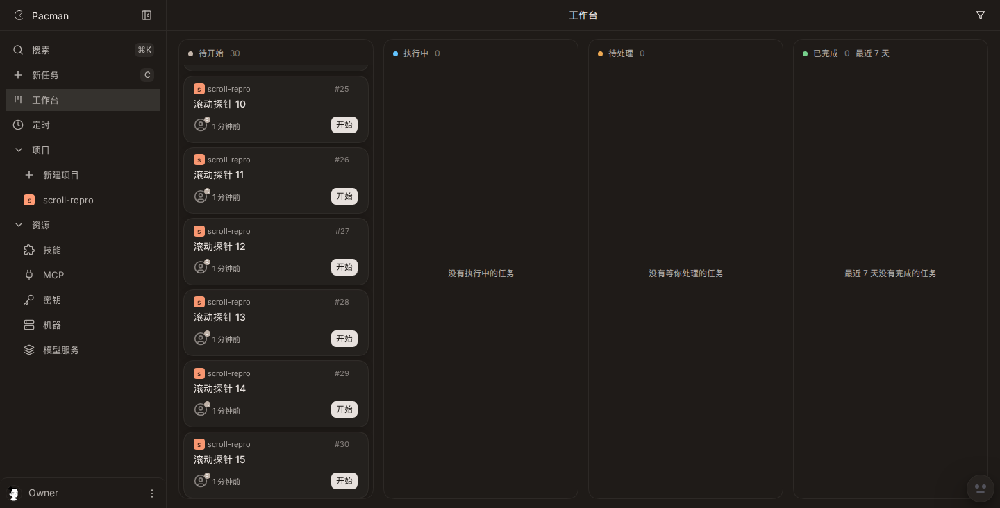
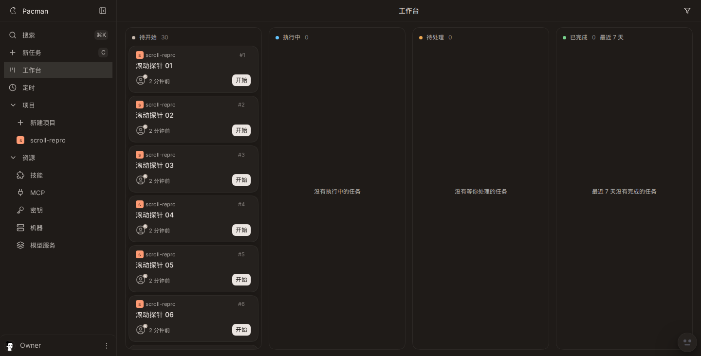
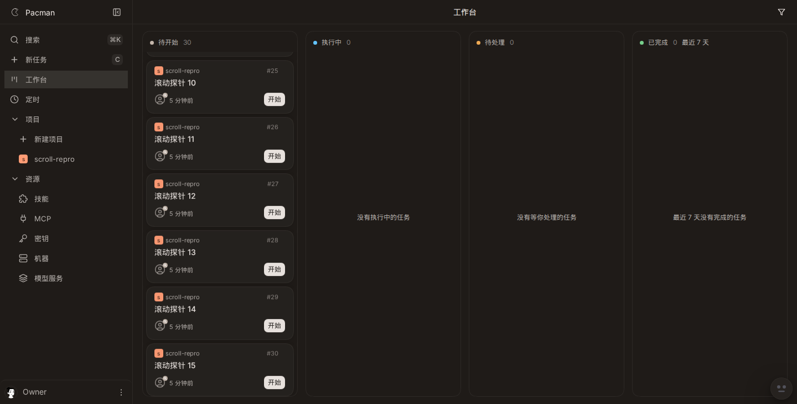

# 1255 board column scroll

Live stack: vite `http://127.0.0.1:5273/app`, server `127.0.0.1:8791`, viewport 1440x732. Thirty cards in `待开始` (`[data-column-list="todo"]`). New todos land in that column. `待处理` uses the same `ColumnList`.

The scrolling node is the column list. `[data-testid=board-scroller]` is `overflow-y: hidden` and stayed at scrollTop 0 (`scrollHeight` 688 = `clientHeight` 688).

## Before

Left the board at scrollTop 2445. Esc, browser back, and browser forward each returned scrollTop 0. The opened card sat at y=3068, outside the list viewport (94 to 718). `sessionStorage` was empty on the detail page.

## After

Left at 2445. Esc, back, and forward each restored 2445. The card box was 623 to 717, inside the list 94 to 718. While the detail page was open, `sessionStorage["pacman.board.column-scroll"]` was `{"todo":2445,"building":0,"pending":0,"done":0}`.

Numbers: `offsets.json`.

## Fixture e2e

`apps/web/e2e/board-scroll-restore.spec.ts` on `?scenario=board-overflow` (12 cards). Before the fix the poll expected scrollTop 601 and received 0 (`e2e-fail.txt`). After the fix that spec plus `board-overflow.spec.ts` passed 7/7 (`e2e-pass.txt`). `board-dnd.spec.ts` passed 25/25 (`e2e-dnd.txt`). The droppable ref on the list is the same node as before.

The click that opens the card can clamp `scrollTop` by a pixel when `scrollHeight` shrinks in the same turn (local fixture: 601 before the click, 600 at the click). The spec asserts the offset read after that click. Esc, back, and forward restore that leave offset, and the opened card stays inside the list.

A bare `sessionStorage` read throws `SecurityError` in an opaque-origin iframe and the router error page replaces the board (`storage-unavailable.spec.ts`). Column scroll now goes through `safeSessionStorage()`, the same acquisition point as `safeLocalStorage()`. After that change, both storage-unavailable tests and the scroll-restore spec passed.
