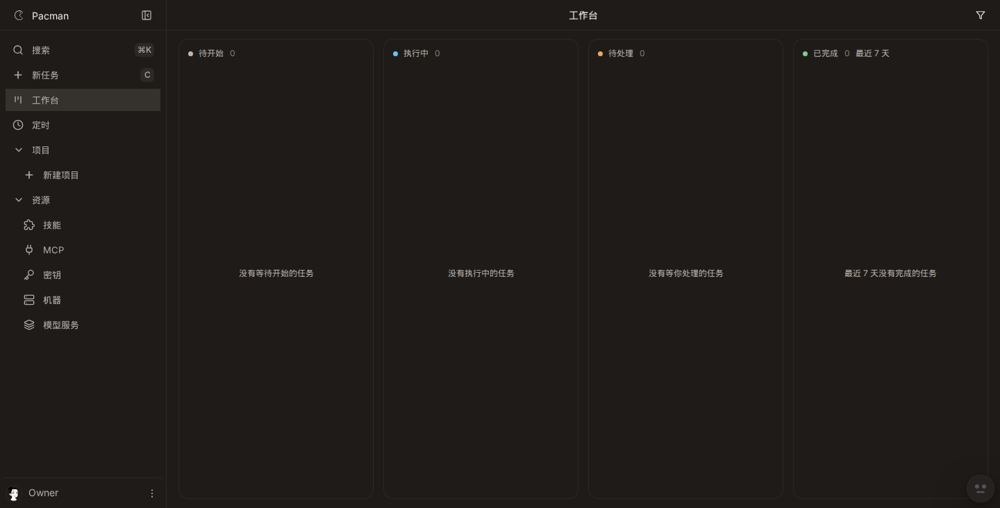
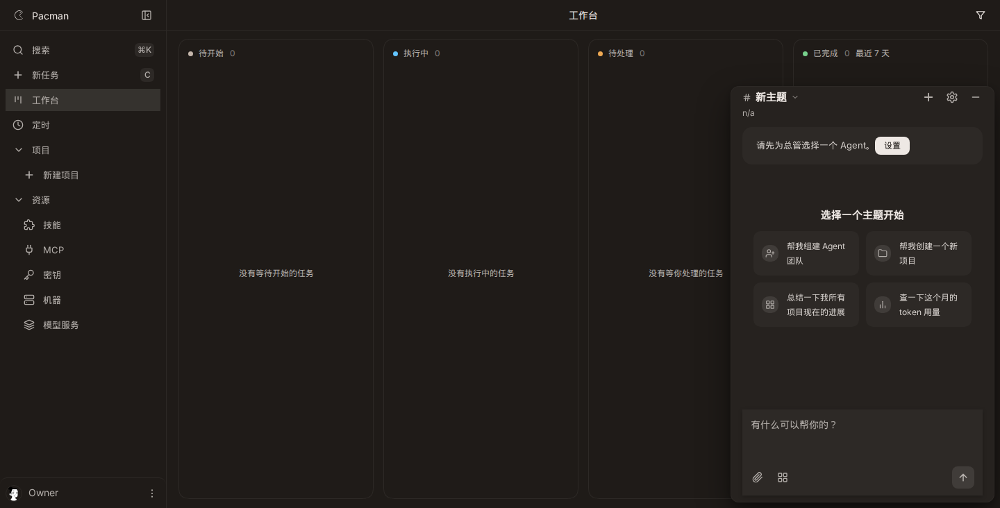

# 1267 gesture machine

Live stack: vite `http://127.0.0.1:5273/app`, server `127.0.0.1:8791`, viewport 1440x732, dark. Board route `/app`. Same script both times: idle shot, Meta+J, second Meta+J with an opacity `transitionrun` counter on `.chief-drawer`, then Meta+J and Escape.

## Before

Drawer starts hidden. First Meta+J opens it (`data-open`, text starts `新主题`). Second Meta+J hides the same node. Opacity `transitionrun` count is 0 (the #1266 fill-mode fix already on main). Escape after a reopen leaves the drawer open. Idle keydown registrations: 16, of which 8 are on `window`. Numbers: `before-report.json`.

## After

Same path. First Meta+J opens. Second Meta+J hides the same node. Opacity `transitionrun` count is 0. Escape leaves the drawer open. Idle keydown registrations: 15, of which 7 are on `window`. The chief chord and Escape share `bindGestureKeys` in `apps/web/src/overlays/gesture-machine.ts`. Numbers: `after-report.json`.

## Tests

`pnpm --filter @pacman/web exec vitest run test/gesture-machine.test.ts` with the module absent: `vitest-fail.txt`. Same command with the module present: 7 passed (`vitest-pass.txt`).

`E2E_PORT=8398 pnpm exec playwright test e2e/chief-toggle-flash.spec.ts e2e/escape-wiring.spec.ts e2e/hotkeys.spec.ts` from `apps/web`: 36 passed (`e2e-pass.txt`).
