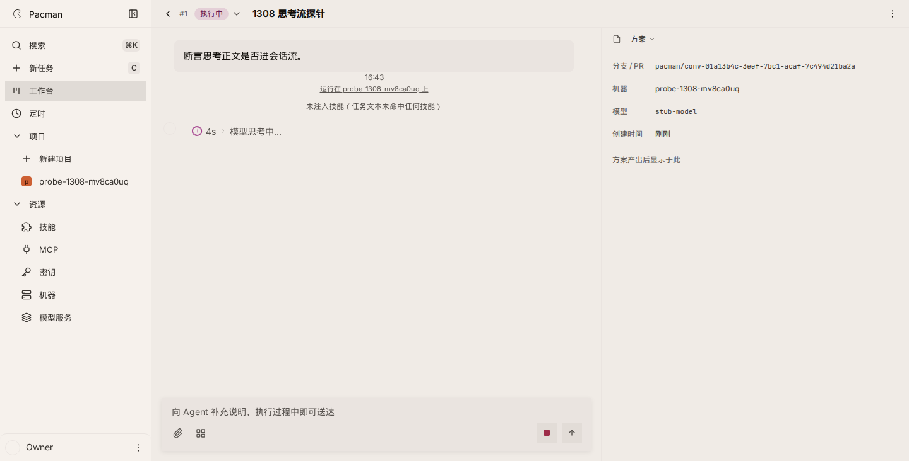
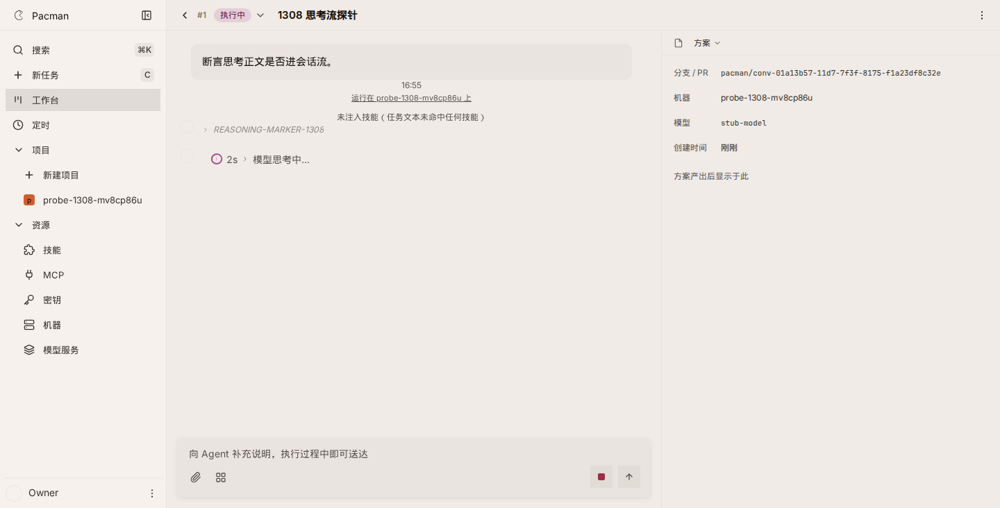

# #1308 live thinking text on the conversation stream

Live stack (`VERIFY_PORT` 8791, `VERIFY_WEB_PORT` 5273, fresh `PACMAN_HOME`). No daemon, no LLM. A fake machine claims one build step, posts `{kind:'activity', activity:{phase:'thinking'}}`, then posts `{kind:'thinking_delta', text:'REASONING-MARKER-1308'}`.

Probe: `.claude/skills/verify-pacman/scripts/drive-1308-thinking-delta.mjs`.

```sh
node .claude/skills/verify-pacman/scripts/launch.mjs
node .claude/skills/verify-pacman/scripts/drive-1308-thinking-delta.mjs --expect=new
```

`--expect=old` is the pre-fix shape: the machine body is HTTP 400, the conversation stream frames are `ping,step,activity`, and the detail page shows `模型思考中...` with no marker.

Before (8/8, `before-result.json`, `before-sse-summary.json`, `before-post.json`):



After (10/10, `after-result.json`, `after-sse-summary.json`, `after-post.json`): POST 200, one SSE frame `{type:'thinking_delta', text:'REASONING-MARKER-1308'}`, the detail page shows that text on the Think row, and the phase label stays. The marker is absent from `GET /messages` until a thinking segment row is posted. After that row, the page text contains the marker once (`after-page-settled.txt`) and sqlite has one message (`after-sqlite.json`).




