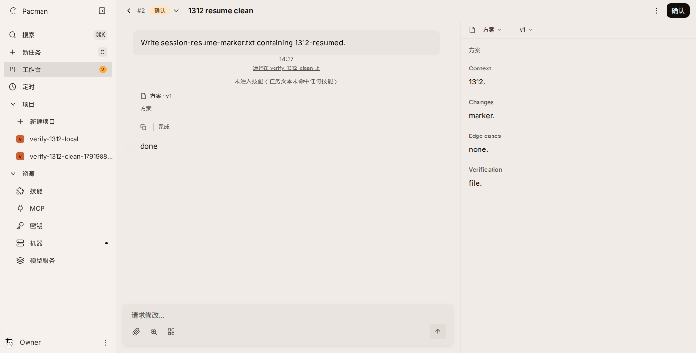
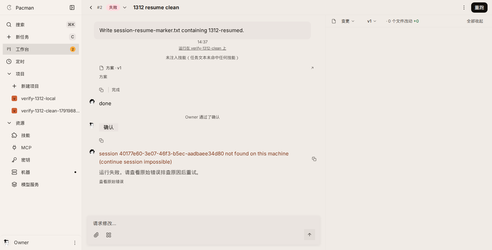
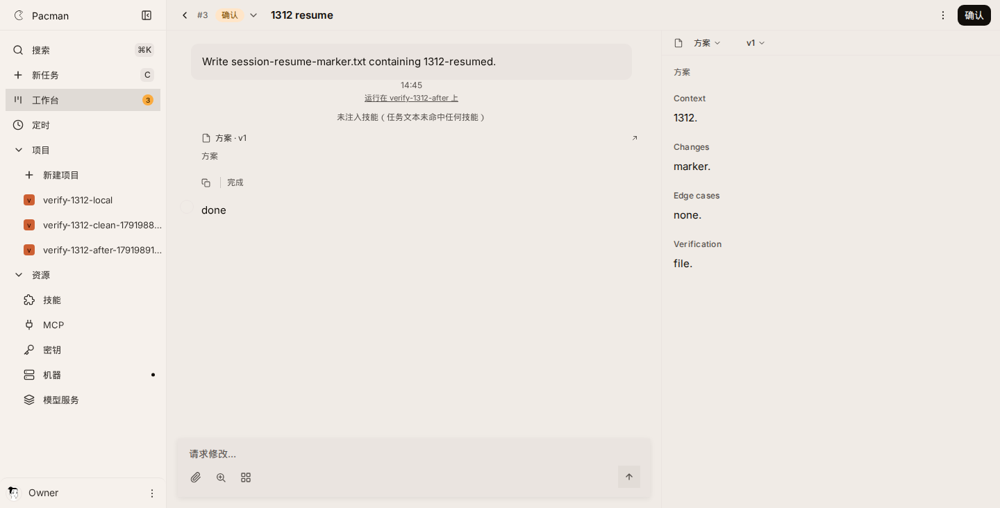
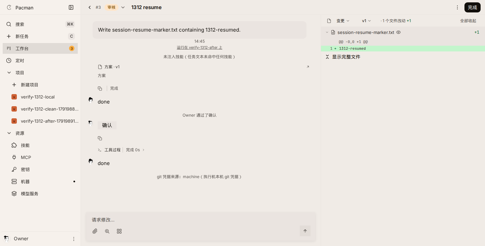
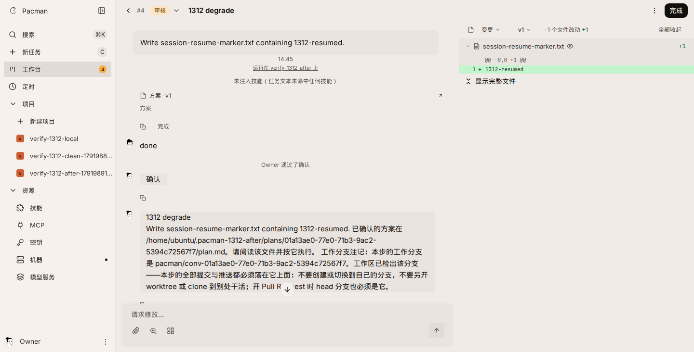

#1312 evidence

Claude Code CLI `2.1.278` at `~/.local/bin/claude`. Verify stack: server `8791`, web `5273`. Model endpoint is a local Anthropic SSE stub. The daemon is `pnpm exec tsx src/cli.ts start --foreground --server http://127.0.0.1:8791` with `PACMAN_HOME` under a dotted directory (`~/.pacman-1312-clean` on main, `~/.pacman-1312-after` on this branch).

Both runs create a `claude-code` agent, a local git repo, and a `withPlan` card, then click `确认` in the browser after the plan step is `done`. The daemon is online before the card is created, so the build step is a normal claim.

## Main (`6909f67d`, before the slug change)

Probe output: `main-probe.txt`. Session file the CLI wrote:

`/home/ubuntu/.claude/projects/-home-ubuntu--pacman-1312-clean-workspaces-01a13ad8-d000-7338-904f-77da2dc2e4f1/40177e60-3e07-46f3-b5ec-aadbaee34d80.jsonl`

Path the daemon checked (slash replacement only). This file was absent:

`/home/ubuntu/.claude/projects/-home-ubuntu-.pacman-1312-clean-workspaces-01a13ad8-d000-7338-904f-77da2dc2e4f1/40177e60-3e07-46f3-b5ec-aadbaee34d80.jsonl`

`main-daemon.log` line for the build claim:

```
[step] failed: session 40177e60-3e07-46f3-b5ec-aadbaee34d80 not found on this machine (continue session impossible)
```

`build.errorMessage` is that same sentence (`main-build-error.txt`). The log has `new session` for the plan and no `continue session` and no `falling back to new session`.





## This branch

Probe output: `branch-probe.txt`.

Resume card `01a13ae0-6601-75dc-80c8-76b2cd30e5a6`. Plan session `e54fb25b-d646-4d6b-9ed8-f7a003545920`. The build step finished `done` with that same session id. `branch-daemon.log`:

```
continue session 01a13ae0-6601-75dc-80c8-76b2cd30e5a6
```

The stub's build request carried the same `x-claude-code-session-id`. The worktree file `session-resume-marker.txt` contains `1312-resumed`. The slash-only path was still absent (`branch-slug.json`), so the resume used the CLI slug.





Degrade card `01a13ae0-77e0-71b3-9ac2-5394c72567f7`. Plan session `ed05482f-b9da-409a-b2e9-7952a673c66b` was deleted from `~/.claude/projects` after the plan step, before confirm. The build step finished `done` on a new session `13f473a0-e9b4-43b0-a26f-ca1409bc961d`. `branch-daemon.log`:

```
continue session unavailable (ed05482f-b9da-409a-b2e9-7952a673c66b) — falling back to new session — 本机找不到会话 ed05482f-b9da-409a-b2e9-7952a673c66b，无法续接。已改开新会话，按原任务继续。
```

The same sentence is a `system` message on the card (`branch-degrade-notes.json`). The marker file was written in that worktree too.



A second machine is covered by `apps/server/test/machine-pin.test.ts` (`priorMachineId` on the claim) and `apps/daemon/test/runner-recover-degrade.test.ts` case 6 (the card note says the session is on another machine).

## Long cwd slug (CLI 2.1.278)

A sanitized slug longer than 200 characters is truncated and given a hash of the resolved path. Measured with the real CLI, cwd length 250, session `cccccccc-dddd-4eee-8fff-111111111111`. The project directory name and the `hm` formula are the same string (`long-slug.json`, `match: true`), length 207, suffix `-ebpasi`. The transcript file is on disk at that path. `apps/daemon/test/claude-transcript-path.test.ts` failure mode 13 pins `sdkTranscriptPath` to this formula, and failure mode 14 pins the `CLAUDE_CONFIG_DIR` / `CLAUDE_CODE_PROJECT_DIR_NAME` override.
