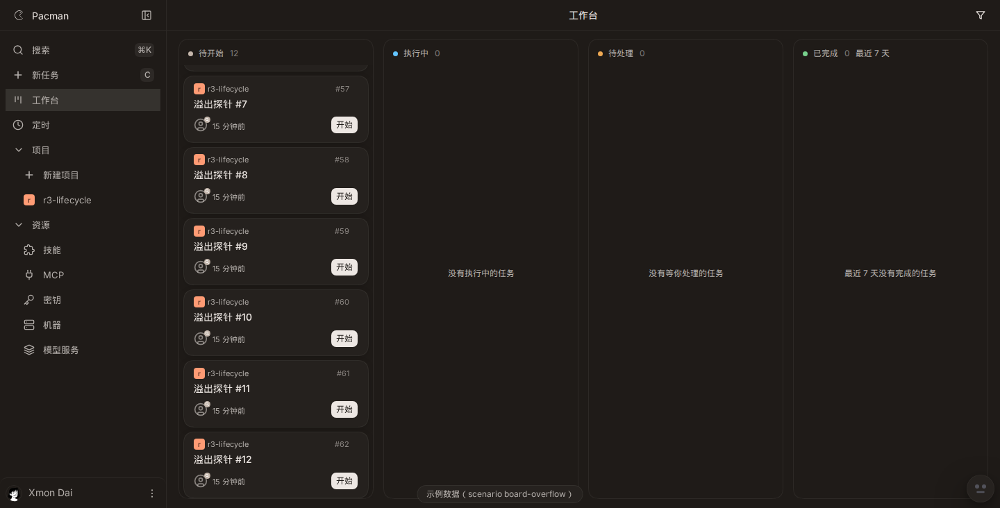

# 1331 column scroll assertion

Fixture preview `http://127.0.0.1:8399/app?scenario=board-overflow`, viewport 1440x732. The todo column has 12 cards. Each card is 94.5px tall. Eleven gaps of 8px and 2px of list padding sum with those cards to 1224. With `clientHeight` 624 the settled max `scrollTop` is 600.

## The miss

`node /tmp/scroll-before.mjs` walked the same steps as `e2e/board-scroll-restore.spec.ts`: set `scrollTop` to `scrollHeight`, DOM-click the last card, read `scrollTop` in that turn, Escape back to the board.

On run 4 the click turn still reported `scrollHeight` 1225 and `scrollTop` 601. `sessionStorage["pacman.board.column-scroll"]` on the detail page was `{"todo":600,...}`. After Escape the list was `scrollHeight` 1224 and `scrollTop` 600. The old poll's `toBe(601)` failed. The opened card was still inside the list.

```
expect(received).toBe(expected) // Object.is equality

Expected: 601
Received: 600
```

Full output: `e2e-fail.txt`. Numbers: `miss.json`.



The same 601 versus 600 miss is the failure in GitHub Actions run 38605170805, job `e2e (1)`, on `board-scroll-restore.spec.ts` line 41.

## After the assertion change

The poll expects `min(leftAt, scrollHeight - clientHeight)`. On three runs where the click turn still read 601, that settled value was 600 within 32 to 54ms, the stored offset was 600, and the card stayed in the list (`offsets.json`). A restored `scrollTop` of 0 does not satisfy that equality.

`E2E_PORT=8399 pnpm exec playwright test e2e/board-scroll-restore.spec.ts --repeat-each=20 --reporter=line` from `apps/web`: 20 passed (`e2e-pass.txt`).
