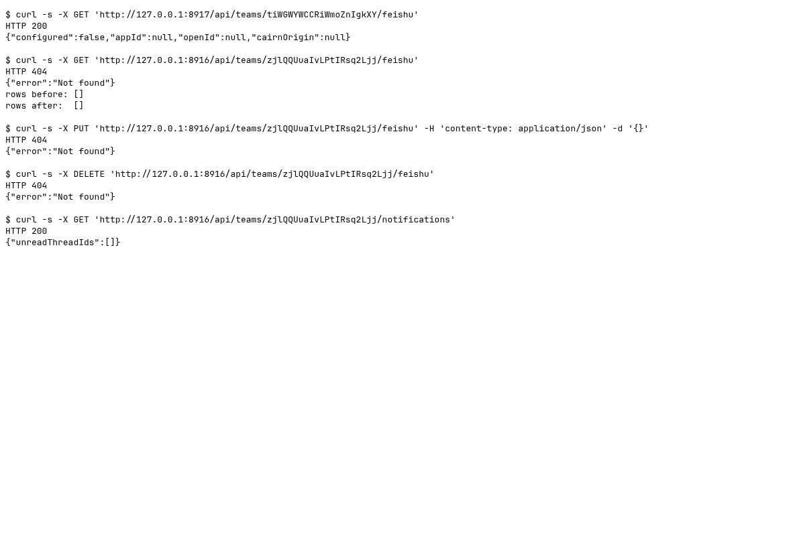

### Requests

| Clause | Request | Response | Rows before to after | ok |
|---|---|---|---|---|
| Before: configuration is exposed | `GET /api/teams/{team}/feishu` | `200` `{"configured":false,"appId":null,"openId":null,"cairnOrigin":null}` | n/a | yes |
| Configuration cannot be read | `GET /api/teams/{team}/feishu` | `404` `{"error":"Not found"}` | 0 to 0 | yes |
| Configuration cannot be saved | `PUT /api/teams/{team}/feishu` `{}` | `404` `{"error":"Not found"}` | n/a | yes |
| Unbind API is retired | `DELETE /api/teams/{team}/feishu` | `404` `{"error":"Not found"}` | n/a | yes |
| Native unread notifications remain | `GET /api/teams/{team}/notifications` | `200` `{"unreadThreadIds":[]}` | n/a | yes |
