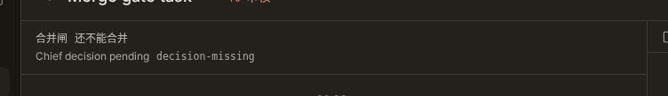

# 1794 in-product merge gate

The implementation runs review, verification and a separate chief go/no-go decision through the product step queue. `apps/server/src/services/merge-gate/run.ts` evaluates the existing readiness rules and persists digest, round and state records. The gate decision source lives under the protected merge-gate directory and has only typed I/O ports. `machine-gate-port.ts` and `machine-gate-storage.ts` provide mechanical database, filesystem, credential, HTTP and shared-contract adapters under the existing protected `machine*.ts` category. No protection list or pure-import allowlist changes are needed.

A completed GitHub build queues the default Reviewer once for its head. Gate authorization reads the server-owned first-completion payload and executing agent/model snapshot from the internal verdict row, keyed by step ID. It never trusts messages or uploaded sessions to grant pass. A stopped review, missing claim identity or absent structured payload cannot clear the gate. Subsequent done reports and transcript uploads cannot overwrite the first snapshot. Server claim snapshots the executing agent ID and effective model in the existing step fallback JSON. Review completion and author independence use that execution snapshot, not mutable agent settings. A legacy build without an execution snapshot has an unknown author identity and cannot clear protected-path independence, even when its fallback model is known. Changing the task assignment or agent settings cannot rewrite the recorded author. The snapshot preserves the fallback model, tried-model list and zero-token retry flag.

Once review and verification pass and only `decision-missing` remains, the product queues one read-only review-kind step assigned to the chief with `purpose: decision`. Its prompt includes the reports, head SHA and patch digest. The result is persisted as a decision verdict. A no-go, safety flag, extraction failure, or reported head drift stays blocked. The daemon reports an actual checkout head only when the observed start and finish are full SHAs equal to the expected head. Missing, changed or wrong checkouts cannot substitute the prompt head. The server applies this rule to both code-review and chief-decision bindings; older daemons that omit actual heads remain blocked until upgraded. Review and decision payload completeness and safety interpretation run in the protected pure verdict core and are checked again when constructing readiness, even if a stored outcome claims pass. Verification also uses its original typed payload rather than an external blocked flag. The core reads the latest server plan for this build through a raw-content port and derives evidence coverage itself. It does not trust criteria supplied in a completion message. A required missing or invalid plan stays unknown and blocked. Legacy verdict rows without the original server-owned payload stay blocked. The chief `merge_builds` refusal and the existing human `requestMerge` entry remain in place.

Each evaluation records a redacted JSONL trajectory under `attachments/gate-runs/<build>.jsonl`: reviewer raw session output when available, parsed verdict, model, readiness, status-write outcome and observed merge state. The product writes a commit status; it does not enable or disable GitHub auto-merge, so the action explicitly records `autoMerge: not-requested`. Trajectory export includes these records in `judgments.gate_runs`. The scheduler forwards its attachment directory to the poller. Human GitHub merge success leaves the task in review, records that it merged with audit pending, and stops unclaimed gate steps. Review-phase reconciliation waits for the gate audit to succeed before marking a merged task done, so a transient issue-write failure is retried on the next sweep. GitHub still reports the PR as merged while this audit is pending. The terminal merged-to-done transition requires a fresh auditable merged observation, durable storage and a usable audit issue port; missing prerequisites stay retryable even if the earlier ordinary evaluation returned null, failed to read facts, or observed an open PR. A task timeline hint records that the PR has merged while audit confirmation is pending.

When GitHub reports a merged head whose last recorded evaluation was blocked, the product opens a `gate-mismatch` issue through the existing GitHub write seam. A PR/head marker deduplicates retries. Tests stub the GitHub port and do not create external issues.

Task detail reads `GET /api/builds/:id/gate` every three seconds while mounted. The browser regression starts with `decision-missing` and observes ready without a page reload.

The full pre-push run caught an initial attempt to put database/filesystem adapters inside the pure gate directory. Its three import-boundary failures remain the negative control. The current split passes all eight existing import-boundary tests. Step/identity matching, decision scheduling and deduplication, readiness, mismatch decisions and audit marker matching remain in the pure core; the adapters do not choose gate outcomes. `port-protection.txt` records runtime path-classification results for both new adapter files.

The F15 report-boundary test was revised for the new server-owned database adapter. Its former blanket ban on every `machine*.ts` referencing gate tables failed on `machine-gate-port.ts`. That single protected adapter is now distinguished from daemon report handlers. All other machine report modules still cannot directly reference gate tables, and a recursive runtime import/re-export check prevents them reaching the adapter indirectly. The check exposed the existing `machine-finish-step` import of CI retry helpers through `ci-loop`; those unchanged helpers now live in protected `machine-ci-retry.ts`, with compatibility re-exports from `ci-loop`. Restoring the old indirect import makes the new boundary check fail. A real authenticated machine completion submits forged digest, round, verdict and ready-state fields, completes successfully, and leaves all four internal tables empty. The pure gate import test and protected-path classifier remain unchanged.

Product gate extraction now requires the last meaningful assistant text to end with schema-valid verdict JSON. It never recovers an earlier assistant example after an unfinished final response. The runner also resets per-message segment state at message completion so a following assistant response cannot disappear from the uploaded transcript. Its strict parser and checkout-head rule live in the existing protected daemon `merge-decision.ts`. Legacy plan-confirmation extraction keeps its existing final-draft behavior.

The existing plan-contract parser was mechanically relocated into the already protected shared gate source, then its private single-use helpers were inlined to retain the existing helper gate. The original plan module re-exports the same function bindings, so builds, retry context and the web mapper retain their existing API and parsing semantics. `PLAN_SECTIONS` has no mutating consumers and is frozen under the existing gate-export contract. `plan-parser-move.txt` records the initial mechanical relocation; the current source is not byte-identical after inlining. `plan-parser-parity.txt` compares the original and current outputs for 259 inputs across both public APIs, with all 518 comparisons equal. The protected core calls that parser on server plan text; the database port only reads the latest plan content. No criteria, gate ruler or protected-path list changes are included.

The nullable verdict payload and reviewer identity columns require a normal database migration. Existing rows remain null and fail closed; the migration does not invent historical evidence. The local migration number follows the current main tail and must be regenerated if another migration lands first. Transcript upserts use a conversation/thread condition: a machine cannot replace another conversation's message ID, while same-conversation retransmission and completed-step recovery remain supported. Uploaded sessions are raw audit evidence and never supply authorization identity.

The first normal push stopped at the single-use helper check (`helper-gate-red.txt`). After inlining, that same check reports zero (`helper-gate-green.txt`), and the parser, export binding, mapper, gate import, product and runner set passes 85 cases (`inline-related-tests.txt`). No helper allowlist exception was added.

Gate evaluations and terminal audits make additional GitHub read requests. The legacy reconciliation and grind unit fixtures isolate that separate gate work so their original cache and grind-budget assertions remain unchanged; these are not assertions about the total poller request count. `legacy-grind-budget-red.txt` records the additional pull read found by the full check. Product-port and audit regressions cover the new reads and failure/retry behavior separately.

A default Reviewer can finish with a valid NoGo while CI still owns the building phase. Its blocking payload is recorded and the machine completion succeeds; it does not enter the legacy review-to-replan transition or queue a plan from the building phase. `default-nogo-machine-probe.txt` and `default-nogo-red.txt` record the prior 409. The corrected real endpoint and five related suites pass 453 cases (`default-nogo-green.txt`). Earlier full-hook unit and partial browser results belong to their earlier source SHA and are not validation of this phase fix.

Validation recorded during this change:

- Server-owned snapshot, human-merge audit, legacy PR, machine and gate regressions: 1042 cases in 31 files passed (`snapshot-related-tests.txt`), plus 18 transcript/chief consumer cases (`transcript-consumers.txt`). `machine-forgery-red.txt` records actual completed-machine message attacks; `machine-forgery-green.txt` covers tool and upload recovery with immutable verdict facts. `chief-transcript-boundary.txt` covers the chief thread boundary. `human-merge-audit-red.txt` records the direct completion bypass before deferring it to the audit poller.
- Earlier core and parser regressions: 684 cases in 26 files passed (`protected-related-tests.txt`), plus the web plan reader case (`web-plan-reader.txt`). `review-verify-policy-red.txt` records four caller/DB-pass bypasses, and `plan-criteria-red.txt` records the forged-empty-criteria bypass before the fixes.
- Earlier protected-decision and actual-head regressions: 626 cases across 21 files passed (`final-related-tests.txt`). `actual-head-red.txt` captures the runner failing to send a stable checkout head and the server accepting a missing decision head. `decision-policy-red.txt` captures caller pass flags overriding safety payloads before core enforcement.
- Earlier continuation regressions: 609 cases across 20 files passed (`blocker-related-tests.txt`), including all CI-loop, retry, gate, strict extraction and real runner tests. `report-boundary-red.txt` records the indirect-import negative control.
- CI reconciliation, model fallback and audit-retry regressions: 53 passed. The old audit ordering marked a task done before a failed mismatch-issue write; the current ordering retries the audit before finishing.
- After the port split: CI loop, model fallback, verdict binding, trajectory CLI export and pure-import boundary suites: 116 passed (`port-related-tests.txt`). Product, audit, scheduler and reconciliation suites plus the import boundary: 32 passed.
- Scheduler wiring: the regression failed with an undefined attachment directory and passed after forwarding the configured directory.
- Prompt-echo regression: the old extractor returned `ok` for an echoed passing JSON followed by a final `VERDICT: block`; the current extractor fails closed. Malformed safety verdicts cannot degrade into passing findings or fall back to an older pass; chief decisions require both boolean safety answers. Independent review found this failure and the regression suite covers it.
- Browser regression: the old query stayed on `decision-missing` for ten seconds. The polling query passes with Playwright Chromium. Screenshots above show stubbed API states, not a live task or a real merged PR.
- `pnpm lint`, `pnpm typecheck`, and `pnpm spec:parse` passed. Final pre-push results are recorded separately.

Outstanding host acceptance:

- No live Cairn task PR has merged through this implementation in this environment. This document is local automated evidence and does not satisfy that issue acceptance item.
- Public review publication and autonomous merge execution have not been demonstrated here. The existing human merge API is unchanged.
- The external omarchy review timer remains active. Its retirement requires one week of matching real PR outcomes.
- The existing readiness inputs for the future autonomy pause and daily merge cap are not backed by a production executor in this change. No unattended merge path is enabled.

This change must not close issue #1794 until its host acceptance is complete.
