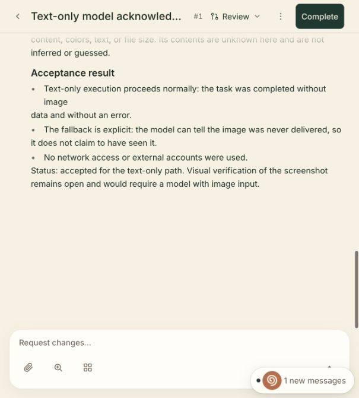
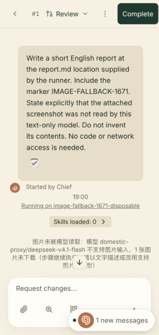

# Bounded image fallback delivery archive

Issue: [#2083](https://github.com/xiechimon/cairn/issues/2083). Parent: [#1671](https://github.com/xiechimon/cairn/issues/1671). Delivery: [#2082](https://github.com/xiechimon/cairn/pull/2082), reconciling the original implementation from [#1928](https://github.com/xiechimon/cairn/pull/1928).

## Completed child scope

This archive records the already implemented bounded text-fallback delivery: model metadata and negotiated Gemini capability determine image delivery; a measured unknown-model capability rejection is cached and permits one fresh text-only retry before useful progress. The rejected session history is excluded, progress and cancellation guards remain intact, and unread-image notices persist through task transcripts and steering. Network retry, resume-miss and steering integration regressions cover their interaction with current main.

The related 21-file run passed 409 tests. Scripted runner tests cover the rejection/retry mechanism, while the real-provider trial covers declared-text-only execution and actual-card presentation. This distinction is preserved in the child issue's completed acceptance.

## Source and proof binding

- Feature checkpoint: `6091529dd1e38f5c7edaaeefb7e217718d05cef1`.
- Real-provider and actual-card proof checkpoint: `500969a9d1afc6bf948108163ad1fa0cce36a3fb`.
- Original verification record and all original paths remain in [../1671/README.md](../1671/README.md).
- [../1671/reviewed-source-hashes.json](../1671/reviewed-source-hashes.json) binds all 19 tested source and test files. They remained unchanged through the real-provider trial.
- [../1671/live-artifact-hashes.json](../1671/live-artifact-hashes.json) binds the compiled web assets, harness and live proof files.
- [archive-hashes.json](archive-hashes.json) records SHA-256 hashes for those manifests, the terminal evidence, request metrics, report and screenshots. The archived screenshots are byte-identical copies of the originals.

The live information task reached `review` with its build step `done` and no build error. Its report contains `IMAGE-FALLBACK-1671` and explicitly states that the screenshot was not read, without inventing contents. The model was `domestic-proxy/deepseek-v4.1-flash`, declared text-only with a 1,000,000-token context window. All 12 real forwarding calls, including Chief orchestration and the information task, returned HTTP 200 with zero image blocks and 130,800 total tokens. Per-build usage was input 8,416, output 570 and cacheRead 3,840. Safe metrics and terminal evidence remain at the original paths linked above; no credential or provider request payload is included.

## Actual-card observations

The coordinator clicked Start in the real built web UI and observed the Review card, unread-image notice and report. This archive does not attribute that UI action to the evidence-collection lane. The real screenshots are copied below; they are not generated mockups.

The owned trial stacks were stopped normally after the build and Chief became idle. Their PIDs exited and private runtime directories were removed; [../1671/live-text-only-cleanup.json](../1671/live-text-only-cleanup.json) records cleanup.

## Remaining parent scope

Parent #1671 remains open. Automatic vision-model routing, a real unknown-model or GLM capability rejection followed by a text-only retry, and the unresolved unknown-model late-steer case remain with that parent. No real rejection or late-steer acceptance is claimed by this child. The original parent acceptance is unchanged.
