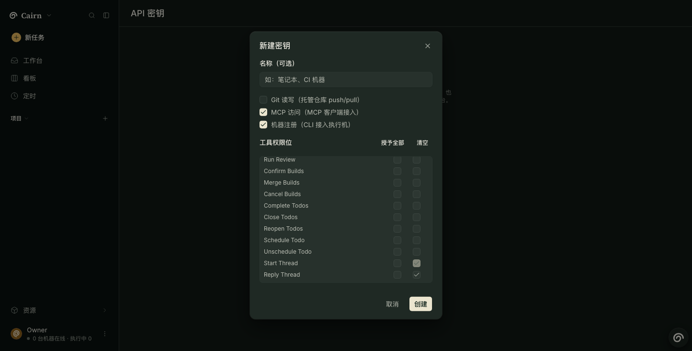

# MCP terminal entry — #2291

## Implementation and limits

Measured in this worktree on 2026-10-31: an MCP SDK client initializes the real server face with a generated API key, starts a Project Thread, reads its status, and replies. The transport uses the application in process, an isolated SQLite database, and a configured test Coordinator. No external model or real harness session runs in that test.

The three real harness sessions and the Grok probe were run afterwards on an isolated live stack at commit `622284f23`; see [Real-session evidence](#real-session-evidence). Claude Code, Codex, and pi each started, read, and replied to a Thread through cairn's MCP server. No daemon ran, so the Coordinator never answered; the sessions prove the MCP entry, not a completed Coordinator turn.

The database still distinguishes Coordinator conversations from work Threads. New tools accept Coordinator conversation IDs and work item IDs as documented below; no schema migration or new CLI is introduced. The original 24 MCP tools and grants remain available. Existing keys must explicitly receive the new grants through the existing API key flow.

## API key and one-command setup

In cairn's existing API key settings, create a key for the intended team, enable MCP access, and select these grants:

- Read: `Projects`, `Threads Waiting on Me`, `Read Thread`, `Thread Pull Requests`.
- Write: `Start Thread`, `Reply Thread`.

Copy the key when shown, export it as `CAIRN_API_KEY` in the shell launching the harness, and set `CAIRN_MCP_URL` to the reachable cairn server's `/api/mcp` URL. For a local server, use `http://127.0.0.1:8787/api/mcp`. A remote connection should use HTTPS. Configure an Agent for the Coordinator in cairn before starting a Thread.

Measured sources: installed `claude mcp add --help`, `codex mcp add --help`, and `pi mcp --help`, captured in [cli-help.txt](cli-help.txt). Versions: Claude Code 2.1.269, codex-cli 0.165.0, pi 1.4.0. The commands below were run with a dummy key and temporary configuration roots; config readback confirmed the URL and authorization settings. This checks setup syntax and persistence, not a live session. Results: [setup-check.txt](setup-check.txt).

### Claude Code

```sh
claude mcp add --transport http --scope user cairn "$CAIRN_MCP_URL" --header "Authorization: Bearer $CAIRN_API_KEY"
```

This stores the expanded header in Claude Code's user configuration. Keep that private configuration out of the repository. Start a fresh `claude` session after setup.

### Codex

```sh
codex mcp add cairn --url "$CAIRN_MCP_URL" --bearer-token-env-var CAIRN_API_KEY
```

Codex stores the environment variable name, so `CAIRN_API_KEY` must also be exported when starting `codex`.

### pi

```sh
pi mcp add cairn --url "$CAIRN_MCP_URL" --bearer-token-env-var CAIRN_API_KEY --exposure direct
```

pi stores an authorization header referencing `${CAIRN_API_KEY}`. Export the variable when starting `pi`. Direct exposure makes these five tools visible individually.

## Tool contract

| Tool | Arguments and result |
| --- | --- |
| `start_thread` | `projectId`, `content`: starts a Coordinator Thread in that Project and returns its ID, Project, status, and initial message. |
| `threads_waiting_on_me` | Optional `projectId`: pending Coordinator questions and unarchived work Threads owned by the caller or unassigned, in `confirm`, `review`, or `failed`. Excludes resolved work and machine/quota waits. |
| `read_thread` | `threadId`, optional `before`: current Thread status, pending structured questions, and the conversation page. Use `conversation.nextBefore` as `before` for older messages when truncated. Work Thread IDs are work item IDs, not run IDs. |
| `reply_thread` | `threadId`, `content`, optional `mode` (`queue` by default, or `steer`). Coordinator replies inherit the latest selected Project; optional `projectId` selects another Project in the same team. Work replies reuse the existing queue/continuation/steer services and cannot move Project. |
| `reply_thread` question answer | `threadId`, `requestId`, `answers`: answers a pending Coordinator question using the existing structured answer contract. Each answer has `header` and exactly one of `text` or `choices`. Do not also send `content`, `projectId`, or `mode`. |
| `thread_pull_requests` | `threadId`: persisted `{threadId, buildId, prUrl, prNumber}` entries. Coordinator Threads resolve work linked by orchestration provenance or a current watch. An empty list means no PR link is recorded; links are not guessed from text. |

Each tool requires its own grant. Authorization continues to use the caller key's team. Foreign and missing IDs return tool errors without reading or changing foreign data. Coordinator status is `waiting_on_you` for pending questions, `working` for live turns, `failed` for a failed latest turn, and `idle` otherwise. Work status preserves its current phase.

## Failure modes and automated evidence

Tests were written before the tools. The initial run had 7 failures because the tools were absent. Additional edge cases brought the focused suite to 10 tests. The tests use `Client` and `StreamableHTTPClientTransport` against the MCP face, including initialize, tool discovery, and tool invocation; they do not call Thread REST routes to exercise the feature.

- Cross-team Project selection, Coordinator/work Thread reads and replies, structured answers, pagination cursors, and PR lookup fail without foreign state mutation. A deliberately corrupted latest-run pointer cannot expose another team's conversation.
- Missing grants hide and reject all five tools; each individual grant exposes only its matching tool. The original MCP suite checks invalid credentials, disabled MCP access, and the legacy tools.
- Blank starts and an unconfigured Coordinator create no Thread or message. Invalid or ambiguous replies do not create messages. Work without a run fails explicitly.
- Coordinator replies queue unless steering is explicit. Work replies use the existing queue. Project inheritance survives tied message timestamps.
- Pending questions can be read and answered; duplicate answers fail. Archived/resolved/working work is excluded from the waiting list.
- PR lookup returns no link before one exists, returns only linked work, and filters foreign work even when it carries matching orchestration provenance.

The shared vocabulary test pins all 29 grants/tool pairs. The existing snapshot pins the original 24-tool prefix for backward compatibility and explicitly asserts all five new grants. A failing web test also exposed the existing key dialog's tool-name/grant-label mismatch; the dialog now takes the server's grant labels from the registry.

## Validation

Measured locally; final related tests use Node 24.14.0 through fnm. No dependency rebuild, installation script, dependency change, or lockfile change was needed.

| Command/check | Result |
| --- | --- |
| `pnpm lint` | Pass; one informational diagnostic in unchanged Feishu tests. |
| `pnpm typecheck` | Pass across all workspace packages. |
| `pnpm spec:parse` | Pass; rerun by the final prepush after adding the browser spec. |
| Related Vitest files below | 188 passed in seven files, including 10 new MCP entry tests, the API key selector test, and all three real-server MCP integration tests. |
| `pnpm --filter @cairn/web e2e:affected` | 26 passed across four selected specs. |
| `pnpm --filter @cairn/web e2e:affected -- apps/web/e2e/focus-ring-clip.spec.ts` | 3 passed, including the grant-submission case and existing focus-ring regressions. |
| Installed harness setup commands with isolated config readback | 10 assertions passed; [setup-check.txt](setup-check.txt). |
| Security/independent review | Two confirmed non-security findings fixed; [review and limits](security-review.md). |
| `pnpm prepush` | Pass: 20 checks, including lint, typecheck, spec parsing, affected-test coverage, and comment discipline. |

```sh
pnpm exec vitest run apps/server/test/mcp-entry.test.ts apps/server/test/mcp-face.test.ts apps/server/test/token-auth.test.ts packages/shared/test/vocabulary.test.ts packages/shared/test/snapshot.test.ts apps/web/test/api-key-mcp-grants.test.ts integration/test/m4b-mcp-e2e.test.ts
```

Additional broad check: `pnpm exec vitest run --changed` selects unrelated daemon and integration suites through shared exports. A separate Node 24 rerun of `apps/daemon/test/local-executor.test.ts`, `apps/daemon/test/workspace-hooks.test.ts`, and `integration/test/routing-cli.test.ts` reproduced five failures with 32 tests passing: missing credential probe output, a missing grandchild PID file during the timeout test, and three routing oracle failures reporting unavailable write-boundary enforcement on this Mac. Those unchanged test/source paths were not modified. The cause of the first two failures is unverified. The broad run was interrupted after recording these failures; it is not claimed green.

The key-dialog browser evidence uses a mocked API and no model/provider; it proves the grant-selection/submission behavior only. The live path is covered by the real-session evidence below. [Result metadata](cairn-mcp-entry-key-evidence/result.json).



## Real-session evidence

Measured 2026-10-31 on an isolated live stack started per `.claude/skills/verify-cairn/SKILL.md` (server on port 8791, scratch `CAIRN_HOME`, fresh database) at commit `622284f23`. Setup through REST: a local Project `mcp-entry-2291` (`B0fy8CIOd9Toiqeklrqny`) on a throwaway one-commit git repository, a Coordinator Agent bound to the team's Coordinator, and an API key with MCP access and exactly the six grants listed above. No daemon ran. Each Coordinator turn therefore stayed `pending` and every status read returned `working`; no Coordinator reply and no PR exist, so `thread_pull_requests` was not exercised.

Each harness got the MCP server from its documented one-command setup, scoped to a temporary directory so the user-level configuration stayed unchanged (checked by hash before and after). Each ran one non-interactive session with the same prompt: call `projects`, `start_thread`, `read_thread`, `reply_thread`, then `read_thread` again. Transcripts are filtered to tool calls, results and final messages; the key and local paths are redacted.

| Harness | Version, model | Thread | Calls observed (all succeeded) | Reply message | Transcript |
| --- | --- | --- | --- | --- | --- |
| Claude Code | 2.1.312, `claude-opus-5-5` | `chief-01a18eaa-53cf-7264-8d41-8dd96d188f29` | `projects`, `start_thread`, `read_thread` (`working`), `reply_thread` (`steered: false`), `read_thread` (`working`, 2 messages) | `BRTcXm0H1meEPzoRJ0_QO` | [claude-code.txt](real-sessions/claude-code.txt) |
| Codex | codex-cli 0.165.0, `gpt-6.1-sol` | `chief-01a18eab-702f-7d4a-ae49-0b6c40e11712` | same sequence and statuses | `CTJz3fR7CJGfEBu-_N3vG` | [codex.txt](real-sessions/codex.txt) |
| pi | 1.4.0, `claude-sonnet-5-5` | `chief-01a18eac-e242-7c48-a0e1-281819621172` | same sequence and statuses | `rHAD1tWXj_ntRar-JFZqf` | [pi.txt](real-sessions/pi.txt) |

Server-side check after the sessions ([server-side.txt](real-sessions/server-side.txt)): `GET /api/teams/:id/chief/threads` lists all three Threads. `GET /api/conversations/:id/messages` returns exactly the start message and the reply for each Thread. Read-only SQLite shows six `chief_message` rows, all with the Project ID, and two `pending` Coordinator steps per Thread, one for the start and one for the queued reply.

### Claude Code

```sh
claude mcp add --transport http --scope project cairn "$CAIRN_MCP_URL" --header "Authorization: Bearer $CAIRN_API_KEY"
claude -p --output-format stream-json --verbose --settings '{"enableAllProjectMcpServers":true}' --allowedTools 'mcp__cairn__*' --no-session-persistence "<prompt>" < /dev/null
```

Run in a temporary directory: `--scope project` writes `./.mcp.json` there instead of the user configuration. The init event reports `cairn` as `connected` with the six tools. The `--settings` and `--allowedTools` flags only approve the project server and its tools for a non-interactive run; an interactive session asks instead. Result: pass.

### Codex

```sh
CODEX_HOME=<temp> codex mcp add cairn --url "$CAIRN_MCP_URL" --bearer-token-env-var CAIRN_API_KEY
CODEX_HOME=<temp> codex exec --json --skip-git-repo-check -s read-only -c approval_policy='"never"' -c 'mcp_servers.cairn.default_tools_approval_mode="approve"' "<prompt>" < /dev/null
```

The temporary `CODEX_HOME` held a copy of the existing login and only the model setting. The first attempt omitted the `default_tools_approval_mode` override. Codex then refused the first call with `MCP tool call requires approval, but approval policy is never` and created no Thread (included in the transcript). For non-interactive `codex exec`, the documented setup therefore needs this per-run override, or the same key under `[mcp_servers.cairn]`. An interactive session prompts for approval instead; that path was not run. Result: pass on the second attempt.

### pi

```sh
pi mcp add cairn -l --url "$CAIRN_MCP_URL" --bearer-token-env-var CAIRN_API_KEY --exposure direct
pi -p --mode json --approve --no-session --no-context-files --model domestic-claude/claude-sonnet-5-5 "<prompt>" < /dev/null
```

Run in a temporary directory: `-l` writes `./.pi/mcp.json` there, with `Authorization: Bearer ${CAIRN_API_KEY}` and no key value. `pi` ignores an untrusted project file, so `--approve` trusts it for this run only. All three attempts listed the six `cairn__*` tools in the system prompt. The first two attempts, the configured default model and the same model through a second provider, failed at the model provider with HTTP 502/503 and 429, before any tool call. The third attempt passed. The model choice is incidental to the MCP path. Result: pass.

## Grok probe

Measured 2026-10-31. `npm view @xai-official/grok` shows version 1.0.70, license Apache-2.0, maintainer `xai-security` at x.ai, and per-platform binary packages under the same scope, so this is the official npm package. Installation is free: it was installed into a temporary prefix with `--ignore-scripts` (postinstall not run), and `grok --version` printed `grok 1.0.70 (f50904eaee6c)`.

Grok supports MCP. `grok mcp` offers `list`, `add`, `remove`, `enable`, `disable`, and `doctor`. `grok mcp add` supports `stdio`, `http` (streamable HTTP), and `sse`, with user or project scope and `-H` headers. With cairn added under a temporary HOME, `grok mcp doctor` connected without a Grok sign-in: handshake OK (protocol 2025-11-25) and 6 tools discovered ([grok-mcp-doctor.txt](real-sessions/grok-mcp-doctor.txt)). A project-scoped entry is not started in an untrusted folder.

A Grok model session was not run: `grok -p` returned `Not signed in` and requires `grok login` or `XAI_API_KEY`, which needs an xAI account. Whether Grok's model calls cairn's Thread tools end to end is therefore unverified. The setup command would be `grok mcp add cairn "$CAIRN_MCP_URL" -t http -H "Authorization: Bearer $CAIRN_API_KEY"`; inferred from help and the doctor run, not from a session.
