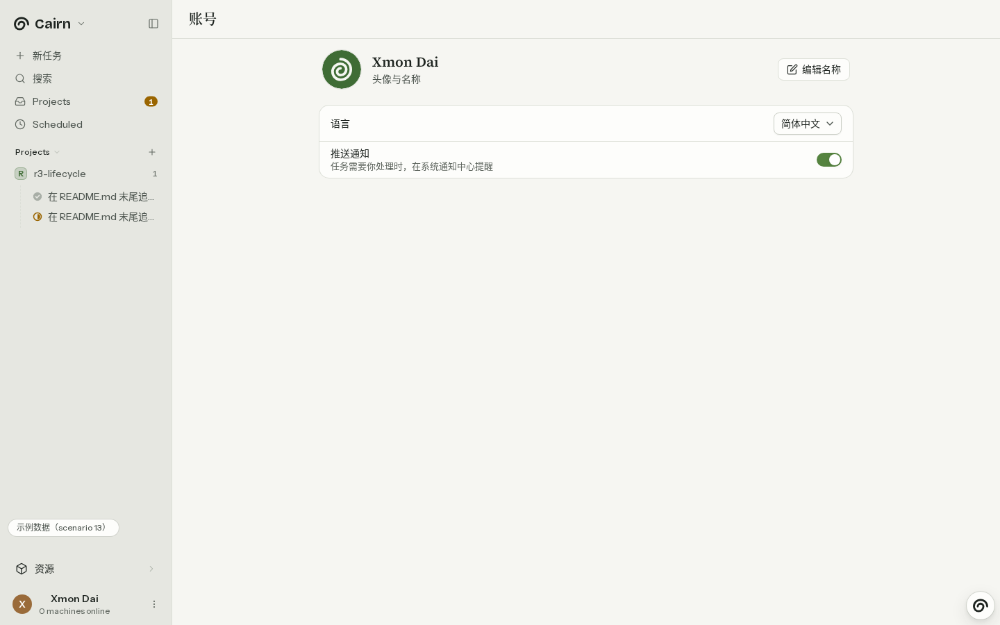
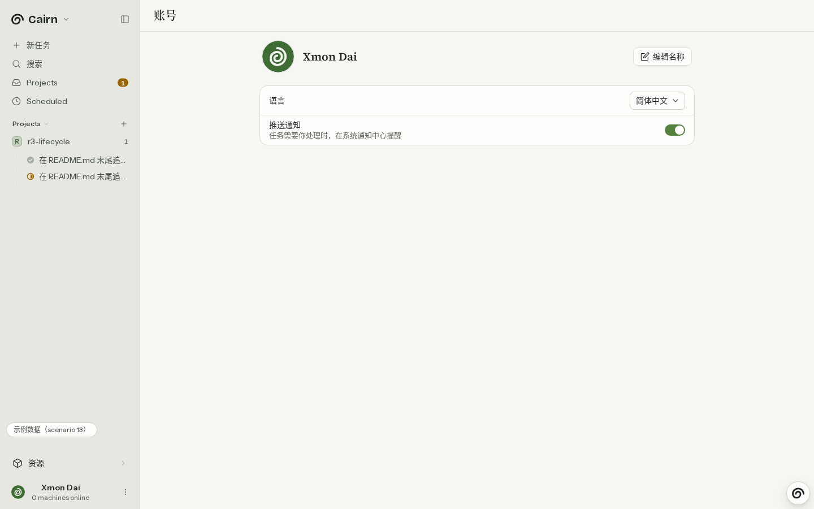
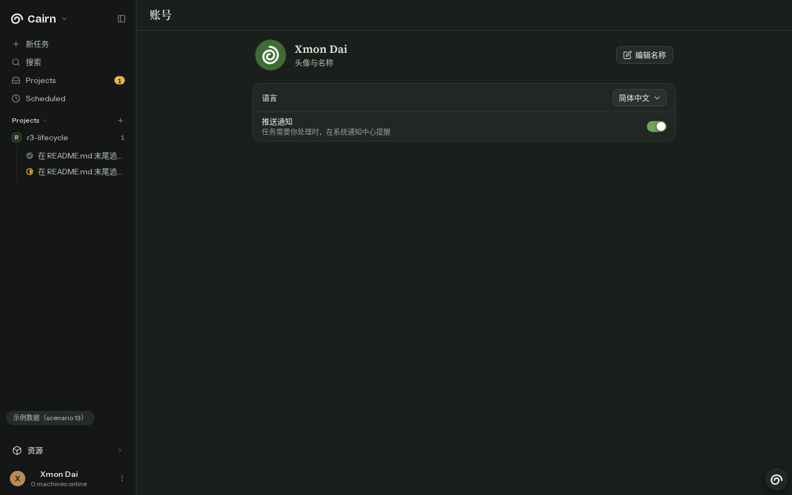
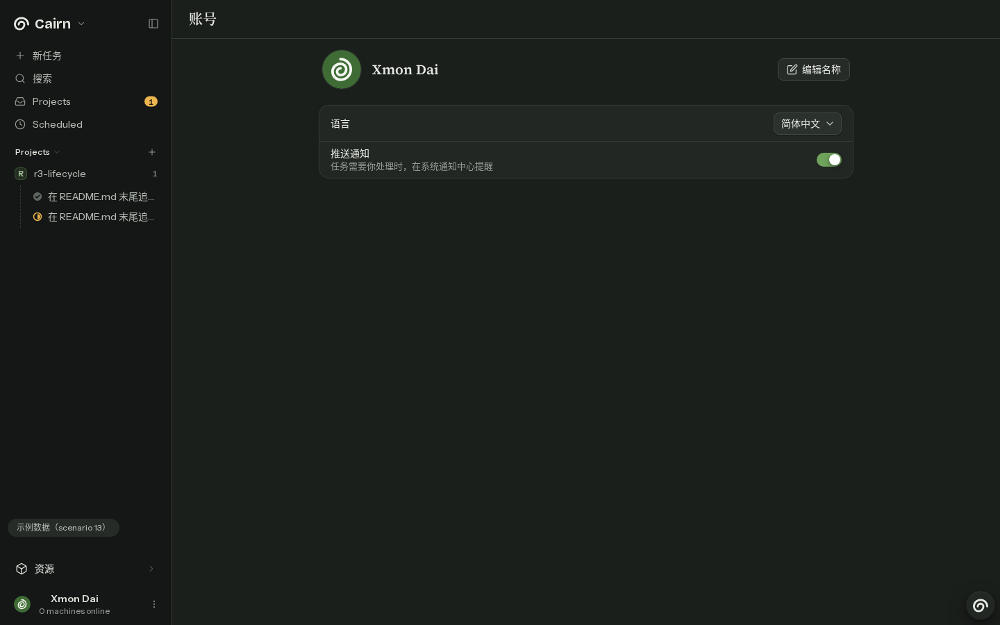
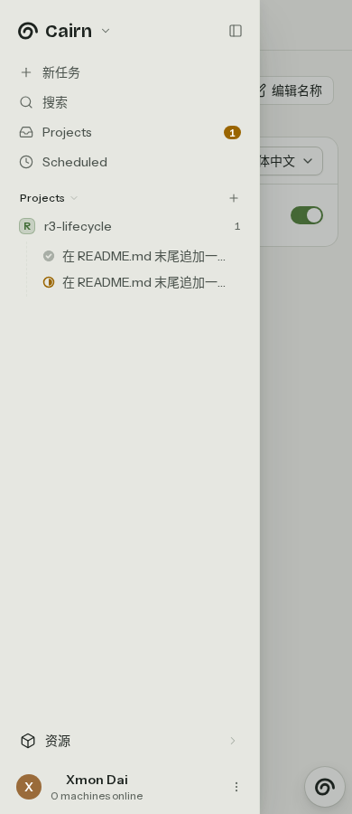
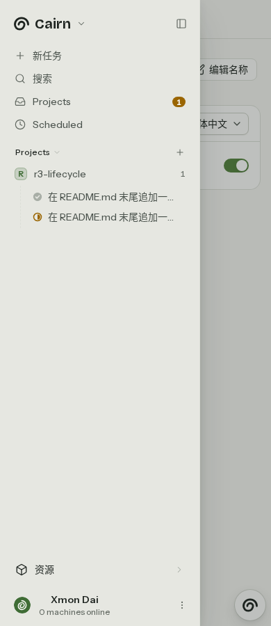
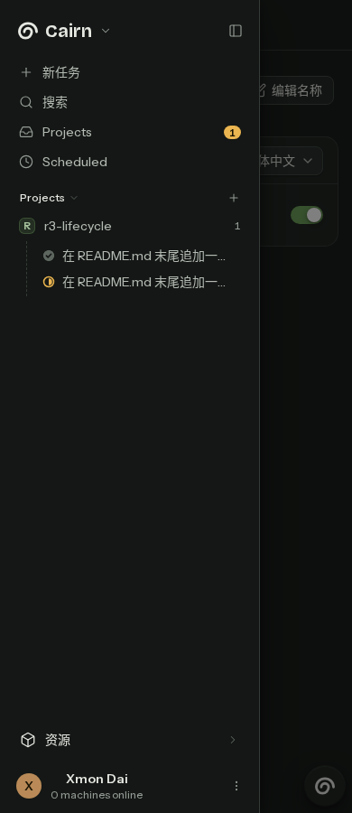
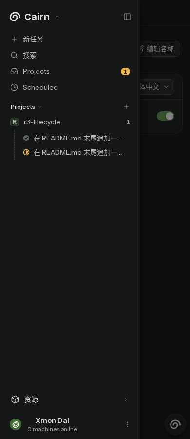

# Avatar consistency

Base: `3aea99f2`, branch `lane/2425`.

The account header and both sidebar modes now use the provider's user identity,
`SeededAvatar`, and `/avatar-user.png` fallback. Fixture name editing remains local;
it does not change the provider's avatar seed. The label-only account subtitle is removed.

## Screenshots

All screenshots use fixture scenario 13 at a height of 900px. The phone drawer is open.

| View | Before | After |
| --- | --- | --- |
| Desktop, light |  |  |
| Desktop, dark |  |  |
| Phone, light |  |  |
| Phone, dark |  |  |

## Regression evidence

The test was added before implementation. All four viewport/theme cases failed
because the expanded sidebar contained no image. A separate fixture-rename check
failed when the account avatar used the local edited name instead of the provider seed.

`apps/web/e2e/account-controls.spec.ts` checks loaded images and identical sources
at desktop and 390px widths in both themes. Stubbed live-session cases cover supplied,
missing, and broken avatar URLs, successful renames, and the collapsed rail. These
checks exercise browser rendering and stubbed session responses, not real authentication.

E2E runs use `flock /tmp/cairn-heavy.lock node scripts/heavy-slots.mjs run -- ...`
with the slot-generated Playwright config and standard fixture build. Playwright
owns and stops its preview server.

Open PRs #2357 and #2437 overlap `apps/web/src/board/sidebar.tsx`; this change only
adds the avatar prop there. Recent merged PRs #2385, #2361, #2359, and #2353 were
checked for overlap. The initial badge is replaced as requested by #2425; project,
snooze, navigation, and gallery functionality is preserved.

## Results

- Account controls: 15 passed, including all seven new avatar cases.
- Affected sidebar/account E2E selection: 290 passed across 33 specs.
- `flock /tmp/cairn-heavy.lock pnpm typecheck`: passed for all packages.
- `flock /tmp/cairn-heavy.lock node scripts/prepush-vitest.mjs`: 3 files, 45 tests passed.
- `pnpm lint`: passed with two existing informational diagnostics outside this change.
- `pnpm spec:parse`: passed.
- `node scripts/english-only-gate.mjs`: 0 lines.
- `node scripts/comment-discipline-gate.mjs`: 0 new comment lines.
- `git diff --check`: passed.
- `node scripts/single-use-helper-gate.mjs`: unavailable; the script does not exist in this checkout.

The default affected selection falls back to all 211 specs for the shell component
and gallery paths; the local affected run explicitly selected sidebar and account
source paths. The complete suite remains unverified locally. No code helpers or
comments were introduced. No push was performed. Per the task's sandbox instructions,
`COMMIT_MSG.txt` supplies the commit message for the external committer.
