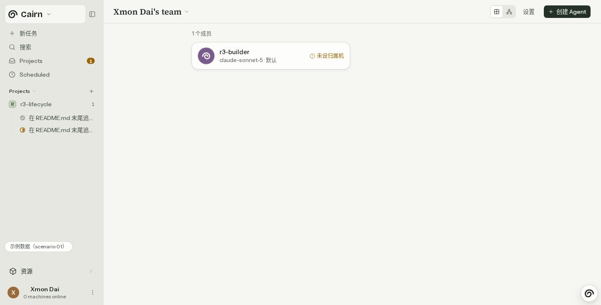
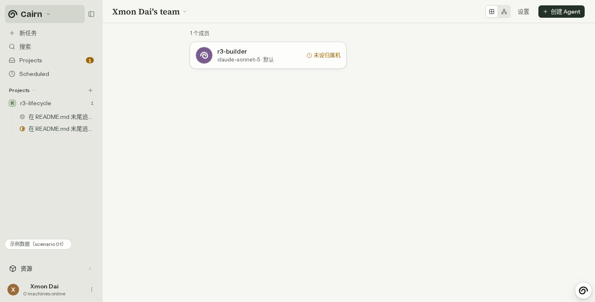
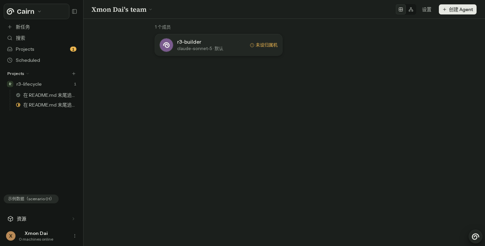
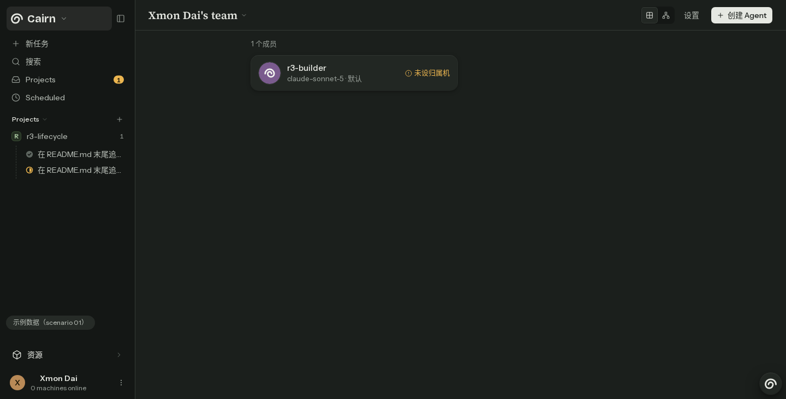
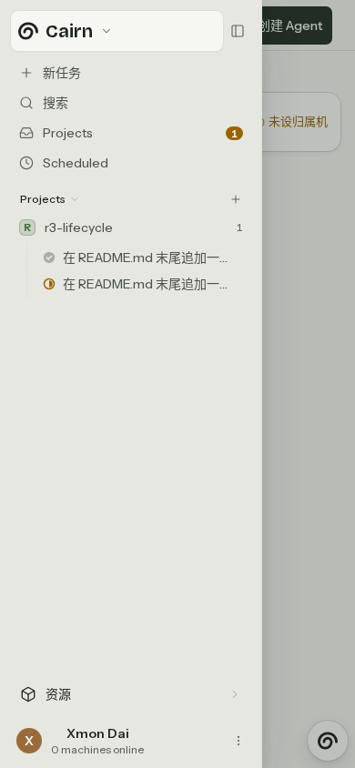
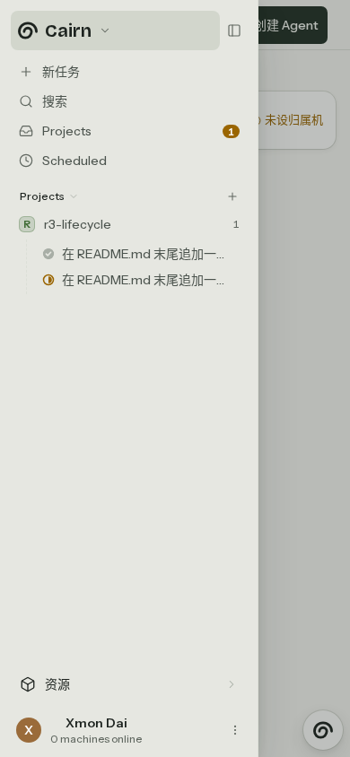
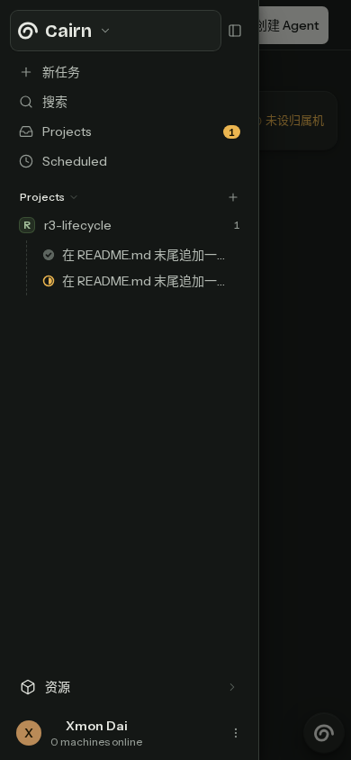
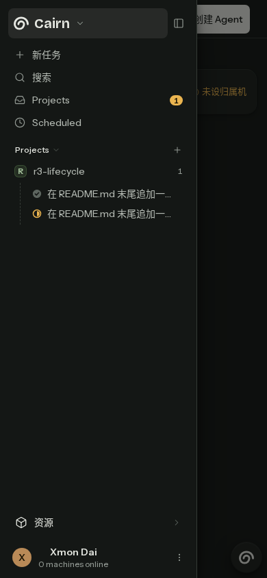

# Team brand active fill

Fixture evidence at `/app/team?scenario=01`, on the lane/2426 worktree based on
`df2121db`. The before images use the original production source; the after
images use the active-fill replacement. No live backend or provider is exercised.

The regression was written and run before the production change. All four
combinations failed on the computed background assertion: light returned
`rgb(246, 246, 242)` instead of `rgb(210, 214, 204)`; dark returned
`rgb(27, 31, 28)` instead of `rgba(230, 232, 226, 0.09)`.

Capture and regression command (set `TEAM_BRAND_CAPTURE=before` for the negative
control and `TEAM_BRAND_CAPTURE=after` for the fixed source):

```sh
TEAM_BRAND_CAPTURE=after flock /tmp/cairn-heavy.lock node scripts/heavy-slots.mjs run -- pnpm --filter @cairn/web exec playwright test e2e/sidebar-visual.spec.ts e2e/sidebar-nav.spec.ts e2e/sidebar-focus-ring.spec.ts
```

The new cases check idle and hover fill and absence of elevation, keyboard focus,
removal of selection after navigation, and search activation. Desktop additionally
checks that search clears the brand fill; mobile search closes the drawer.
Phone screenshots show the open drawer at 390 x 844; desktop is 1440 x 732.

Light desktop before:



Light desktop after:



Dark desktop before:



Dark desktop after:



Light phone before:



Light phone after:



Dark phone before:



Dark phone after:



Final focused result: 26 tests passed, including all four new regression cases.
`pnpm lint`, `pnpm typecheck`, and `pnpm spec:parse` passed. The English-only and
comment-discipline gates each reported 0. `git diff --check` passed.
The requested `scripts/single-use-helper-gate.mjs` is absent in this checkout;
its invocation failed with `MODULE_NOT_FOUND` and is not reported as a pass.

Open PRs #2357 and #2437 overlap `apps/web/src/board/sidebar.tsx`; their behavior
is preserved. Recently merged #2385 project-avatar changes are preserved.

`flock /tmp/cairn-heavy.lock node scripts/prepush-vitest.mjs` passed:
4 test files and 49 tests, with no unexpected failures.

`flock /tmp/cairn-heavy.lock node scripts/heavy-slots.mjs run -- pnpm --filter @cairn/web e2e:affected`
passed all 270 tests across 29 selected specs (1.5 minutes). All Playwright runs
completed and their managed web servers were stopped by the runner.
