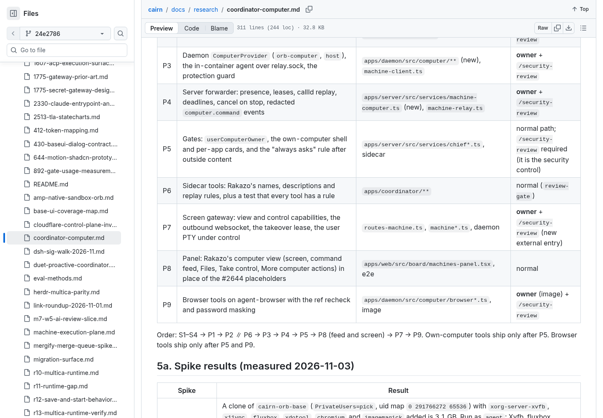
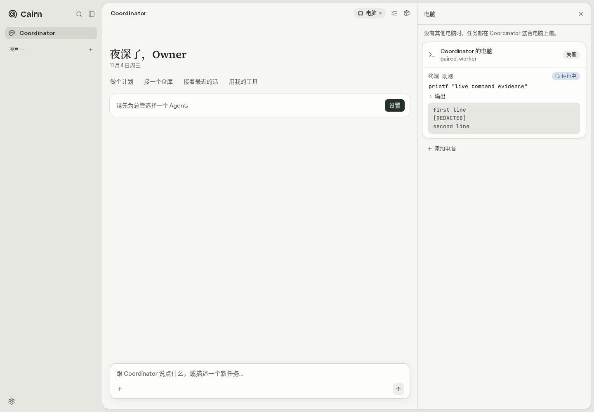
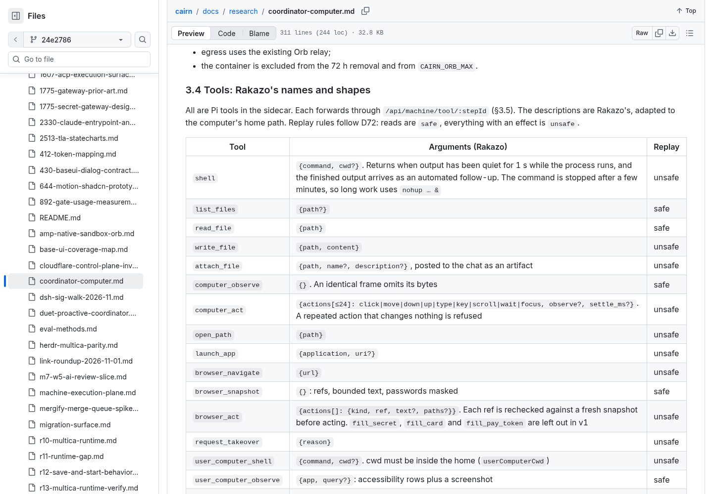
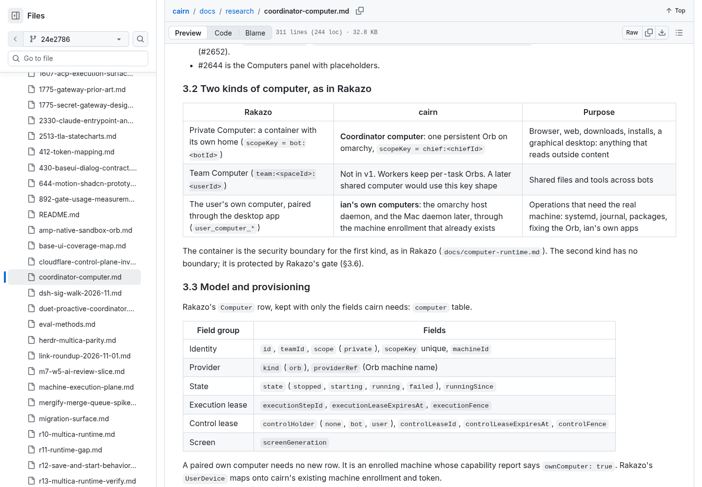
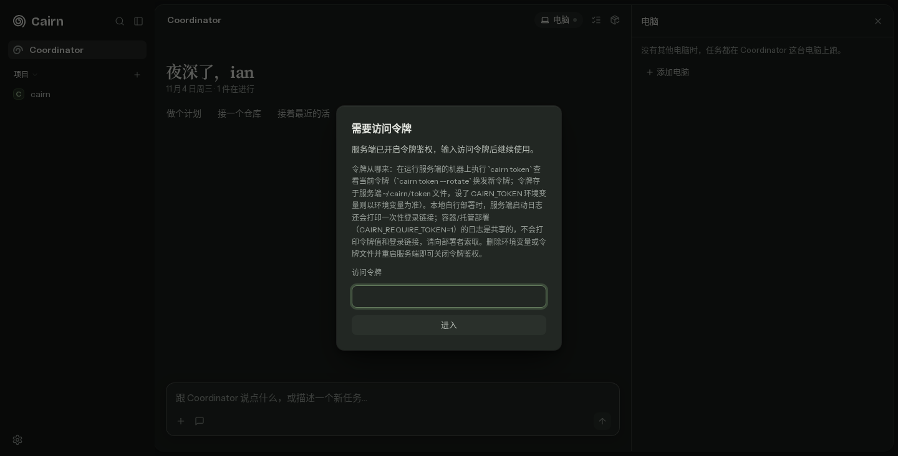
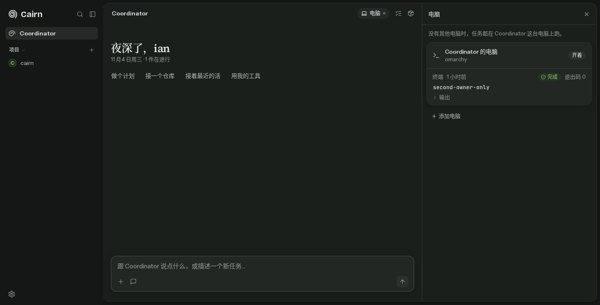
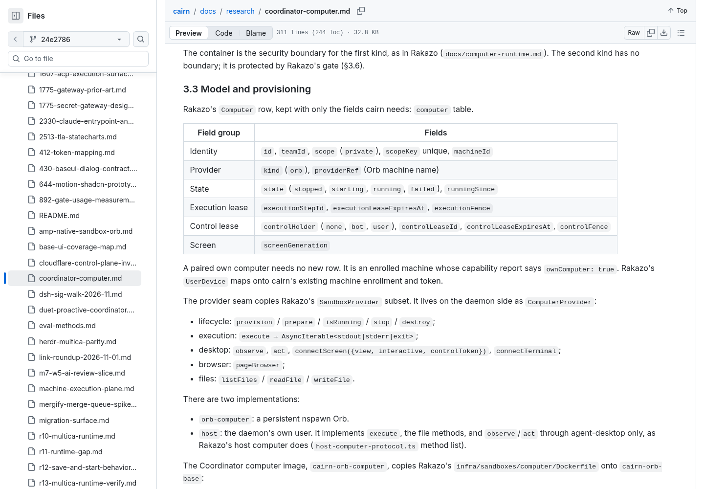
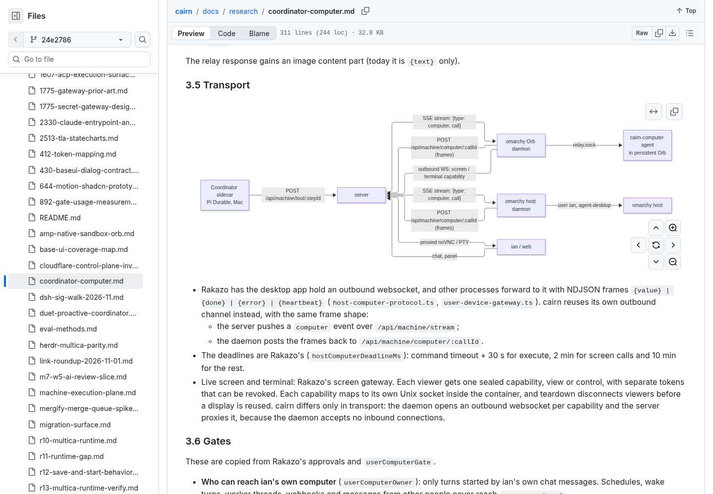
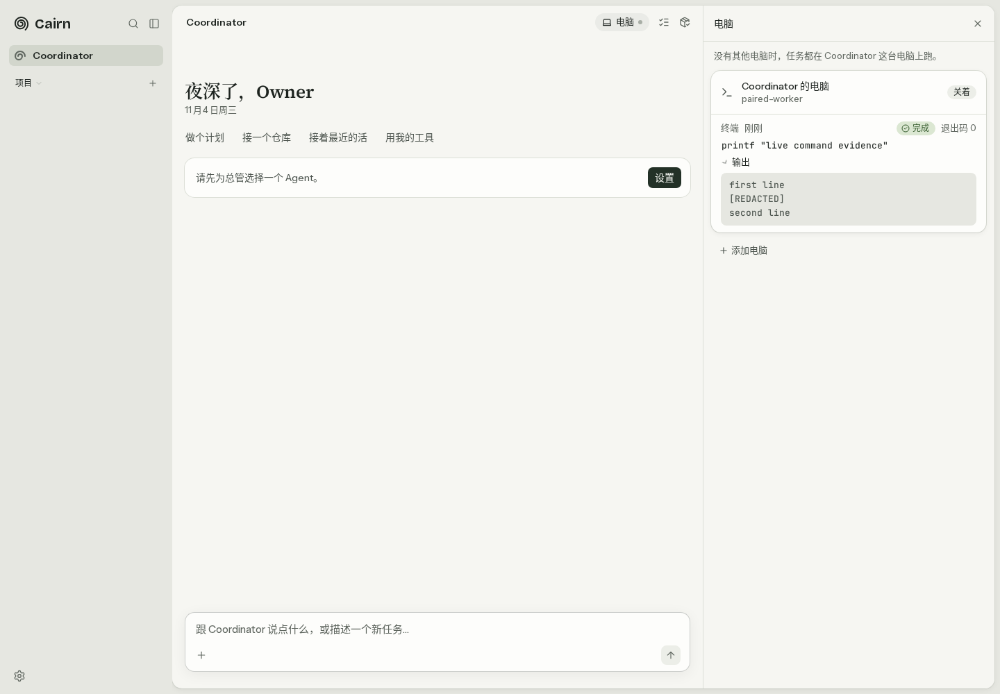
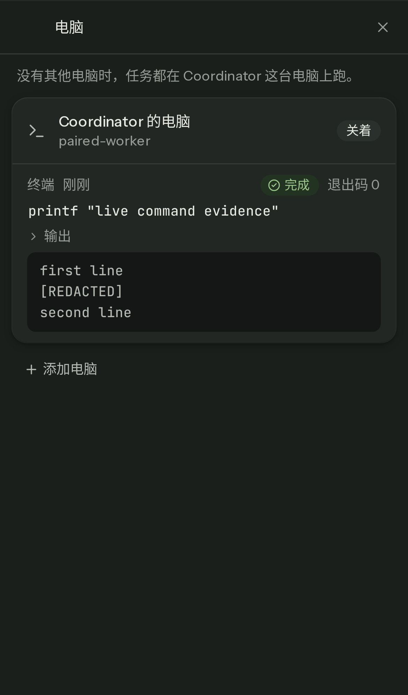

# D75 P8a requirement and running-product pairs

Implementation: `949642219ba49f5b3ca8905615906784b81823c0` (#2855, held).

The original requirement is the actual GitHub-rendered Preview of [coordinator-computer.md at immutable source commit 24e2786542c240fbd11ec986afd5945e5f3c1bc6](https://github.com/xiechimon/cairn/blob/24e2786542c240fbd11ec986afd5945e5f3c1bc6/docs/research/coordinator-computer.md), verified against the `docs/coordinator-computer` branch through GitHub's API.

REAL means the actual GitHub document or actual Cairn browser/server surface. SYNTHETIC daemon means real machine HTTP/SSE with an in-process fake execution boundary. MOCK REST/EventSource means the actual client and auth-gate code with browser-intercepted responses/events. UNCOVERED names an unmet or unproved requirement. No recreated HTML report is used.

| Original requirement screenshot and source | Running product screenshot | One-sentence check |
| --- | --- | --- |
|  [Original source](https://github.com/xiechimon/cairn/blob/24e2786542c240fbd11ec986afd5945e5f3c1bc6/docs/research/coordinator-computer.md#5-pr-list-and-order) |  | PARTIAL — The real 949 panel displays redacted output before completion over real REST/SSE with a synthetic daemon; actual provider execution remains uncovered. |
|  [Original source](https://github.com/xiechimon/cairn/blob/24e2786542c240fbd11ec986afd5945e5f3c1bc6/docs/research/coordinator-computer.md#34-tools-rakazos-names-and-shapes) |  | PARTIAL — The real 949 command entry shows shell command text and streaming output, while the documented quiet-return and automated follow-up tool semantics are outside this panel proof. |
|  [Original source](https://github.com/xiechimon/cairn/blob/24e2786542c240fbd11ec986afd5945e5f3c1bc6/docs/research/coordinator-computer.md#32-two-kinds-of-computer-as-in-rakazo) |   | PARTIAL — The actual client clears private history at the auth gate and retains only the replacement entry after a late old response under MOCK REST/EventSource; this is not proof of a real second-user login. |
|  [Original source](https://github.com/xiechimon/cairn/blob/24e2786542c240fbd11ec986afd5945e5f3c1bc6/docs/research/coordinator-computer.md#33-model-and-provisioning) |  | UNCOVERED — The actual 949 panel still shows `关着` while the command is `运行中`, so real provider lifecycle production and reporting remain unresolved. |
|  [Original source](https://github.com/xiechimon/cairn/blob/24e2786542c240fbd11ec986afd5945e5f3c1bc6/docs/research/coordinator-computer.md#35-transport) |  | PARTIAL — A synthetic daemon's real machine dispatch and posted frames drive the actual 949 panel, while the outbound screen and PTY path is not exercised here. |
|  [Original source](https://github.com/xiechimon/cairn/blob/24e2786542c240fbd11ec986afd5945e5f3c1bc6/docs/research/coordinator-computer.md#5-pr-list-and-order) |  | UNCOVERED — The actual 949 panel provides the command feed and does not yet provide a live screen, Files, Take control, or More computer actions. |
|  [Original source](https://github.com/xiechimon/cairn/blob/24e2786542c240fbd11ec986afd5945e5f3c1bc6/docs/research/coordinator-computer.md#5-pr-list-and-order) |  | ADDITIONAL — The actual 949 command feed fits real iPhone 13 emulation at width 390 with no horizontal overflow under real REST/SSE and a synthetic daemon; this checks layout, not the uncovered later P8 actions. |

The corrected capture records actual zero screen canvases and zero host screen cards instead of inventing a placeholder state, and `paired-capture.json` records the observed HTTP/API truth and PASS result for this limited capture scope. The cache boundary images were previously reviewed by the implementer and lane owner; they capture the actual client code subsequently committed as 949, with MOCK REST/EventSource, rather than an actual second-user server identity.

Backend Swagger/Postman requirement pairs for P7 and helper #2877 belong to the P7 evidence owner; this document does not substitute custom JSON screenshots for those interfaces. The requirement document was operated in GitHub Preview, but Rakazo's actual runtime UI was not operated, so no full visual-equivalence claim is made. The existing lifecycle and EVIDENCE-PENDING holds remain.
