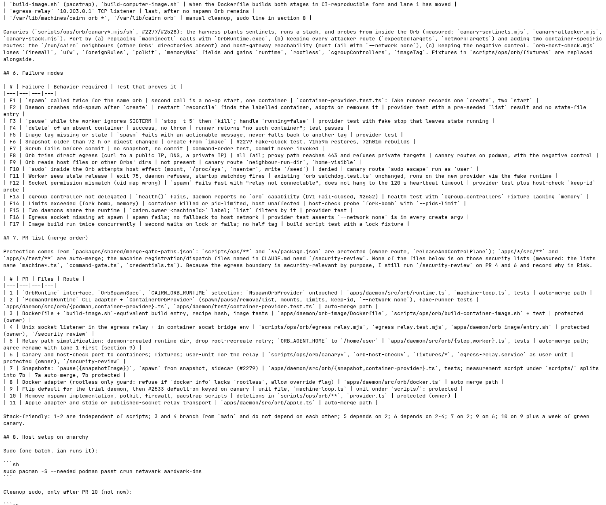
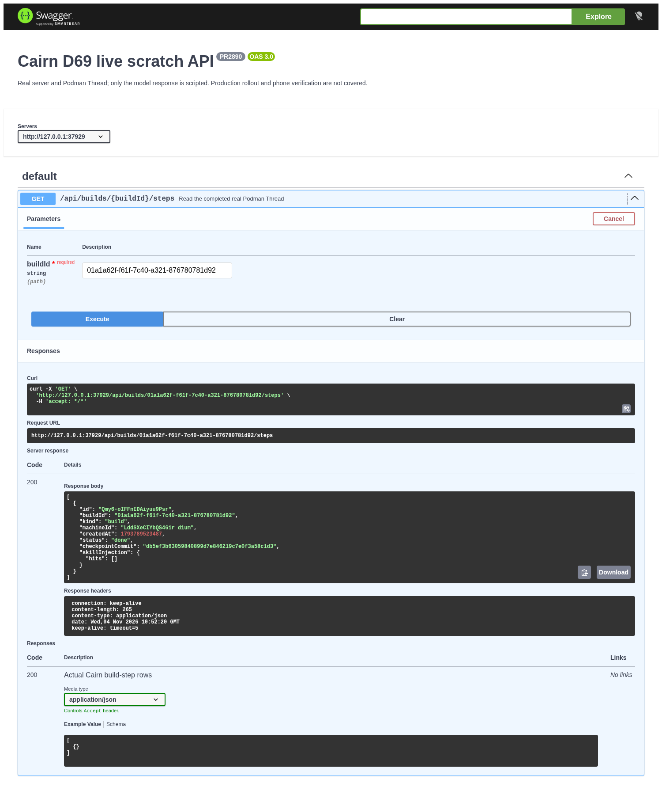

# D69 paired requirement and live API evidence

The screenshots show the original, unmodified requirement document and the actual Swagger UI request/response from a running isolated Cairn server after its real Podman Thread finished.

| Original requirement | Actual API-tool result | Check |
| --- | --- | --- |
|  [Original document](https://github.com/xiechimon/cairn/blob/3e1bde9971ce50552be344dd49396e82dbbd0a6c/docs/research/orb-container-runtime.md#6-failure-modes) |  | The real Podman Thread delivered a done build step through the actual API, while the same-run canary confirms blocked Orb routes and a leaking host negative control; only the model response is scripted, and production/phone acceptance remains uncovered. |

`capture.json` records the original URL and exact source SHA-256, HTTP method/path/status, and the verified Swagger UI v5.34.1 upstream commit/blob identities. Browser text was compared with the unchanged repository document before its screenshot. The Swagger UI assets came from the official upstream distribution; its index HTML is unchanged, and a small viewer specification describes the existing GET route. No response was mocked and no HTML report replaced the application/API tool.

`canary.json` is the successful complete result from the same scratch run. This API screenshot proves delivery, not every sandbox property by itself; filesystem, sudo, network and negative-control assertions are in that raw result and the implementation evidence under `docs/verify/d69-orb-containers/`.

The temporary API authorization was injected privately and did not appear in the screenshot. Cross-origin enforcement was disabled only for this isolated API-tool browser; product CORS was not evaluated. No production service was changed.

To reproduce, use `capture.mjs` with `VERIFY_REPO_ROOT` pointing to the built PR implementation checkout, `SWAGGER_UI_ASSETS_DIR` containing the exact upstream assets named in capture.json, and `VERIFY_EVIDENCE_DIR` pointing outside committed evidence. Set `XDG_RUNTIME_DIR`, `CAIRN_ORB_RUNTIME=podman`, the pinned image and a private dedicated relay socket as for the normal canary, then run the script through `cairn-heavy node`. It uses the real canary stack, reads only the newly recorded scratch server's ephemeral configuration and closes every scratch resource.
