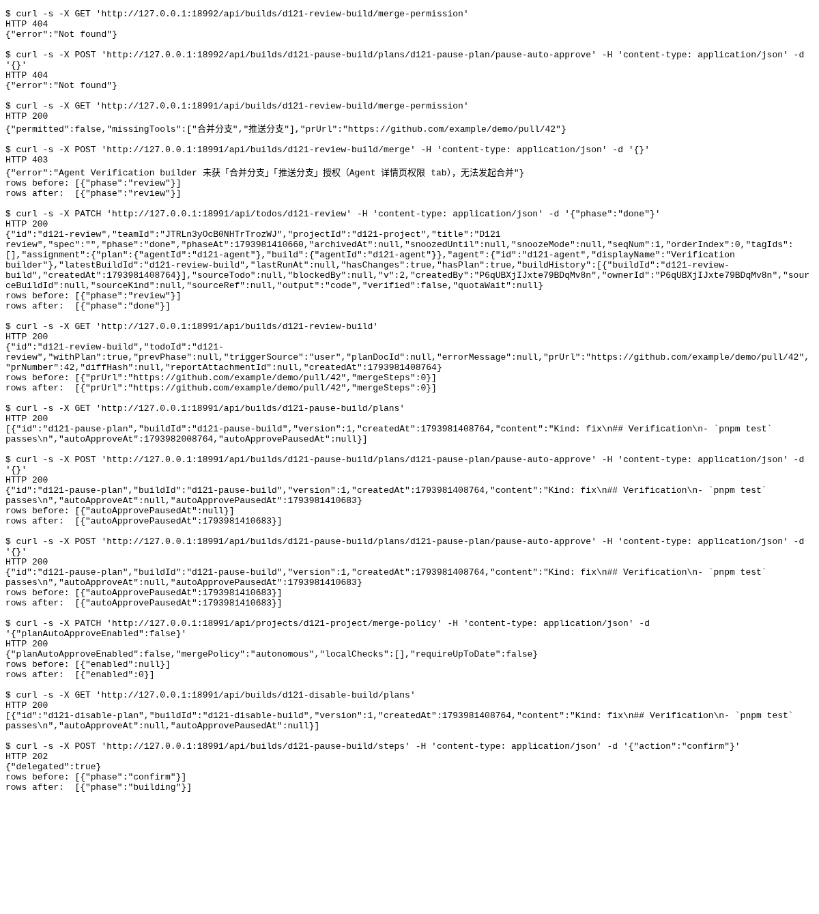

### Requests

| Clause | Request | Response | Rows before to after | ok |
|---|---|---|---|---|
| Before: no permission API | `GET /api/builds/d121-review-build/merge-permission` | `404` `{"error":"Not found"}` | n/a | yes |
| Before: no pause API | `POST /api/builds/d121-pause-build/plans/d121-pause-plan/pause-auto-approve` `{}` | `404` `{"error":"Not found"}` | n/a | yes |
| Read merge permission and PR URL | `GET /api/builds/d121-review-build/merge-permission` | `200` `{"permitted":false,"missingTools":["合并分支","推送分支"],"prUrl":"https://github.com/example/demo/pull/42"}` | n/a | yes |
| Merge still requires permission | `POST /api/builds/d121-review-build/merge` `{}` | `403` `{"error":"Agent Verification builder 未获「合并分支」「推送分支」授权（Agent 详情页权限 tab），无法发起合并"}` | 1 to 1 ({"phase":"review"}) | yes |
| Finish without merge | `PATCH /api/todos/d121-review` `{"phase":"done"}` | `200` `{"id":"d121-review","teamId":"JTRLn3yOcB0NHTrTrozWJ","projectId":"d121-project","title":"D121 review","spec":"","phas...` | 1 to 1 ({"phase":"done"}) | yes |
| PR retained; no merge step | `GET /api/builds/d121-review-build` | `200` `{"id":"d121-review-build","todoId":"d121-review","withPlan":true,"prevPhase":null,"triggerSource":"user","planDocId":...` | 1 to 1 ({"prUrl":"https://github.com/example/demo/pull/42","mergeSteps":0}) | yes |
| Plan exposes deadline | `GET /api/builds/d121-pause-build/plans` | `200` `[{"id":"d121-pause-plan","buildId":"d121-pause-build","version":1,"createdAt":1793981408764,"content":"Kind: fix\n## ...` | n/a | yes |
| Pause one plan | `POST /api/builds/d121-pause-build/plans/d121-pause-plan/pause-auto-approve` `{}` | `200` `{"id":"d121-pause-plan","buildId":"d121-pause-build","version":1,"createdAt":1793981408764,"content":"Kind: fix\n## V...` | 1 to 1 ({"autoApprovePausedAt":1793981410683}) | yes |
| Pause retry is stable | `POST /api/builds/d121-pause-build/plans/d121-pause-plan/pause-auto-approve` `{}` | `200` `{"id":"d121-pause-plan","buildId":"d121-pause-build","version":1,"createdAt":1793981408764,"content":"Kind: fix\n## V...` | 1 to 1 ({"autoApprovePausedAt":1793981410683}) | yes |
| Disable automatic plan approval | `PATCH /api/projects/d121-project/merge-policy` `{"planAutoApproveEnabled":false}` | `200` `{"planAutoApproveEnabled":false,"mergePolicy":"autonomous","localChecks":[],"requireUpToDate":false}` | 1 to 1 ({"enabled":0}) | yes |
| Disabled project has no deadline | `GET /api/builds/d121-disable-build/plans` | `200` `[{"id":"d121-disable-plan","buildId":"d121-disable-build","version":1,"createdAt":1793981408764,"content":"Kind: fix\...` | n/a | yes |
| Manual approval remains available | `POST /api/builds/d121-pause-build/steps` `{"action":"confirm"}` | `202` `{"delegated":true}` | 1 to 1 ({"phase":"building"}) | yes |
