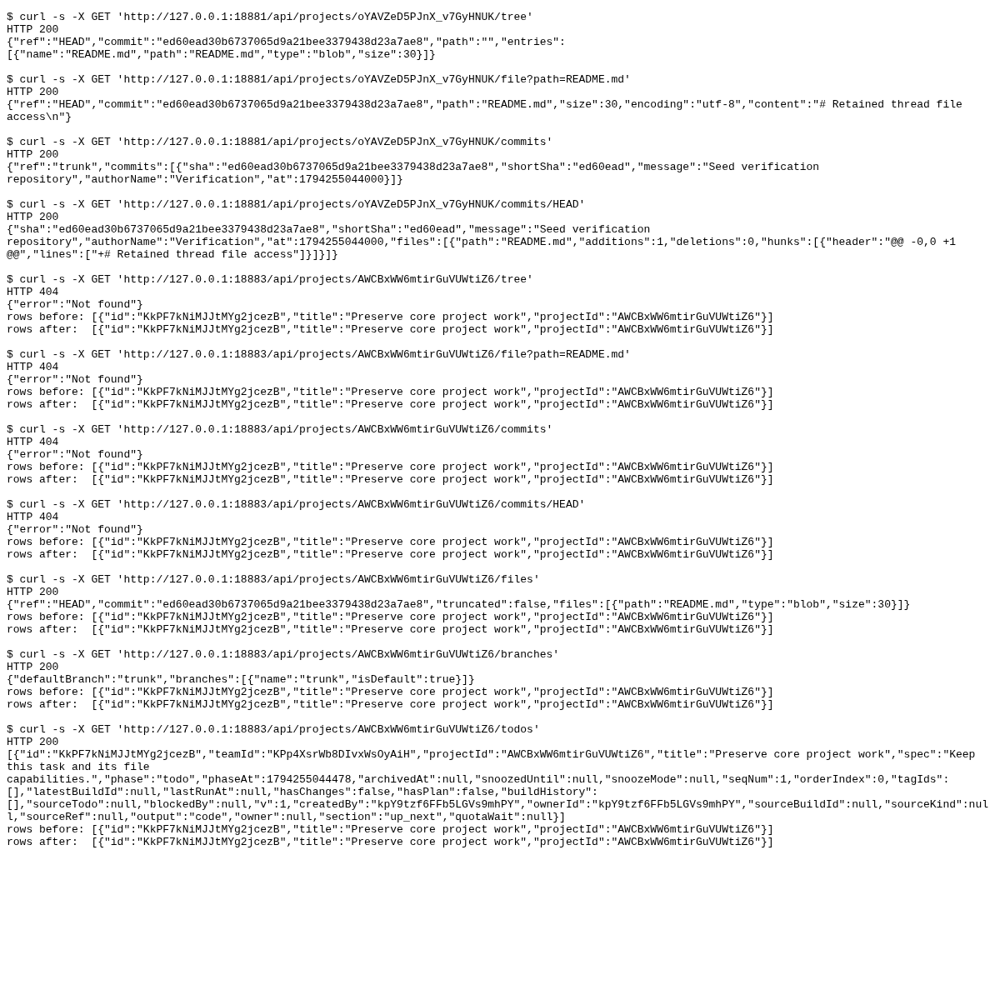

### Requests

| Clause | Request | Response | Rows before to after | ok |
|---|---|---|---|---|
| Before tree | `GET /api/projects/oYAVZeD5PJnX_v7GyHNUK/tree` | `200` `{"ref":"HEAD","commit":"ed60ead30b6737065d9a21bee3379438d23a7ae8","path":"","entries":[{"name":"README.md","path":"RE...` | n/a | yes |
| Before file | `GET /api/projects/oYAVZeD5PJnX_v7GyHNUK/file?path=README.md` | `200` `{"ref":"HEAD","commit":"ed60ead30b6737065d9a21bee3379438d23a7ae8","path":"README.md","size":30,"encoding":"utf-8","co...` | n/a | yes |
| Before commits | `GET /api/projects/oYAVZeD5PJnX_v7GyHNUK/commits` | `200` `{"ref":"trunk","commits":[{"sha":"ed60ead30b6737065d9a21bee3379438d23a7ae8","shortSha":"ed60ead","message":"Seed veri...` | n/a | yes |
| Before commits | `GET /api/projects/oYAVZeD5PJnX_v7GyHNUK/commits/HEAD` | `200` `{"sha":"ed60ead30b6737065d9a21bee3379438d23a7ae8","shortSha":"ed60ead","message":"Seed verification repository","auth...` | n/a | yes |
| Retired tree | `GET /api/projects/AWCBxWW6mtirGuVUWtiZ6/tree` | `404` `{"error":"Not found"}` | 1 to 1 ({"id":"KkPF7kNiMJJtMYg2jcezB","title":"Preserve core project work","projectId":"AWCBxWW6mt) | yes |
| Retired file | `GET /api/projects/AWCBxWW6mtirGuVUWtiZ6/file?path=README.md` | `404` `{"error":"Not found"}` | 1 to 1 ({"id":"KkPF7kNiMJJtMYg2jcezB","title":"Preserve core project work","projectId":"AWCBxWW6mt) | yes |
| Retired commits | `GET /api/projects/AWCBxWW6mtirGuVUWtiZ6/commits` | `404` `{"error":"Not found"}` | 1 to 1 ({"id":"KkPF7kNiMJJtMYg2jcezB","title":"Preserve core project work","projectId":"AWCBxWW6mt) | yes |
| Retired commits | `GET /api/projects/AWCBxWW6mtirGuVUWtiZ6/commits/HEAD` | `404` `{"error":"Not found"}` | 1 to 1 ({"id":"KkPF7kNiMJJtMYg2jcezB","title":"Preserve core project work","projectId":"AWCBxWW6mt) | yes |
| File mentions retained | `GET /api/projects/AWCBxWW6mtirGuVUWtiZ6/files` | `200` `{"ref":"HEAD","commit":"ed60ead30b6737065d9a21bee3379438d23a7ae8","truncated":false,"files":[{"path":"README.md","typ...` | 1 to 1 ({"id":"KkPF7kNiMJJtMYg2jcezB","title":"Preserve core project work","projectId":"AWCBxWW6mt) | yes |
| Branch settings retained | `GET /api/projects/AWCBxWW6mtirGuVUWtiZ6/branches` | `200` `{"defaultBranch":"trunk","branches":[{"name":"trunk","isDefault":true}]}` | 1 to 1 ({"id":"KkPF7kNiMJJtMYg2jcezB","title":"Preserve core project work","projectId":"AWCBxWW6mt) | yes |
| Project tasks retained | `GET /api/projects/AWCBxWW6mtirGuVUWtiZ6/todos` | `200` `[{"id":"KkPF7kNiMJJtMYg2jcezB","teamId":"KPp4XsrWb8DIvxWsOyAiH","projectId":"AWCBxWW6mtirGuVUWtiZ6","title":"Preserve...` | 1 to 1 ({"id":"KkPF7kNiMJJtMYg2jcezB","title":"Preserve core project work","projectId":"AWCBxWW6mt) | yes |
