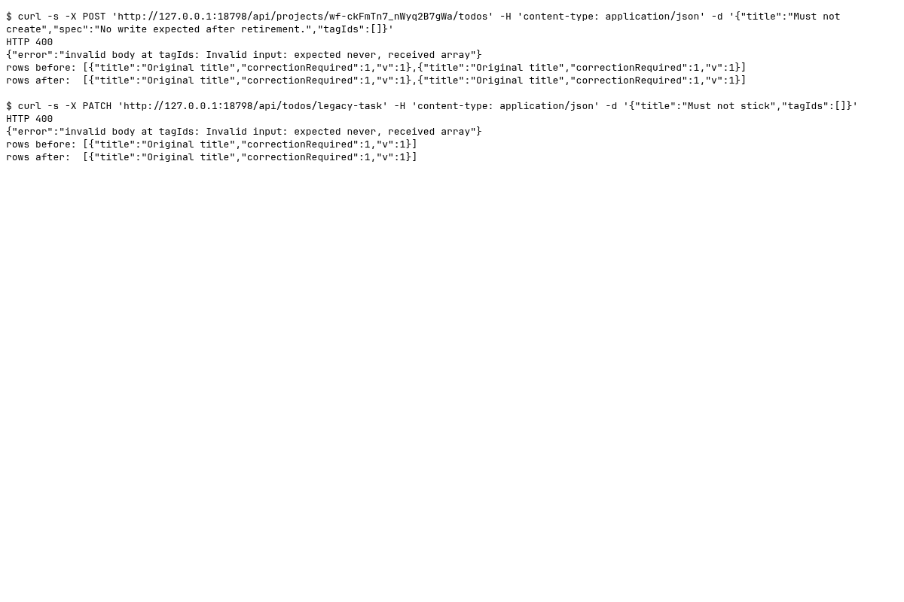

### Requests

Synthetic runtime identifiers are redacted from the generated text; screenshots contain only fresh fixture data.

| Clause | Request | Response | Rows before to after | ok |
|---|---|---|---|---|
| Category create retired | `POST /api/projects/<fixture-project>/todos` `{"title":"Must not create","spec":"No write expected after retirement.","tagIds":[]}` | `400` `{"error":"invalid body at tagIds: Invalid input: expected never, received array"}` | 2 to 2 ({"title":"Original title","correctionRequired":1,"v":1}) | yes |
| Category replacement retired | `PATCH /api/todos/legacy-task` `{"title":"Must not stick","tagIds":[]}` | `400` `{"error":"invalid body at tagIds: Invalid input: expected never, received array"}` | 1 to 1 ({"title":"Original title","correctionRequired":1,"v":1}) | yes |
