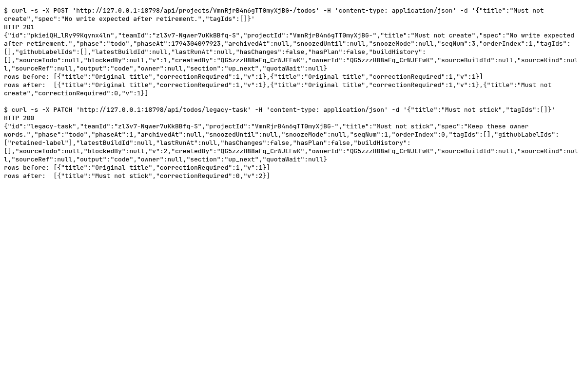

### Requests

Synthetic runtime identifiers are redacted from the generated text; screenshots contain only fresh fixture data.

| Clause | Request | Response | Rows before to after | ok |
|---|---|---|---|---|
| Before: category create allowed | `POST /api/projects/<fixture-project>/todos` `{"title":"Must not create","spec":"No write expected after retirement.","tagIds":[]}` | `201` `{"id":"<fixture-task>","teamId":"<fixture-team>","projectId":"<fixture-project>","title":"Must not ...` | 2 to 3 ({"title":"Original title","correctionRequired":1,"v":1}) | yes |
| Before: category replacement allowed | `PATCH /api/todos/legacy-task` `{"title":"Must not stick","tagIds":[]}` | `200` `{"id":"legacy-task","teamId":"<fixture-team>","projectId":"<fixture-project>","title":"Must not stick","sp...` | 1 to 1 ({"title":"Must not stick","correctionRequired":0,"v":2}) | yes |
