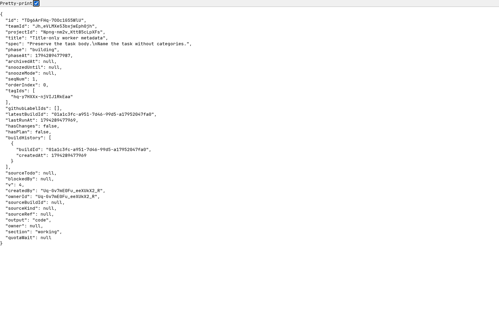

# Title-only ordinary worker metadata

Base: `98927e827213a392e5218132e1315514e0971eac` (#3836). Scope: the ordinary worker writer and its active contracts, under the [approved cutover](../../research/thread-category-runtime-cutover-3481.md). Generic REST/Coordinator/MCP writers, legacy storage/read fields and the final correction-baseline migration remain separate segments.

The screenshot is the isolated production server's actual task API response, not a fixture or fabricated page. It shows the updated title and retained legacy association. Private correction state is observed separately in SQLite.

## Failure controls and regression paths

Five tests failed against the base behavior: advertised category input, two ordinary/sealed stale-write cases and two daemon prompt contracts. The corrected fixture creates an actual `correction` category before testing classification; a fixed `bug` category alone does not imply a legacy correction requirement.

A separate real-SDK negative control confirmed that `createSdkMcpServer` with the raw-shape helper strips a stale `tag` before its handler. The production bridge now registers only ordinary title-only metadata with the SDK's object-schema API and passthrough validation. The canonical HTTP relay rejects the retained stale input; GitHub metadata and other host tools keep their existing handling. This is a thin bridge over the installed SDK, not a replacement MCP implementation.

| Path | Required observation | Regression |
|---|---|---|
| Ordinary claim | Only `title` advertised/required | `task-meta.test.ts`, `github-issues.test.ts` |
| Daemon instruction | Title summary without category input/vocabulary | `task-meta-prompt.test.ts`, `runner-issue-fence.test.ts`, `machine-step-exec.test.ts` |
| Direct machine relay | Retired `tag`/`tags`/`tagIds`, including null/empty/populated values, fail before writes | `task-meta.test.ts` |
| SDK tool invocation | Ordinary stale arguments reach canonical validation intact; GitHub names remain intact | `worker-meta-sdk.test.ts` |
| Ordinary title write | Version/title update; body, associations and correction state retained | `task-meta.test.ts` |
| Sealed owner request | Title, request and body preserved; stale inputs still rejected | `task-meta.test.ts` |
| Later implementation/review/verify | Naming refused and not advertised | `task-meta.test.ts` |
| GitHub labels/title finality | Dedicated labels, atomic invalid sets and imported-title rules unchanged | `github-issues.test.ts`, `github-writeback.test.ts` |
| Git release tags | Annotated Git creation/push preserved | `tag-tool.test.ts`, `runner-create-tag.test.ts` |

## Runtime evidence

[Result JSON](title-meta-live/result.json) records a separately spawned production `apps/server/src/index.ts`, a fresh scratch database and an enrolled machine token. Owner auth was off on loopback; machine calls used the enrolled credential, never recorded in evidence. Fixture setup installs an inert routing choice; no model or GitHub request is made.

The authenticated claim advertises only `title`. Twelve stale-argument HTTP cases return 400 with the complete task and generic links unchanged. Twelve real SDK MCP `tools/call` cases, over linked in-memory MCP transport and the actual production HTTP relay, also return errors/HTTP 400 with identical state. A valid SDK title-only call returns 200. SQL projection shows title/version changing while spec, request and `correctionRequired=1` remain; links remain identical and foreign-key checks are clean. The JSON also contains the executed daemon instruction composer output.

## Local checks

- 312 targeted tests / 16 files pass, including real SDK transport, claim/relay, owner protection, dedicated labels, correction, shared snapshots and Git release tags. Command: `pnpm exec vitest run <files in the table plus claude-t4-tools, claude-mcp-strict, ask-channel, correction-classification, github-label-state, shared task-meta and snapshot> --maxWorkers=4 --no-file-parallelism --testTimeout=120000`, with the lane's `CAIRN_TEST_TEMP_ROOT`.
- Scoped `pnpm --filter @cairn/web e2e:affected apps/server/src/services/machine-relay.ts apps/web/e2e/home-composer-new-task.spec.ts apps/web/e2e/project-github-issues.spec.ts apps/web/e2e/github-issue-writeback.spec.ts`: 33 pass. The shared protocol file selects a full fallback, intentionally left to CI rather than running the full local suite.
- The broader daemon changed selection exposed one obsolete positive `bug` prompt assertion in `machine-step-exec.test.ts`; the initial CI head independently caught the same assertion. It now pins absence of category inputs/vocabulary in the actual machine-loop injected prompt. A subsequent broader run had 2502 passes, one expected failure and a workspace `beforeEach` 10-second setup timeout; that unchanged file passes all 30 cases on a focused rerun. The broad run is not claimed green.
- Lint, typecheck, spec parsing, prepush and verification registry/self-test pass. Regenerated feature maps accurately separate staged category APIs from Git release tags.

Limits: the HTTP/SDK path uses an enrolled test client, not a real model or Claude CLI process. Browser regressions are fixture evidence, not a real-provider claim. Sealed-owner behavior is covered by isolated route regressions, not the separate production-entry-point probe. No UI layout, database schema, dependency or correction-provenance migration is changed. Deploy server and daemon together; code rollback retains all legacy data.
