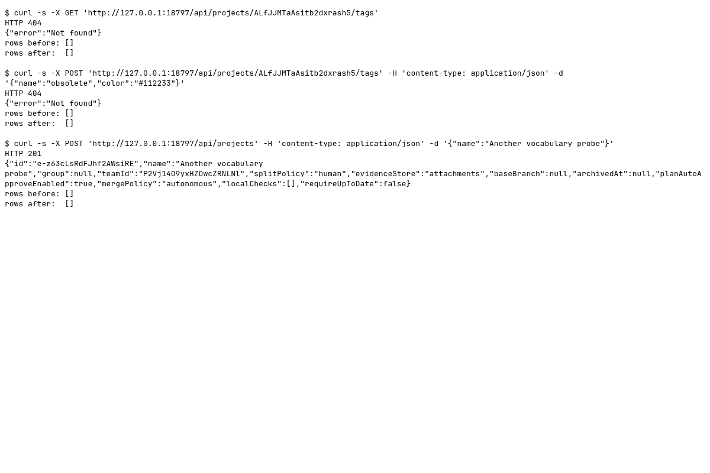

### Requests

Synthetic runtime identifiers are redacted from the generated text; screenshots contain only freshly generated fixture data.

| Clause | Request | Response | Rows before to after | ok |
|---|---|---|---|---|
| Vocabulary read retired | `GET /api/projects/<fixture-project-1>/tags` | `404` `{"error":"Not found"}` | 0 to 0 | yes |
| Vocabulary write retired | `POST /api/projects/<fixture-project-1>/tags` `{"name":"obsolete","color":"#112233"}` | `404` `{"error":"Not found"}` | 0 to 0 | yes |
| Project creation without category seeds | `POST /api/projects` `{"name":"Another vocabulary probe"}` | `201` `{"id":"<fixture-project-2>","name":"Another vocabulary probe","group":null,"teamId":"<fixture-team>","splitP...` | 0 to 0 | yes |
