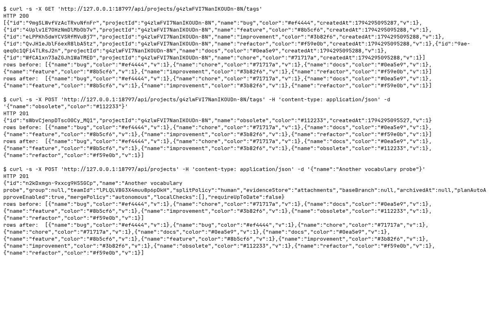

### Requests

Synthetic runtime identifiers are redacted from the generated text; screenshots contain only freshly generated fixture data.

| Clause | Request | Response | Rows before to after | ok |
|---|---|---|---|---|
| Before: vocabulary route | `GET /api/projects/<fixture-project-1>/tags` | `200` `[{"id":"<fixture-label-1>","projectId":"<fixture-project-1>","name":"bug","color":"#ef4444","createdAt":1794295...` | 6 to 6 ({"name":"bug","color":"#ef4444","v":1}) | yes |
| Before: category creation | `POST /api/projects/<fixture-project-1>/tags` `{"name":"obsolete","color":"#112233"}` | `201` `{"id":"<fixture-label-2>","projectId":"<fixture-project-1>","name":"obsolete","color":"#112233","createdAt":179...` | 6 to 7 ({"name":"bug","color":"#ef4444","v":1}) | yes |
| Before: automatic project seeds | `POST /api/projects` `{"name":"Another vocabulary probe"}` | `201` `{"id":"<fixture-project-2>","name":"Another vocabulary probe","group":null,"teamId":"<fixture-team>","splitP...` | 7 to 13 ({"name":"bug","color":"#ef4444","v":1}) | yes |
