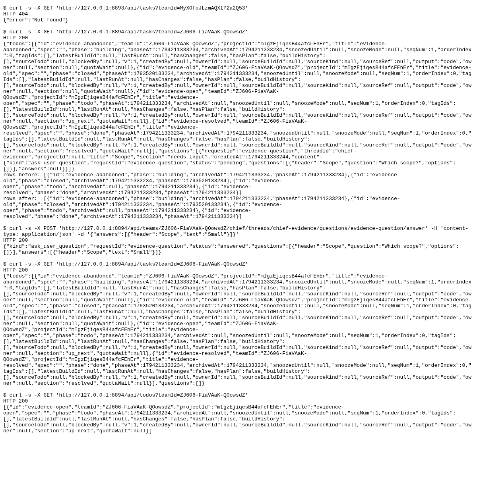

### Requests

| Clause | Request | Response | Rows before to after | ok |
|---|---|---|---|---|
| Before: main has no combined Tasks read | `GET /api/tasks?teamId={team}` | `404` `{"error":"Not found"}` | n/a | yes |
| One read: open, recent archived, null sections and standalone question | `GET /api/tasks?teamId={team}` | `200` `{"todos":[{"id":"evidence-abandoned","teamId":"ZJ606-FiaVAaK-QOowsdZ","projectId":"mIgzEjiqesB44afcFEhEr","title":"ev...` | 4 to 4 ({"id":"evidence-abandoned","phase":"building","archivedAt":1794211333234,"phaseAt":1794211) | yes |
| Answer standalone question | `POST /api/teams/{team}/chief/threads/chief-evidence/questions/evidence-question/answer` `{"answers":[{"header":"Scope","text":"Small"}]}` | `200` `{"kind":"ask_user_question","requestId":"evidence-question","status":"answered","questions":[{"header":"Scope","quest...` | n/a | yes |
| Answered question leaves Tasks | `GET /api/tasks?teamId={team}` | `200` `{"todos":[{"id":"evidence-abandoned","teamId":"ZJ606-FiaVAaK-QOowsdZ","projectId":"mIgzEjiqesB44afcFEhEr","title":"ev...` | n/a | yes |
| Existing todo list remains an array of unarchived tasks | `GET /api/todos?teamId={team}` | `200` `[{"id":"evidence-open","teamId":"ZJ606-FiaVAaK-QOowsdZ","projectId":"mIgzEjiqesB44afcFEhEr","title":"evidence-open","...` | n/a | yes |
