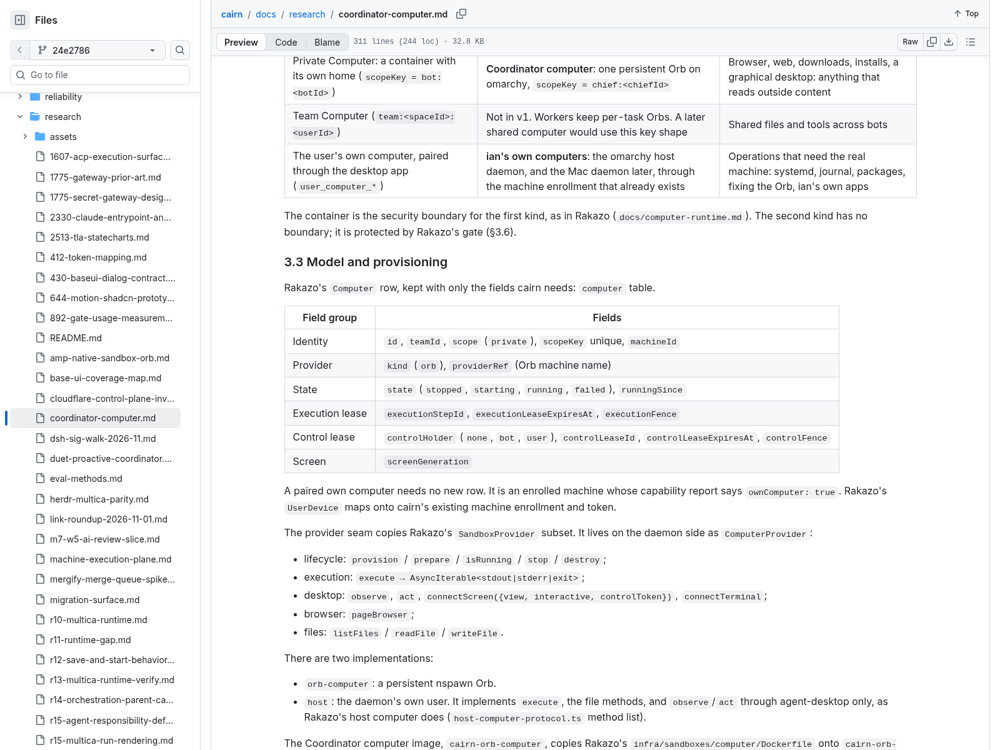
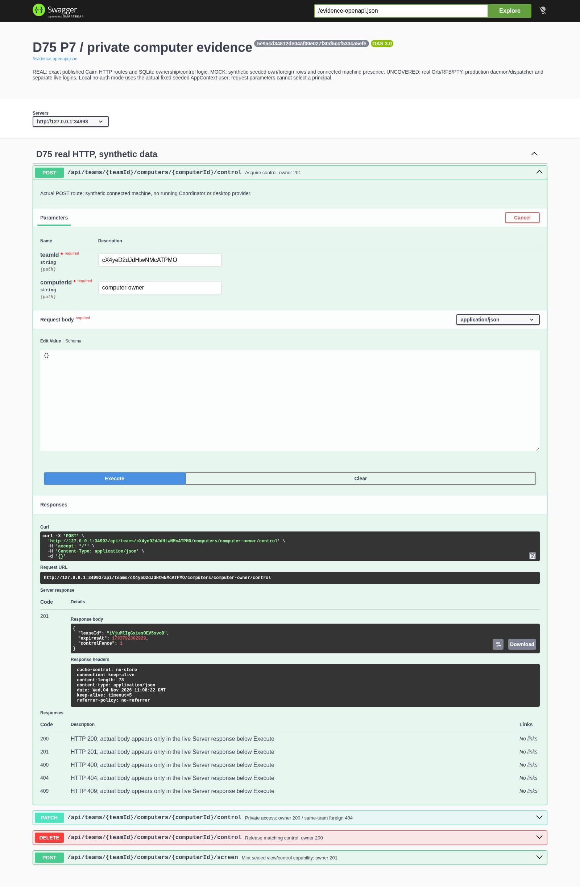
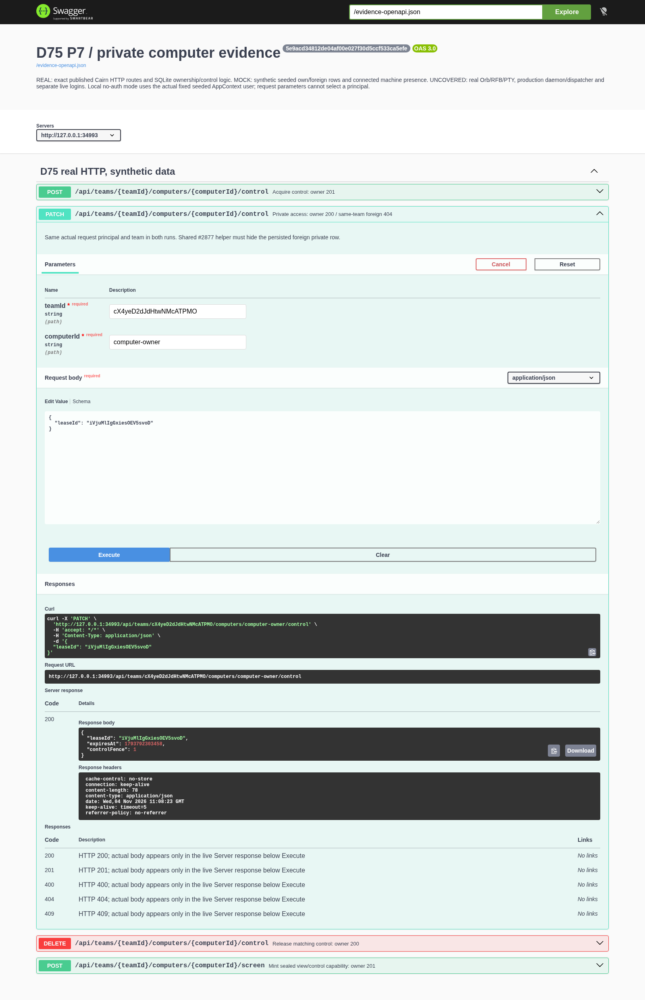
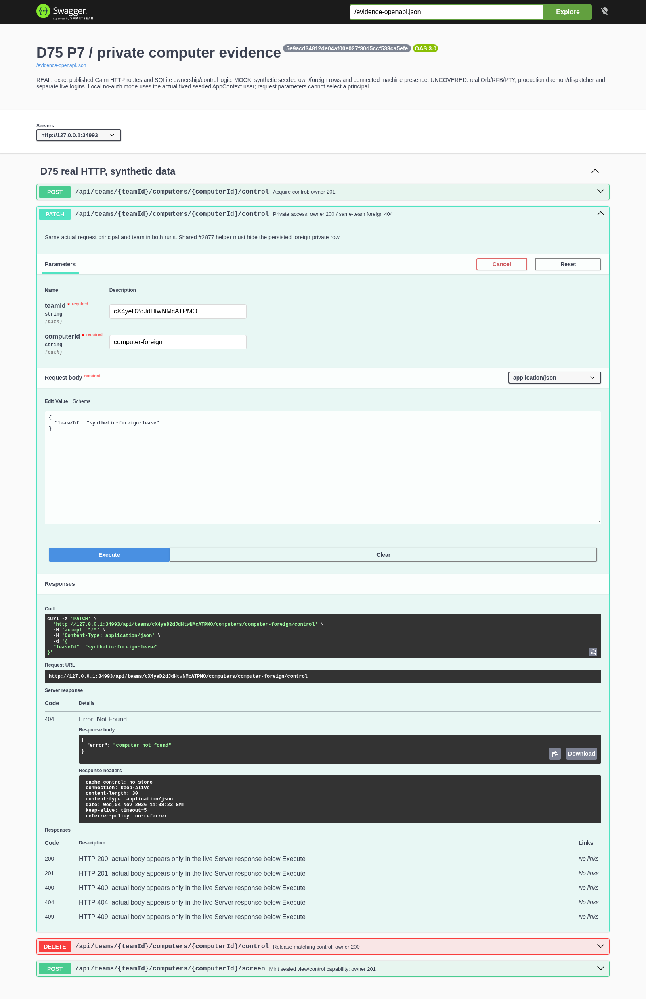
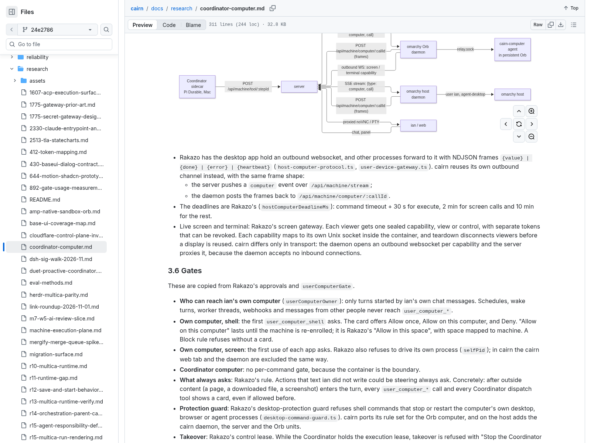
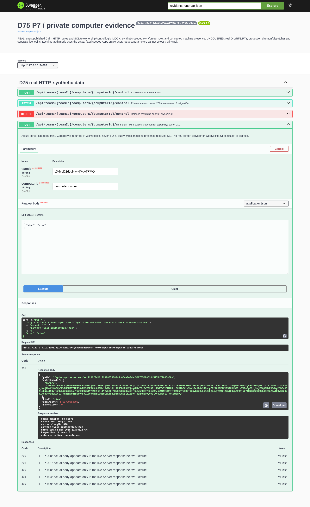
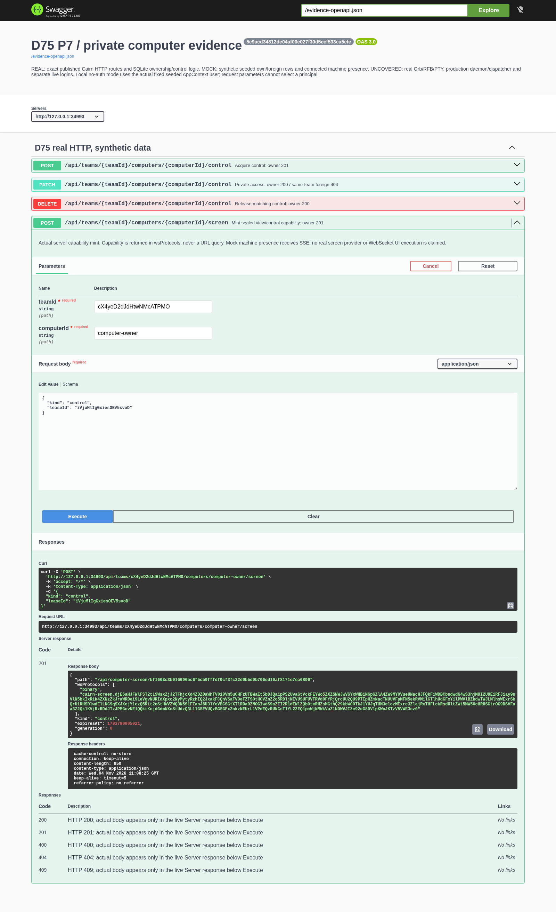
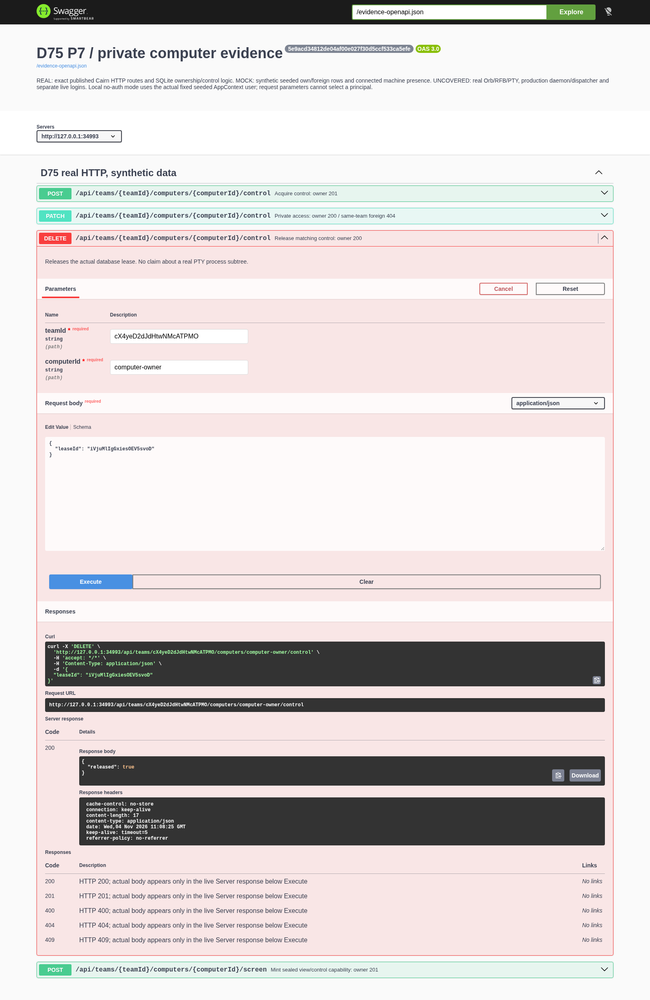
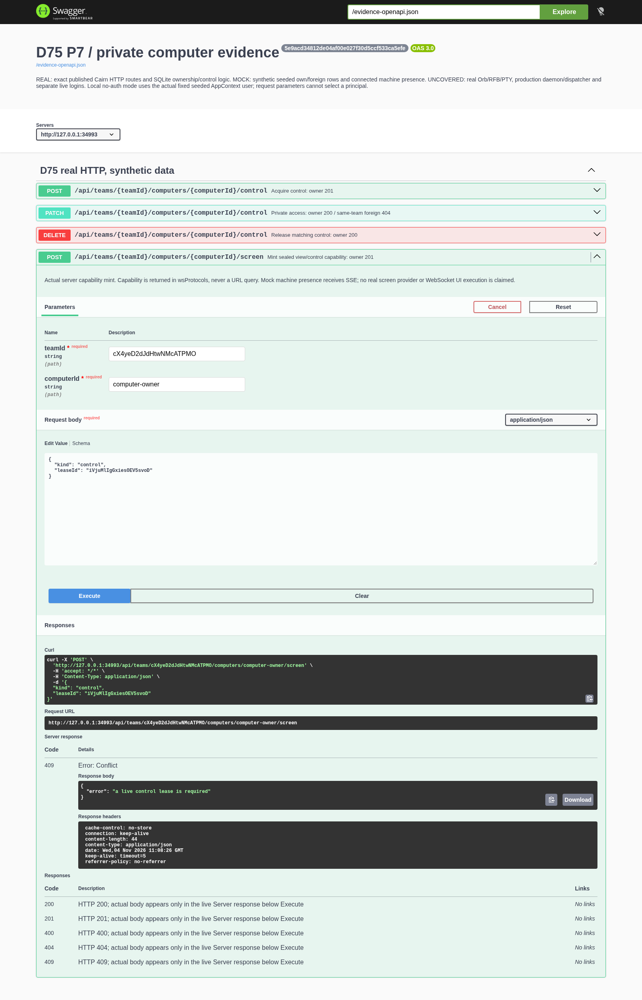

# D75 backend paired screenshot evidence

Implementation: `5e9acd34812de04af00e027f30d5ccf533ca5efe`; helper prerequisite: `413c40a813327ad1c77dff10717a1d67e3258d61`.

Official Swagger UI5.34.1 made all seven HTTP requests against one actual isolated Cairn server and database. The two original screenshots are the real GitHub-rendered document at a pinned commit; they are reused without alteration.

REAL: route handlers, HTTP request/response, SQLite ownership/control logic, capability mint. MOCK: synthetic own/foreign user/chief/computer rows and connected machine presence/SSE sink. The server uses the fixed seeded AppContext user in local no-auth mode; these images do not prove separate live logins.

| Original requirement | Actual official Swagger request/response | One-sentence check |
| --- | --- | --- |
| [Original source](https://github.com/xiechimon/cairn/blob/24e2786542c240fbd11ec986afd5945e5f3c1bc6/docs/research/coordinator-computer.md#32-two-kinds-of-computer-as-in-rakazo)  |  [Actual network JSON](swagger-control-acquire-201.json) | The actual owner acquires one user-control lease while synthetic machine presence is connected. |
| [Original source](https://github.com/xiechimon/cairn/blob/24e2786542c240fbd11ec986afd5945e5f3c1bc6/docs/research/coordinator-computer.md#32-two-kinds-of-computer-as-in-rakazo)  |  [Actual network JSON](swagger-private-owner-200.json) | The current seeded owner renews its own persisted private computer lease through the shared access helper. |
| [Original source](https://github.com/xiechimon/cairn/blob/24e2786542c240fbd11ec986afd5945e5f3c1bc6/docs/research/coordinator-computer.md#32-two-kinds-of-computer-as-in-rakazo)  |  [Actual network JSON](swagger-private-foreign-404.json) | The same principal and team cannot renew a known same-team foreign private row, even with its fixture lease identifier. |
| [Original source](https://github.com/xiechimon/cairn/blob/24e2786542c240fbd11ec986afd5945e5f3c1bc6/docs/research/coordinator-computer.md#35-transport)  |  [Actual network JSON](swagger-view-capability-201.json) | The actual server mints a sealed view capability in wsProtocols while the URL has no query bearer. |
| [Original source](https://github.com/xiechimon/cairn/blob/24e2786542c240fbd11ec986afd5945e5f3c1bc6/docs/research/coordinator-computer.md#35-transport)  |  [Actual network JSON](swagger-control-capability-201.json) | The actual server mints a distinct control capability only with the matching live user lease. |
| [Original source](https://github.com/xiechimon/cairn/blob/24e2786542c240fbd11ec986afd5945e5f3c1bc6/docs/research/coordinator-computer.md#32-two-kinds-of-computer-as-in-rakazo)  |  [Actual network JSON](swagger-control-release-200.json) | The actual owner releases the lease; a real PTY teardown is outside this synthetic provider run. |
| [Original source](https://github.com/xiechimon/cairn/blob/24e2786542c240fbd11ec986afd5945e5f3c1bc6/docs/research/coordinator-computer.md#32-two-kinds-of-computer-as-in-rakazo)  |  [Actual network JSON](swagger-released-control-refused-409.json) | A released lease cannot mint another control capability; the actual server refuses it with HTTP 409. |

Uncovered: real Orb/RFB/PTY provider; full Takeover gate screenshot against active bot execution; production daemon/dispatcher; separate live logins; computerCallOwnerUserId event-audience consumer is outside these P7 HTTP captures; P8 owns its runtime evidence; WebSocket replay/Origin screenshots: Swagger UI is an HTTP client; no invented WS operation is added.

The original private-scope/control fields shown are in sections3.2–3.3; section3.4 is the tool table. The transport screenshot shows the actual sealed view/control capability paragraph in section3.5. The full Takeover gate screenshot remains uncovered.

Every request screenshot shows the actual request body, curl/URL and Server response; static OpenAPI response descriptions are not presented as runtime proof. Image and JSON hashes are recorded in manifest.json. Browser/server/database/temp cleanup completed. No homemade HTML report or Notion write was used. The isolated server is closed; all capability outputs and identities are synthetic and no production credentials or data are included.

Only this README, pairs.json, manifest.json, openapi.json, the two requirement PNGs and the seven named Swagger PNG/JSON pairs are the valid local evidence set. Prior-run and failure artifacts are diagnostics and must not be embedded as successful proof.

The shared access helper is byte-identical at commits `413c40a813327ad1c77dff10717a1d67e3258d61` and `5e9acd34812de04af00e027f30d5ccf533ca5efe` (Git blob `fa3b1884715c9f8039a6bc7ea27079ae9632b57b`), and the prerequisite is an ancestor of the tested gateway head.
