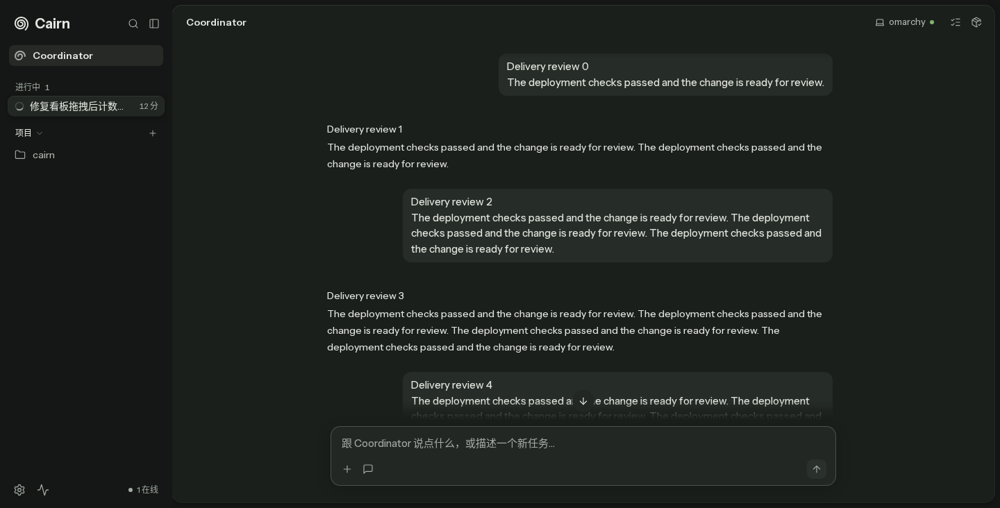
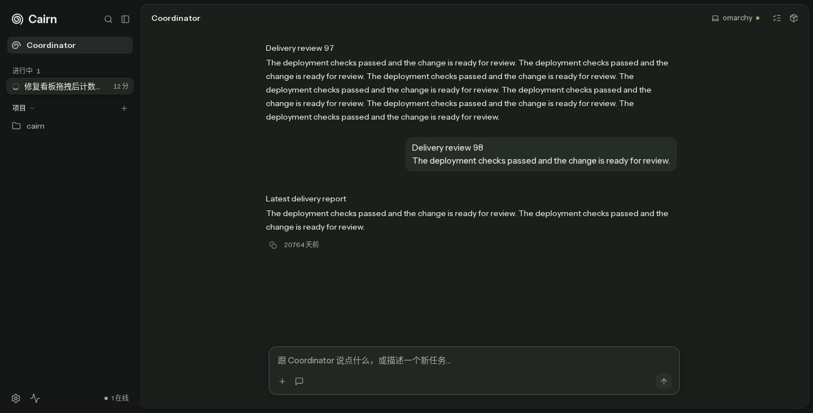
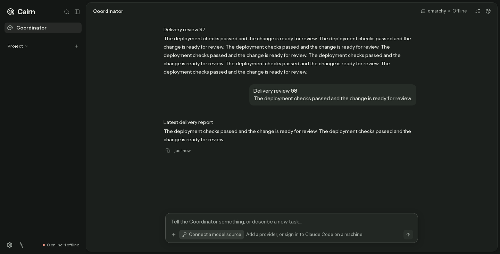
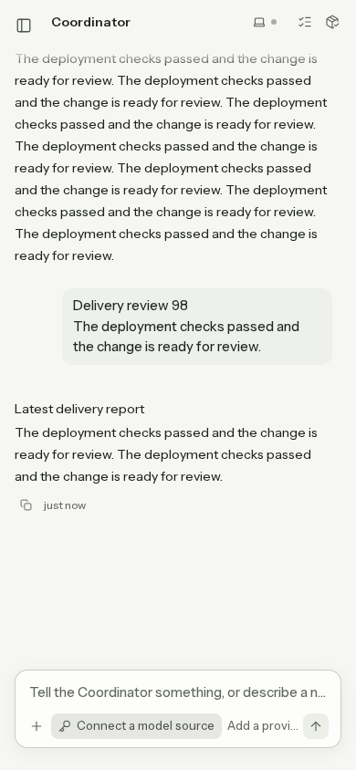

# Instant jump to latest

## UI brief

Surface: Coordinator conversation. Goal: respond immediately when the reader clicks the down arrow after scrolling up. This fixes an existing interaction; no new page draft is needed.

Reference: [Claude.ai jump control](../../design/references/coordinator-chat/claude-ai-reply-jump-to-latest.jpg), opened before implementation. Preserve its quiet, floating placement above the composer. A still reference establishes placement, not timing.

Checked rules: P1, P3, P4, P5, C3, C11, V1. The owner's explicit instant-motion requirement overrides the older motion slot in DESIGN.md.

| Component / state | Coverage |
| --- | --- |
| Jump control / long history, active then hidden | 100 seeded messages, more than five viewports; before and after screenshots below |
| Pointer hover and press | Computed transition duration; real pointer down and up |
| Enter and Space | Native keyboard activation; bottom, latest row and hidden button sampled at 100–150ms |
| Reduced motion | Same regression with reduced motion enabled |
| 390px / light | Same history, deadline, visibility and horizontal overflow assertions, with 4x CPU throttling to expose delayed lazy layout |
| 1440px / dark | Main before/after evidence |
| Empty, loading, error, offline, pending question | No new behavior for these states; not separately captured |

## Evidence

The before and after images are screenshots of the running compiled web app with mocked HTTP/SSE data, not a live-provider run. The test samples browser state on the first animation frame at or after 100ms, then takes the screenshot. Screenshot capture itself has additional latency.

| Before | After |
| --- | --- |
|  |  |
| At the sample: 10,885px from bottom; latest row absent; arrow opaque. Eventually stopped 2,280px short. | By 150ms: gap <=2px, latest row visible, arrow opacity 0. Still at bottom after another 250ms. |

| State | Reference | Ours | Verdict |
| --- | --- | --- | --- |
| Scrolled away | [Claude.ai](../../design/references/coordinator-chat/claude-ai-reply-jump-to-latest.jpg) | [Before](before-100ms.png) | Floating down arrow retains its placement above the composer. |
| Returned to latest | The reference has no returned-to-bottom frame. | [After](after-100ms.png) | Latest reply visible and arrow hidden; timing is established by browser assertions. |

Coordinator currently renders its rows with `contentVisibility: visible`. The regression explicitly seeds `auto` on those rows to exercise estimated-height changes without changing the product's row policy. It does not measure every row before jumping.

The installed `@shadcn/react@0.3.1` types accept `ScrollBehavior`, and its implementation forwards behavior to `viewport.scrollTo` while retaining follow-bottom mode. The activation uses `instant`. It also retains explicit follow intent and corrects the true bottom on scroll, content resize and mutation notifications until wheel, touch, keyboard or pointer input in the viewport cancels it. This covers lazy layout shifts that the registry follow state alone misses, without a timer or animation loop. The shared thread-transcript jump button gets the same behavior. Send and thread-open paths already use the API's default behavior and are unchanged. The pristine registry file and lockfile are unchanged.

## Live stack cross-check

A separate verify-cairn server and Vite instance used an isolated scratch SQLite database with 100 seeded messages, auth disabled, and no API or SSE interception. On both 1440px dark and 390px light, a single click reached gap 0, hid the arrow, and had no horizontal overflow. This live check complements the stricter timed, mocked regression; no provider was invoked.

| Desktop, dark | Phone, light |
| --- | --- |
|  |  |
| Gap 0; arrow hidden; no horizontal overflow. | Gap 0; arrow hidden; no horizontal overflow. |

## Validation

- Regression run on the original source failed before applying the fix; both images were captured on this worktree's own build, port 18499.
- `pnpm lint`: passed.
- `pnpm typecheck`: passed for every workspace package.
- `pnpm spec:parse`: passed, 1,494 tests in 211 files collected.
- `pnpm exec vitest run --changed`: 15 tests in 3 files passed.
- `E2E_PORT=18519 E2E_AFFECTED_WORKERS=2 pnpm --filter @cairn/web e2e:affected apps/web/e2e/chief-home-follow-send.spec.ts apps/web/e2e/chief-home-history-paging.spec.ts apps/web/e2e/chat-instant-feel.spec.ts apps/web/e2e/page-scroll.spec.ts apps/web/e2e/chief-minimize-scroll.spec.ts`: 31 tests passed. The acquired slot used port 18529.

The source path is unmapped in the affected selector and falls back to the full suite. That run was stopped; the five relevant spec files were passed explicitly instead. No other lane's processes were stopped. `lsof -iTCP:8399` showed no holder, but HTTP exposed an existing build, so this lane used separate ports and rebuilt.
- After the final test formatting and measurement typing, the 11-test follow/send spec passed again on a fresh build at port 18549; lint and spec parsing passed again.
- Handoff PR body: all four required sections answered, 302 visible prose characters, task gate and English-only gate passed. Remote image reachability awaits the orchestrator's commit/push and SHA-pinned links.

## Round 1 correction (#3339)

This is a product defect, not an assertion timing error. At 4x CPU throttling,
phone-light failed all eight repetitions before the correction: both the 100ms
sample and the later polling assertion remained 96px from the bottom. The 150ms
deadline assertion passed. The frame trace recorded a constant 678px viewport:

| Frame | Scroll height | Scroll top | Gap |
| --- | ---: | ---: | ---: |
| 25ms, before lazy layout settles | 19,520 | 18,842 | 0 |
| 53ms, original implementation | 19,820 | 19,046 | 96 |
| 55–60ms, corrected implementation | 19,820 | 19,142 | 0 |

The measured height and position changes support lazy-layout drift as the cause;
viewport resize was not involved. Keeping follow intent corrects the landing
when lazy content changes its extent after activation. The unchanged 150ms,
latest-row visibility, opacity and final-bottom assertions passed in three
throttled repetitions. The follow/send regression also verifies that scrolling
up after a jump stops following and leaves subsequent streaming content parked.
Temporary frame probes were removed.

Evidence writes now use the existing `evidenceShot` helper. Regeneration is
explicit and resolves the destination from the repository root:

```sh
CAIRN_E2E_EVIDENCE=docs/verify/jump-latest-instant JUMP_EVIDENCE_PHASE=after E2E_PORT=18999 pnpm --filter @cairn/web e2e e2e/chief-home-follow-send.spec.ts --grep 'jump to latest is instant' --workers=1 --reporter=list
```

This regenerates `after-100ms.png`; the historical before image and prior live
cross-check images remain in the PR. Unset `CAIRN_E2E_EVIDENCE` writes no evidence,
even if `JUMP_EVIDENCE_PHASE` is set. These new runs use mocked HTTP/SSE data and
the compiled product UI; no new live-provider cross-check is claimed.

Round 1 final validation:

- `pnpm exec vitest run --changed`: 15 tests in 3 files passed.
- `pnpm exec vitest run apps/web/test/e2e-tracked-writes.test.ts`: passed.
- `pnpm lint`, `pnpm typecheck`, `pnpm spec:parse`: passed.
- Opt-in evidence run above: all 5 instant-activation cases passed.
- `E2E_PORT=19019 E2E_AFFECTED_WORKERS=2 pnpm --filter @cairn/web e2e:affected apps/web/e2e/chief-home-follow-send.spec.ts apps/web/e2e/chief-home-history-paging.spec.ts apps/web/e2e/chat-instant-feel.spec.ts apps/web/e2e/page-scroll.spec.ts apps/web/e2e/chief-minimize-scroll.spec.ts`: 31 tests passed, including the 11-test follow/send spec.
- SHA-256 manifest comparison around that normal run: 5,399 files under
  `docs/verify`, zero changed, added or removed. `JUMP_EVIDENCE_PHASE` was set to
  `normal-run-must-not-write`, with `CAIRN_E2E_EVIDENCE` unset; no such PNG appeared.
- No commits, pushes or PR changes were made in this fix round.
