# Flat hover feedback

UI brief: settings lists and shared row/card controls. Remove partial background bands and hover elevation; keep keyboard outlines, borders and dividers. Reference: [t3code Environments](../../design/references/settings/t3code-environments.jpg). Rules: V7, V21, A2, R1.

## Evidence

Every image is a real Chromium capture at 1440 px, 2x scale, with the pointer (red dot, injected only for the capture) over the row. Before is the web source from origin/main built in fixture mode; after is this branch.

| State | Light before | Light after | Dark before | Dark after |
| --- | --- | --- | --- | --- |
| Machines, name hovered |  | 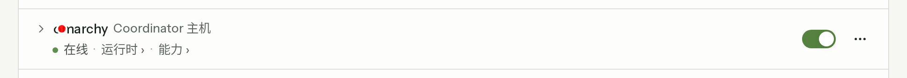 | 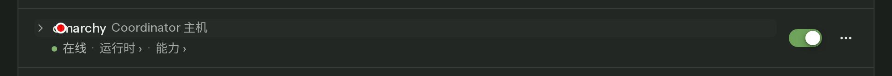 | 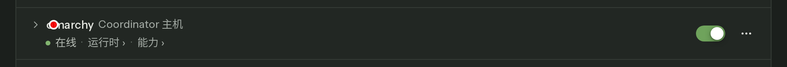 |
| Machines, menu hovered |  | 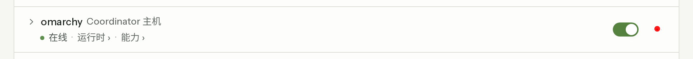 | 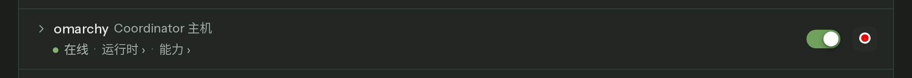 |  |
| Machines, keyboard focus | n/a | 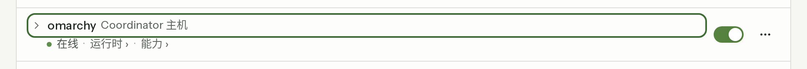 | n/a | 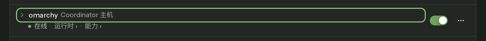 |
| Providers |  | 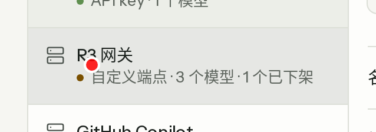 |  | 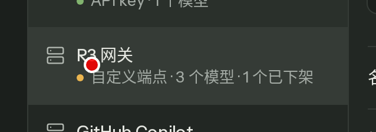 |
| MCP servers |  |  |  |  |
| Skills |  | 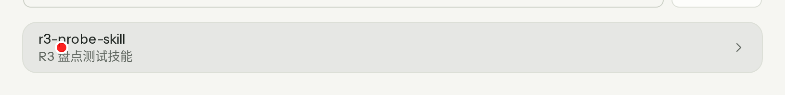 | 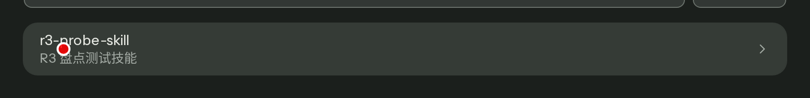 |  |
| API keys | 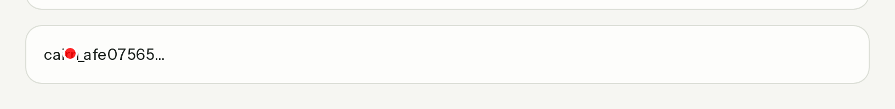 |  |  | 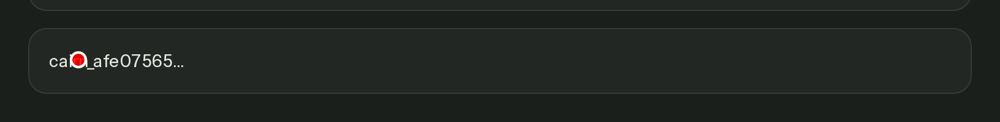 |
| Secrets |  | 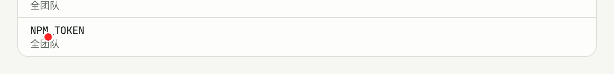 |  | 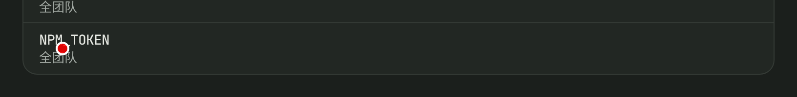 |

Computed backgrounds under the omarchy row on main: dark name hover paints `machine-toggle` at 808x22 px (first line only); light menu hover paints `machine-menu` at 28x28 px. After: no descendant of the row changes background. Machine focus has no before image because focus rendering is unchanged by design (a 2px solid outline).

## Regression guard

`apps/web/e2e/paper-hover-bands.spec.ts` run against a fixture build of the old sources fails `machines light` and `machines dark` (`V21: machine-toggle changes background on only part of the row`, box `[392,154,808,22]`); the other 12 pass. Against this branch all 14 pass. Command, with a preview server for each build:

```sh
E2E_PORT=<port> pnpm --filter @cairn/web exec playwright test e2e/paper-hover-bands.spec.ts
```

G8 in `scripts/ui-drift-gate.mjs` scans web TS, TSX and CSS for hover/active shadow utilities and box-shadow or `all` transitions; a `deliberate-shadow: reason` annotation on the preceding line permits an exception.
