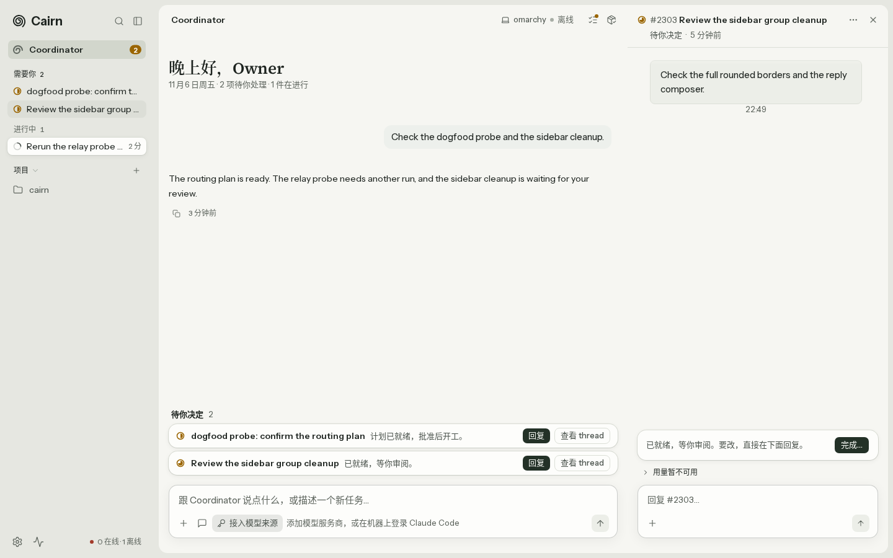
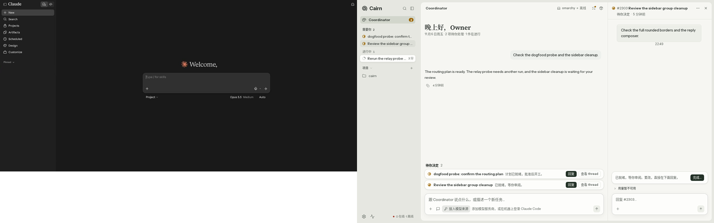
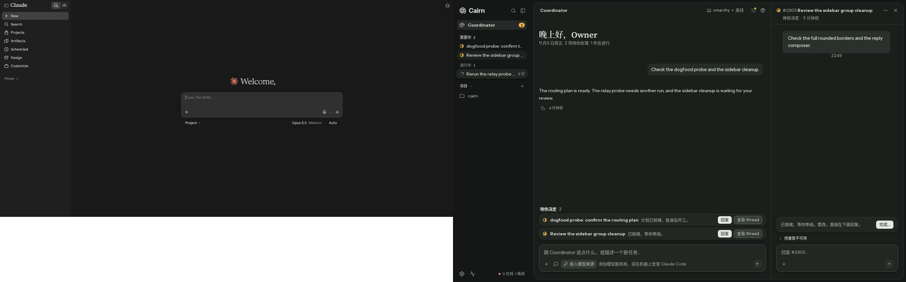

# Shell continuity and hairline verification

Follow-up to #3341. Changes remain uncommitted in `web/shell-seamless`; no push, PR operation, dependency installation or lockfile change was made.

## Live comparison

The full-page captures show the running app at 1440×900, with the thread panel open, a seeded Coordinator exchange, two decision rows, a review action and both composers. The isolated server uses scratch SQLite with auth off; no scenario URL, API interception or provider call is used. The failed seed was automatically requeued by the real server and is visible under in-progress. The two remaining decision rows exercise the same tray as the fixture's three rows.

| State | Main | Line-free PR head | Restored hairlines |
|---|---|---|---|
| Light |  |  |  |
| Dark |  |  |  |

Before uses the three original components read from `origin/main`; before-lines uses their committed PR versions. Each source swap is restored in a `finally` block. A browser condition requires the expected border/shadow/inset for each stage before capturing. After uses this worktree's final components. The browser waits for the seeded assistant reply and fonts before taking a full-page screenshot. Each stage's `*-runtime.json` records actual computed styles and bounds.

The final sheet is at x=256, y=8, 1176×884, with a 14px radius and 1px solid border. Its desktop panel is 420×882 inside that border and has a 1px solid left divider. Both lines resolve to `rgb(220, 223, 215)` in light and `rgb(53, 59, 54)` in dark, the same `--border` token used by main. Both desktop shadows are `none`. The 8px gutter remains canvas-colored; the tray retains 8px symmetric row clearance. A real border consumes 1px on each edge, so tests measure composer spacing from the inner sheet floor and page-column width excludes the two border pixels.

## Separator audit

The complete source diff against main changes only the tray, sheet and SidePanel. `hairline-audit.json` preserves the audited head/base and removed line carriers.

| Element / removed carrier | Decision | Reason |
|---|---|---|
| Sheet `shadow-(--e1)` | Restore its 1px ring as `border border-border`; keep `rounded-(--radius-card)` | The token contains both a shadow pool and the structural ring. Only the pool painted the gutter band; restore the line without that pool. |
| SidePanel `shadow-[inset_1px_0_0_var(--border)]` | Restore as desktop `border-l border-border` | It was the conversation/thread divider. Keep existing floating overlay skin below 1100px, where main also replaced the inset shadow. |
| Mobile sheet `max-[640px]:shadow-none` | Replace with `max-[640px]:border-0` | Main's edge-to-edge mobile sheet had no ring; retain that behavior. |
| Other removed `border`, `border-l`, `border-r`, `divide-*`, `ring-1` | None found | Header, row, action-card and composer separators remain untouched. |
| Tray scrollport | Retain `p-2` and expanded scrollport width | Reserves room for external row rings and prevents left clipping. |

## References and states

| State / reference | Ours | Verdict |
|---|---|---|
| Coordinator / Claude.ai, light |  | Quiet canvas and contained composer; Cairn retains the owner's bordered sheet and denser tray. The populated conversation is less sparse than the empty reference. |
| Coordinator / Claude.ai, dark |  | Hairlines preserve the two columns without elevation; the reference has no equivalent decision tray. |

Rules checked: P1/P3/P5, V1/V4/V7/V8, R1. Reference shots for Coordinator and thread review were reopened. The four main before/after shots, line-free comparison, reference montages, refreshed fixture shots and both old/new SidePanel baselines were visually inspected. Original before-fixture captures and fixture edge crops from the first pass remain as historical evidence; refreshed final fixture captures are labelled fixture and supplement the live shots. Main live edge crops were regenerated from the new full-page screenshots.

## Validation

| Command | Result |
|---|---|
| New 1440 light/dark hairline assertions, before implementation | 2 failed: both card and divider were 0px. |
| Focused shell, page shell and Coordinator panel e2e | 27 passed. |
| `pnpm exec vitest run --changed` | 3 files, 15 tests passed. |
| `pnpm lint` | Passed. |
| `pnpm typecheck` | Passed in all workspace packages. |
| `pnpm spec:parse` | 1502 web tests / 212 specs and 70 integration files parsed. |
| `E2E_PORT=8499 pnpm --filter @cairn/web e2e:affected` | Interrupted with SIGTERM / exit 143 before its summary; rerun sequentially as four affected shards. |
| Affected `--shard=1/4` | 333 passed, 20 skipped, 2 gallery aggregates failed; both SidePanel comparisons passed. |
| Affected `--shard=2/4` | 413 passed, including the initially failing long-reply case. |
| Affected `--shard=3/4` | 382 passed. |
| Affected `--shard=4/4` | 352 passed, including all four inner-floor composer-gap cases. |
| All affected shards | 1480 passed, 20 skipped, 2 gallery aggregates failed; all 1502 selected tests completed. |

Live: isolated server on 8791, web on 5273, seeded SQLite and Coordinator exchange; full-page 1440 light/dark with thread panel open.
Mocked: fixture e2e, pending question and 390px captures; no real providers were called by the screenshot run.
Not covered: production data, real providers, CI rendering, dedicated loading/error screenshots; gallery aggregates remain red; production/CI verification is still outstanding.

The initially failing Activity clock and long-reply cases passed in the completed shards without changes to those tests or their implementation. The two remaining gallery aggregates include 111 light and 101 dark unaccepted specimen differences; neither includes SidePanel. `gallery-drift.json` records their names. No broader baseline refresh was accepted. Earlier original-code/control images remain historical evidence; this follow-up does not claim a new original-code control for every gallery specimen. `validation.json` records all four completion summaries and limits.

The handoff body passes local section, coverage-line, baseline-verdict, English-only and task checks, with 236 prose characters. Image HTTP reachability is deferred until the orchestrator publishes the uncommitted images and SHA-pins their links; it is not claimed as passing.
