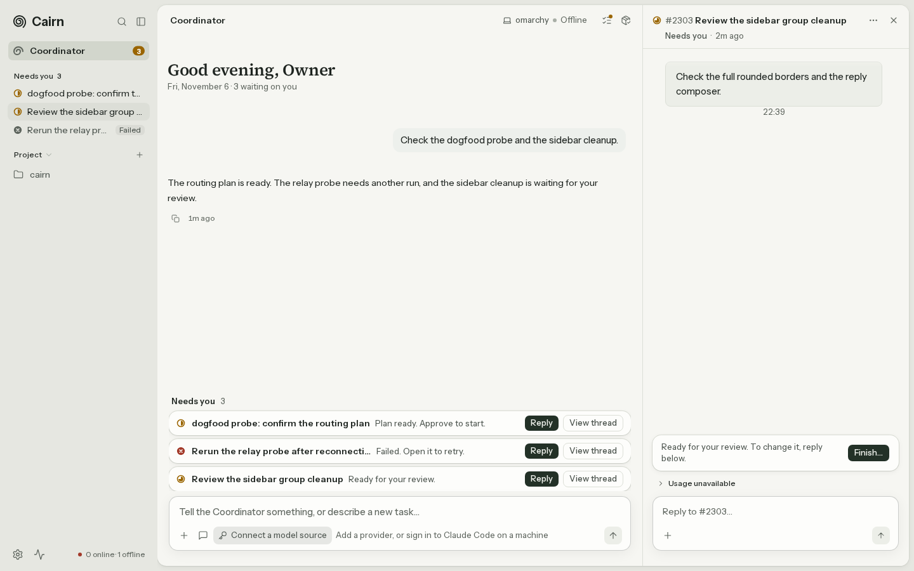
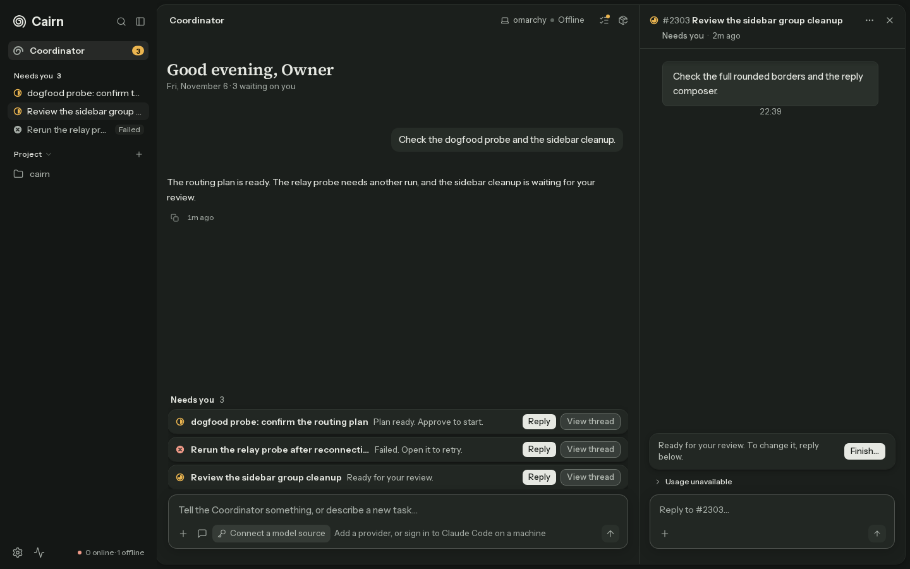
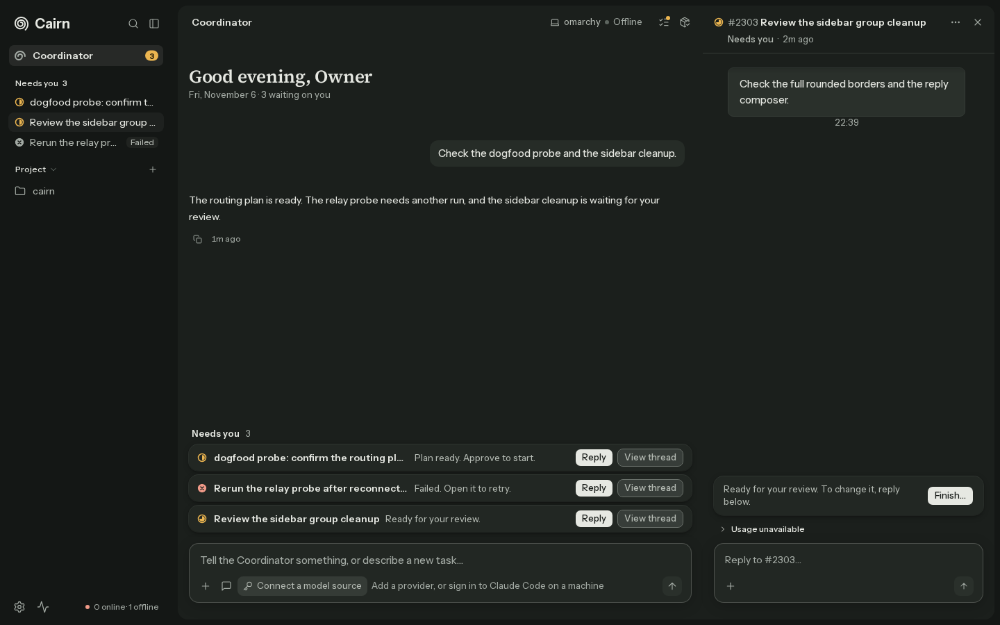
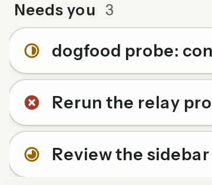
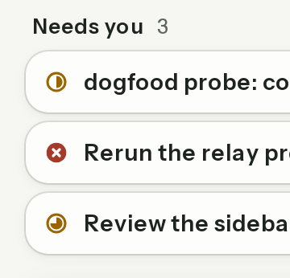
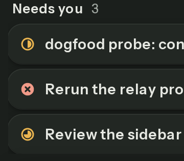
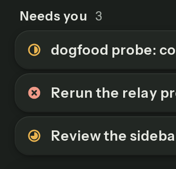

# Shell continuity verification

Base: `749f36b74e21db2872e3c5c07992137171bf2519` plus the uncommitted shell-seamless changes. No commit, push, dependency installation or lockfile change was made.

## Runtime evidence

The main evidence comes from a real isolated server with scratch SQLite records for confirm, failed and review threads. The browser loads `/app?thread=shell-3`, with no scenario query or API interception. The model source is not configured and no provider is called. The Coordinator shows a seeded user turn and assistant reply; the decision tray, right thread, action card and both composers are real app components backed by the seeded server. Separate fixture captures exercise a populated conversation and a pending question.

| State | Before | After | Observed result |
|---|---|---|---|
| 1440 light, review thread open |  |  | Canvas gutter is continuous; sheet starts at x=256 instead of 248. |
| 1440 dark, review thread open |  |  | No outer sheet ring/shadow or desktop panel separator. |
| Decision edges, light |  |  | Rounded left ring and shadow are fully visible. |
| Decision edges, dark |  |  | The first and last row edges have room inside the scrollport. |

The left-edge crops are captured at device scale 2 for inspection. Before screenshots use a separately compiled copy of the original three components; after screenshots use the working changes.

The `before-*-runtime.json` and `after-*-runtime.json` files record live computed styles and bounding boxes. The sidebar colors are `rgb(230, 231, 225)` in light and `rgb(20, 23, 21)` in dark. The sheet has 8px margins on all sides after accounting for the sidebar. The tray's padding changes from 0px to 8px; its row width remains aligned with the composer. The panel and sheet now both report `box-shadow: none` on desktop.

## Fixture coverage and references

| State | Evidence | Review |
|---|---|---|
| Populated conversation and pending question, 1440 light | [Before](before-light-fixture.png), [after](after-light-fixture.png) | Full decision rings, composer and question card remain aligned. |
| Populated conversation and pending question, 1440 dark | [Before](before-dark-fixture.png), [after](after-dark-fixture.png) | Same rounded edges on the dark sheet. |
| 390 light, thread closed / open | [Home](after-390-light-fixture.png), [thread](after-390-light-thread-fixture.png) | No horizontal overflow; complete row, action and composer borders. |
| 390 dark, thread closed / open | [Home](after-390-dark-fixture.png), [thread](after-390-dark-thread-fixture.png) | Same full-width phone behavior and visible borders. |
| Claude.ai reference | [Reference](../../design/references/coordinator-chat/claude-ai-empty-composer.jpg), [ours light](after-light.png), [ours dark](after-dark.png) | Quiet canvas and contained composer; Cairn retains the owner's inset sheet and denser decision tray. |
| t3code thread reference | [Reference](../../design/references/thread-review/t3code-done-changed-file-card.png), [ours](after-390-light-thread-fixture.png) | Thread cards and composer fit their column; Cairn retains its own action card. |

Rules checked: P1, P3, P5, V1, V4, V7, V8, R1. All screenshots above were opened for visual review. The two updated SidePanel gallery baselines were each inspected before and after acceptance. Only the intended desktop left edge is removed; dimensions and content stay the same.

## Tests and limits

| Command | Result |
|---|---|
| `E2E_PORT=8399 pnpm --filter @cairn/web e2e chief-home-shell-seamless.spec.ts --workers=1` before fixing | 8 failed: gutter color/inset, sheet/panel elevation, and clipped row rings. |
| Same regression after fixing | 8 passed. |
| `pnpm exec vitest run --changed` | 3 files, 15 tests passed. |
| `pnpm lint` | Passed. |
| `pnpm typecheck` | All workspace packages passed. |
| `pnpm spec:parse` | 1497 web tests in 212 specs and 70 integration files parsed. |
| `E2E_PORT=8499 pnpm --filter @cairn/web e2e:affected` | Shared SidePanel triggered full fallback: 1474 passed, 20 skipped, 3 failed. |
| `E2E_PORT=8499 pnpm --filter @cairn/web e2e chief-panel.spec.ts chief-home-shell-seamless.spec.ts paper-board-sheet.spec.ts --workers=2` | 25 passed after updating the old one-sided sheet-width expectation. |
| Focused SidePanel gallery screenshot comparison using the existing gallery capture algorithm | 2 passed against the updated light/dark baselines. |

The remaining two failures are the light/dark gallery aggregate comparisons, which include unrelated text raster differences. The original three components were compiled from HEAD into a separate cache output directory, restoring the working files in a `finally` block. In both themes, the original-code `sizes-2` control screenshot is pixel-identical to the failed post-change screenshot (`compare -metric AE`: 0). Both differ from the repository baseline. This establishes pre-existing drift for that unchanged specimen, without accepting unrelated snapshots. The `gallery-original-code-{light,dark}.png` and `gallery-current-code-{light,dark}.png` pairs preserve this control evidence. Other gallery differences still need the orchestrator's CI comparison.

Live: isolated server, seeded decision tray, review thread, action card and composers, light/dark at 1440.
Mocked: populated conversation, pending question, 390px and regression e2e use fixtures; no model invocation.
Not covered: production data, provider execution, CI rendering, dedicated empty/loading/error screenshot matrix.
