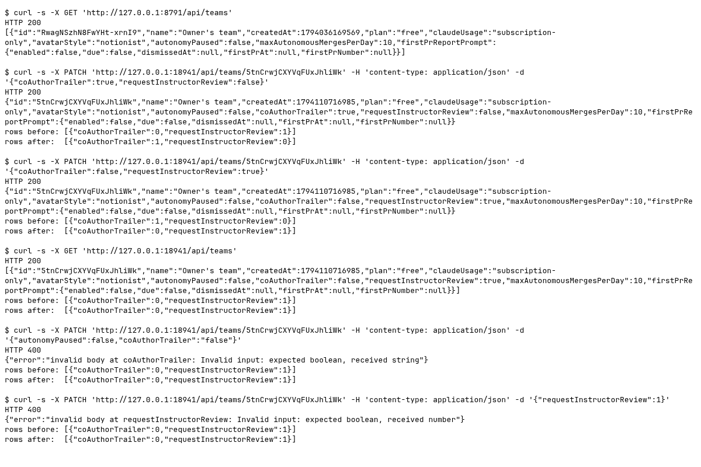

### Requests

| Clause | Request | Response | Rows before to after | ok |
|---|---|---|---|---|
| Before: attribution fields absent (read-only baseline) | `GET /api/teams` | `200` `[{"id":"RwagNSzhN8FwYHt-xrnI9","name":"Owner's team","createdAt":1794036169569,"plan":"free","claudeUsage":"subscript...` | n/a | yes |
| Default trailer on and review off | `PATCH /api/teams/{team}` `{"coAuthorTrailer":true,"requestInstructorReview":false}` | `200` `{"id":"5tnCrwjCXYVqFUxJhliWk","name":"Owner's team","createdAt":1794110716985,"plan":"free","claudeUsage":"subscripti...` | 1 to 1 ({"coAuthorTrailer":1,"requestInstructorReview":0}) | yes |
| Opt out of trailers and opt into review | `PATCH /api/teams/{team}` `{"coAuthorTrailer":false,"requestInstructorReview":true}` | `200` `{"id":"5tnCrwjCXYVqFUxJhliWk","name":"Owner's team","createdAt":1794110716985,"plan":"free","claudeUsage":"subscripti...` | 1 to 1 ({"coAuthorTrailer":0,"requestInstructorReview":1}) | yes |
| Persist settings on reread | `GET /api/teams` | `200` `[{"id":"5tnCrwjCXYVqFUxJhliWk","name":"Owner's team","createdAt":1794110716985,"plan":"free","claudeUsage":"subscript...` | 1 to 1 ({"coAuthorTrailer":0,"requestInstructorReview":1}) | yes |
| Reject nonboolean trailer | `PATCH /api/teams/{team}` `{"autonomyPaused":false,"coAuthorTrailer":"false"}` | `400` `{"error":"invalid body at coAuthorTrailer: Invalid input: expected boolean, received string"}` | 1 to 1 ({"coAuthorTrailer":0,"requestInstructorReview":1}) | yes |
| Reject nonboolean review | `PATCH /api/teams/{team}` `{"requestInstructorReview":1}` | `400` `{"error":"invalid body at requestInstructorReview: Invalid input: expected boolean, received number"}` | 1 to 1 ({"coAuthorTrailer":0,"requestInstructorReview":1}) | yes |
